<nav class="menu">
    <ul>
        <li class="home"><a href="/">Home</a></li>
        <li class="name">Convolutions</li>
                <li><a href="#video-000">Why convolutions?</a></li>
                <li><a href="#video-018">Why convolutions?</a></li>
                <li><a href="#video-057">Why convolutions?</a></li>
        <li class="pdf"><a href="https://dlvu.github.io/pdfs/lecture03.convolutions.pdf">PDF</a></li>
    </ul>
</nav>

<article class="slides">

       <section id="slide-001">
            <a class="slide-link" href="https://dlvu.github.io/details#slide-001" title="Link to this slide.">link here</a>
            

            <figcaption>
            
 

            </figcaption>
       </section>

       <section id="slide-002">
            <a class="slide-link" href="https://dlvu.github.io/details#slide-002" title="Link to this slide.">link here</a>
            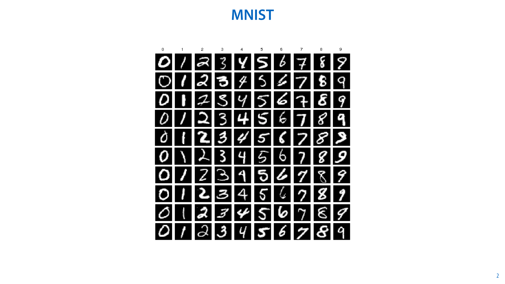

            <figcaption>
            
One of the biggest drivers of early deep learning research was the MNIST dataset. A collection of 60 000 handwritten digits, originally built to evaluate OCR systems for ZIP code recognition by the US postal system.  

The digits are represented as 28x28 pixel images, in white on a black background. 

            </figcaption>
       </section>

       <section id="slide-003">
            <a class="slide-link" href="https://dlvu.github.io/details#slide-003" title="Link to this slide.">link here</a>
            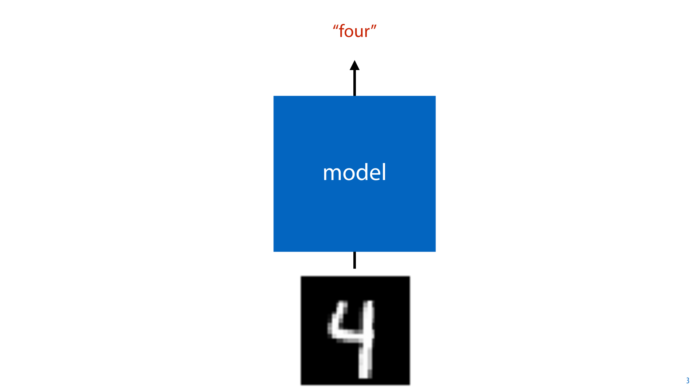

            <figcaption>
            
This was most commonly framed as a <em>classification problem</em>. We feed some model the image in some way, and we ask it to choose (or provide a probability distribution) over the classes 0,1,…,8,9.

            </figcaption>
       </section>

       <section id="slide-004" class="anim">
            <a class="slide-link" href="https://dlvu.github.io/details#slide-004" title="Link to this slide.">link here</a>
            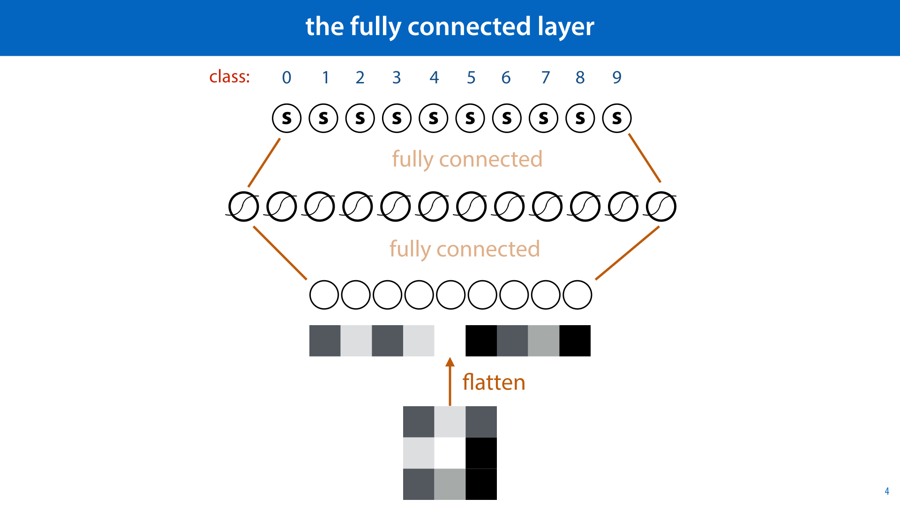

            <figcaption>
            
We can build this kind of classifier already with the the neural network parts we’ve seen so far. 

The only thing we do is to <em>flatten</em> the image. The slide shows the idea for a 3x3 image. We just arrange the pixels into a vector in some arbitrary, but standardized order and feed it to the network as a vector.  
<aside    >In this case, we flatten the image in “row major order” by scanning along the rows first, and then the columns. However, any order will do, so long as we do it the same way for all images.  </aside>
Once we have a vector that captures all the information in the image, we can just feed that to the classic feedforward network that we’ve already seen. We’ve given it one hidden layer, with sigmoid activations, and an output layer with 10 units (one for each class) and a softmax activation.

            </figcaption>
            click image for animation
       </section>

       <section id="slide-005">
            <a class="slide-link" href="https://dlvu.github.io/details#slide-005" title="Link to this slide.">link here</a>
            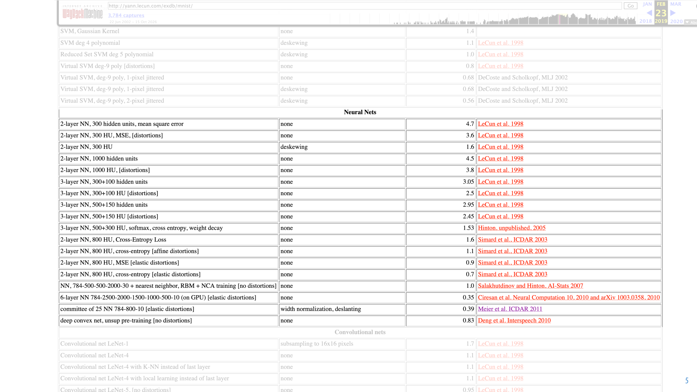

            <figcaption>
            
Using this approach on MNIST (possibly with a few other tricks like data augmentation), you can get the test accuracy above 99% already. So why would we need anything more? 
<aside    >This screenshot is from Yann Lecuns now defunct website for MNIST where he kept a ranking of the best performing models for MNIST. It’s still available in the wayback machine here:<a href="https://web.archive.org/web/20190223235504/http://yann.lecun.com/exdb/mnist/"><strong>https://web.archive.org/web/20190223235504/http://yann.lecun.com/exdb/mnist/</strong></a> with results going up to 2012. </aside><aside    ></aside>
            </figcaption>
       </section>

       <section id="slide-006">
            <a class="slide-link" href="https://dlvu.github.io/details#slide-006" title="Link to this slide.">link here</a>
            

            <figcaption>
            

            </figcaption>
       </section>

       <section id="slide-007" class="anim">
            <a class="slide-link" href="https://dlvu.github.io/details#slide-007" title="Link to this slide.">link here</a>
            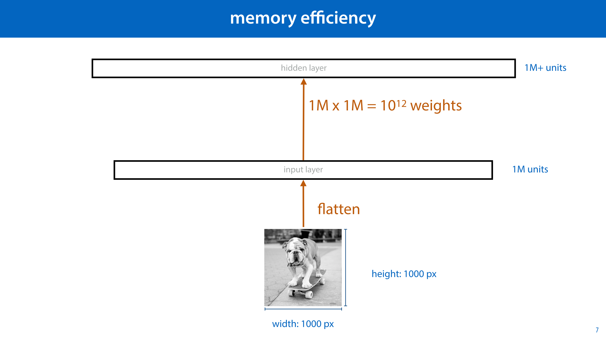

            <figcaption>
            
The first problem is easy to explain. Let’s look at what happens when we try to train a classifier for a one megapixel image (that is, an image with a million pixels).  
<aside    >This is not a lot: a medium budget phone can easily take photos up to 50 megapixels.  </aside>
Flattening this image into a vector gives us  one million input nodes. In order to learn certain shapes, the hidden layer should be a bit bigger than the input layer, so we’ll need to make that one at least a million nodes as well. The result is that between the first and the second layer, we already have a thousand billion weights. Even at 16 bits per weight, that’s 2 terabytes of memory, far too much for even a modern server. 

            </figcaption>
            click image for animation
       </section>

       <section id="slide-008">
            <a class="slide-link" href="https://dlvu.github.io/details#slide-008" title="Link to this slide.">link here</a>
            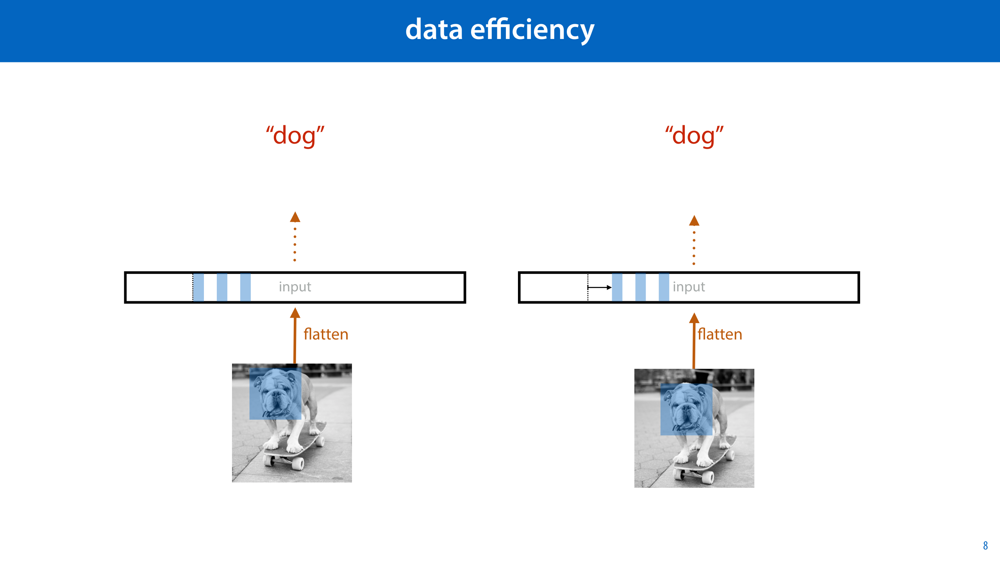

            <figcaption>
            
Another, perhaps deeper reason, is that the fully connected network end up learning a lot of things over and over again.  

To illustrate, imagine that we show our network the same image twice, but shifted a few pixels down and to the right. The content of the image doesn’t meaningfully change, and the basic classification (“dog”) doesn’t change. Let’s imagine that the network looks mostly at the dog’s face. 

In the example on the left, the pixels corresponding to the dog’s face end up, after flattening in a certain region of the  input layer. After we shift the image a bit, all pixels of the dog’s face are mapped to different input units.  

In the remainder of the network these are connected to completely different weights to the rest of the network. The conclusion is that the network has a completely different subnetwork for each part of the image. If it learns to recognize a dog’s face in the top left and the bottom right of the image, it does that with two completely separate subnetworks.  

Put differently, for each part of the image, the network needs to re-learn a separate network for recognizing dogs. Each such subnetwork needs to see dog’s faces appearing in that location. That means we don’t just need a lot of dogs in our data to learn what they look like, we need a lot of dogs <em>for each location in the image</em>.  

            </figcaption>
       </section>

       <section id="slide-009">
            <a class="slide-link" href="https://dlvu.github.io/details#slide-009" title="Link to this slide.">link here</a>
            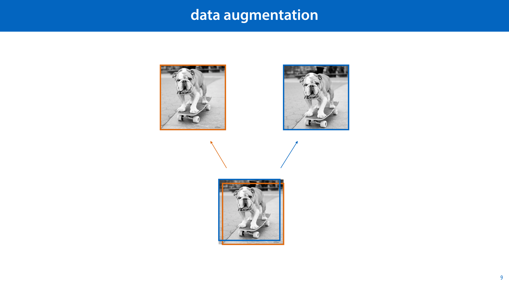

            <figcaption>
            
A cheap trick to mitigate this issue is data augmentation. If we have very few images of dogs in our dataset, we can just create sightly shifted versions of each dog image by cropping them and scaling them up.  

This works, and it’s a good way to start thinking about what kind of patterns we are trying to learn, but it’s a bit unsatisfying to have the network learn the same thing for every position in the image. A truly intelligent system would surely be able to re-use the things it learns for one part of the image elsewhere in the image.  

It’s also inefficient, of course, and this inefficiency gets worse as the resolution of the images gets higher: the more pixels, the more regions the image has and the more subnetworks we need to train.

            </figcaption>
       </section>

       <section id="slide-010">
            <a class="slide-link" href="https://dlvu.github.io/details#slide-010" title="Link to this slide.">link here</a>
            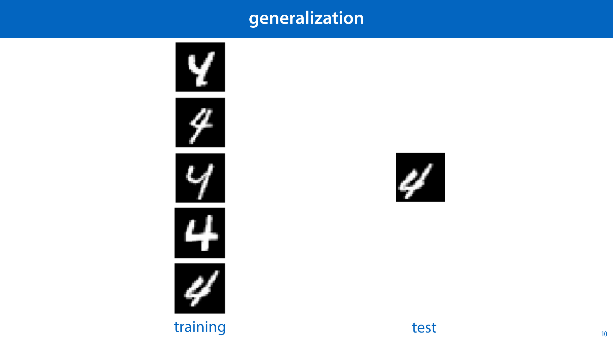

            <figcaption>
            
A final issue is the deep problem of <em>generalization</em>. What happens if your test data (or rather, the examples you will see in production) have a slightly different distribution than those you will see during training? For example, what if all the fours you train on are perfectly centered but during test you see a four that is a little off center.  

As we’ve already seen, a fully connected network will not have a subnetwork to recognize fours in the bottom left of the image. It’s never seen a four here, so it won’t be able to make a good classification, even though it would classify it perfectly if the four was in the center of the image.  
<aside    >We call generalization a deep problem, because it’s ultimately about what patterns from the dataset you remember and what patterns you forget. This depends on what the test set will look like, which you don’t know at training time. In this sense, it’s an underspecified problem: you can’t do this well in general. The fact that people can still do this is a bit of a mystery. For this lecture, we will simply hardcode certain patterns into the model for it to generalize over, but the more general problem of generalization goes quite deep. It’s discussed in more detail here: <a href="https://mlvu.github.io/introduction/#video-107"><strong>https://mlvu.github.io/introduction/#video-107</strong></a>. </aside><aside    ></aside>
            </figcaption>
       </section>

       <section id="slide-011" class="anim">
            <a class="slide-link" href="https://dlvu.github.io/details#slide-011" title="Link to this slide.">link here</a>
            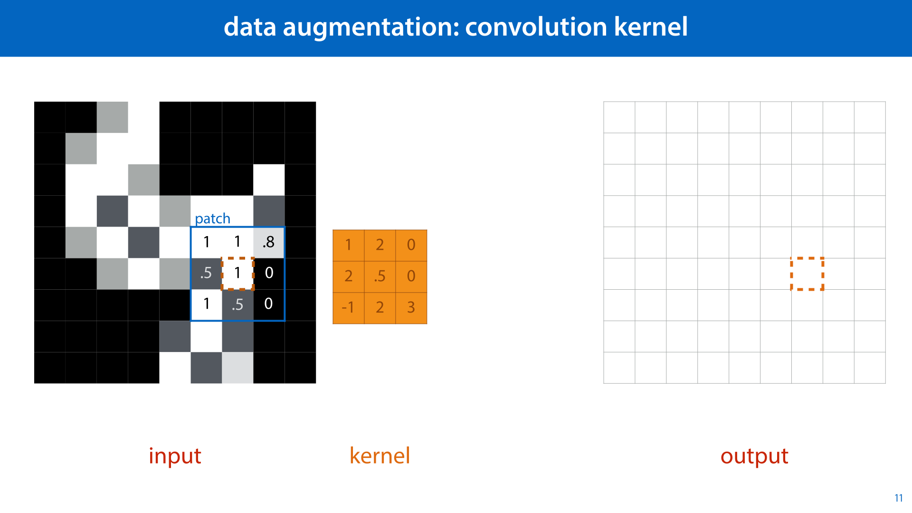

            <figcaption>
            
To inspire us, we’ll look at a few popular data augmentation method from before deep learning. Te convolution kernel.  

Note that this is not (yet) a learning method. It’s just a cheap and versatile way to modify an image.  

A convolution is define by a small matrix: we’ll stick to 3x3 for now. It’s filled with some numbers which can be any real value. <em>Applying</em> it to an image results in another image with the same resolution.  

To compute some pixel in the output, we first look at the corresponding pixel in the input, and the 3x3 <em>patch</em> around that pixel. We extract that patch, and element-wise multiply it by the the kernel. We then sum up the result, and that’s our answer.  

Doing this for every pixel in the output image, we get another image of the same resolution. What that image looks like, depends on the values we pick for the kernel. We’ll look at a few examples. 
<aside    >You may wonder what we do for the pixels whose patches overlap the edges of the input. A common approach is to ignore the parts of the kernel that fall over the edge. This is equivalent to “padding the image with a border of pixels set to zero.  </aside><aside    >Another technical detail to deal with is that the output image may have negative values of values larger than 1 (which we’ve equated with white here). We can clip the output image to (0,1) if we need to display it, but otherwise, we don’t need to worry about the range: it’s just a representtion of the input image with values (-∞ ,∞). </aside>
 

 

            </figcaption>
            click image for animation
       </section>

       <section id="slide-012" class="anim">
            <a class="slide-link" href="https://dlvu.github.io/details#slide-012" title="Link to this slide.">link here</a>
            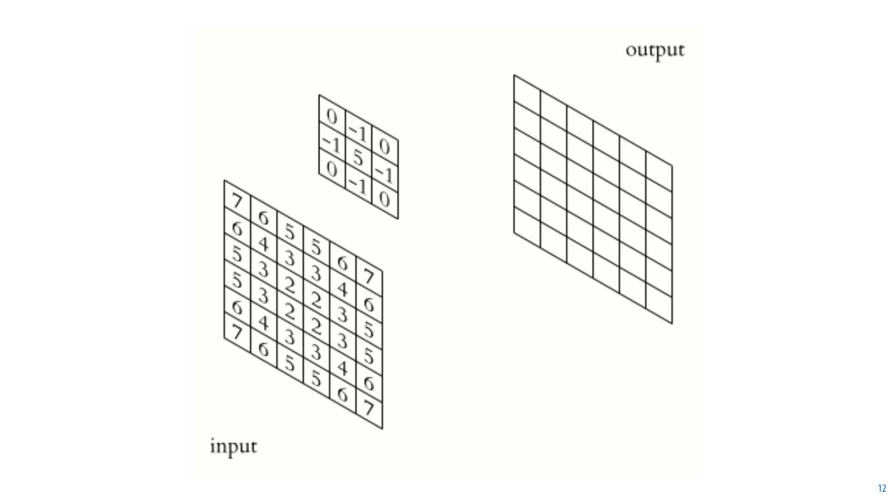

            <figcaption>
            
By Michael Plotke - Own work, CC BY-SA 3.0, https://commons.wikimedia.org/w/index.php?curid=24288958

            </figcaption>
            click image for animation
       </section>

       <section id="slide-013">
            <a class="slide-link" href="https://dlvu.github.io/details#slide-013" title="Link to this slide.">link here</a>
            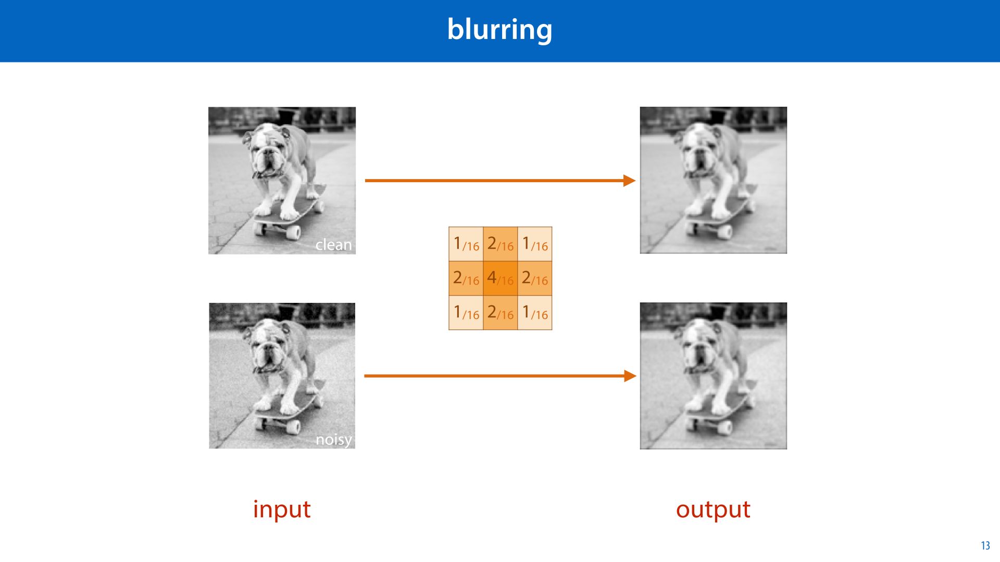

            <figcaption>
            
One very common use of the convolution kernel is to approximate Gaussian blurring. In Guassian blurring each output pixel is a mixture of the input pixels weighted by distances to the output. That is the output pixel is mostly the same as the corresponding input pixels, but the values of the nearby pixels are mixed in a little bit, with their weight dropping off with distances the same way a Gaussian or normal distribution drops off.  

Because only the very nearby pixels get any substantial weight, a small kernel approximates this blur very well. 

It may seem counter-intuitive to use blurring as a data augmentation, since it removes details, rather than creating variations. However, the detail it removes may be detail that we know we’re not interested in. In this case, if we have slight noise in some of our images, the blurring operation removes that noise, and makes all the images look the same. This reduces the chances of the classifier overfitting on random noise.  
<aside    >We’ve downsampled the image to 128x128 to make the effect of the kernel clearer. Normally you’d use a larger kernel for an image of this size, but for the Convolutional networks whichs we’re workong toward, a 3x3 kernel is the standard for reasons we’ll explain later. </aside><aside    ></aside>
            </figcaption>
       </section>

       <section id="slide-014">
            <a class="slide-link" href="https://dlvu.github.io/details#slide-014" title="Link to this slide.">link here</a>
            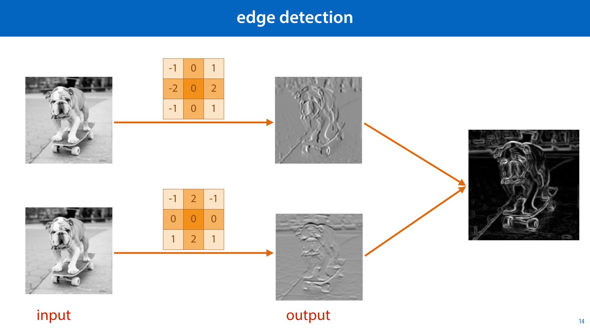

            <figcaption>
            
Here’s another application. These kernels detect how much the pixel values change in the horizontal and vertical directions. The look primarily at the central band, but take the neighbouring bands into account as well. For the horizontal one at the top, the resulting pixel is white if the change is increasing from left to right and black if it is decreasing.  

If we want to detect edges in the image, regardless of direction, we can take both outputs and combine them: we sum their (squared) magnitued and we get an image that is white if there is a strong edge in some direction. 
<aside    >This is called the sobel edge detector.  </aside>
This opereation again, extracts some important information and removes other information. For some purposes the output may be more informative than the input.  

Another conclusion we can draw is that taking multiple convolutions and combining their results, with some linear or non-linear function, can lead to even better data augmentations. 

            </figcaption>
       </section>

       <section id="slide-015">
            <a class="slide-link" href="https://dlvu.github.io/details#slide-015" title="Link to this slide.">link here</a>
            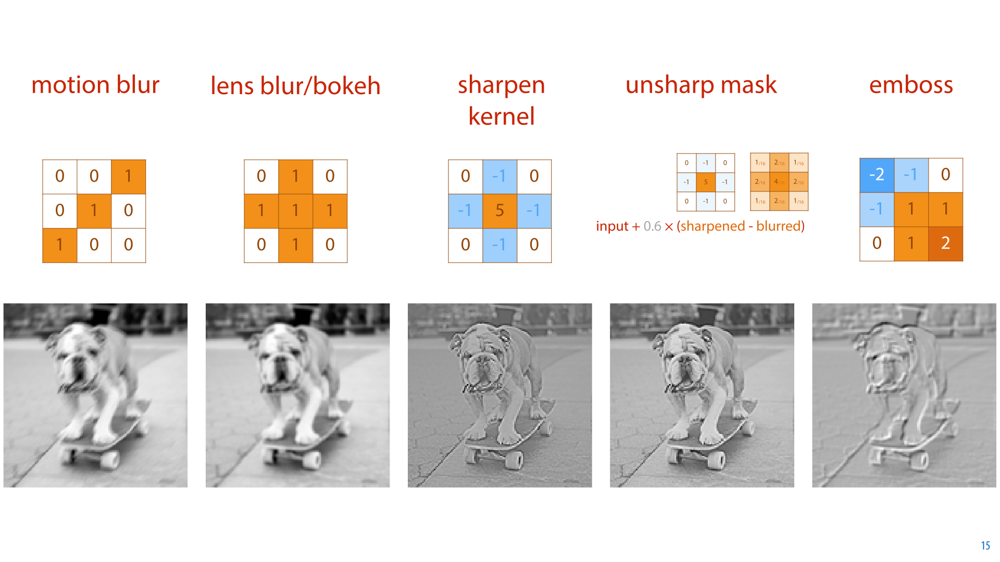

            <figcaption>
            
Here are some other options. 
<aside    >For simplicity we haven’t normalized the kernels to sum to 1, but instead normalized the output image in the plot.  </aside>
The motion bur goes from the bottom left to the top right here, but any kernel that looks like a line of 1s on background of 0s works.  

The lens blur doesn’t look much different from the Gaussian blur here, but for larger kernels a filled disc of 1s of a certain shape creates <a href="https://maxvanleeuwen.com/project/unblurring-images/"><strong>a kind of bokeh effect</strong></a>.  

The sharpen kernel is a slightly weak sharpening effect. Combining it with the blurring kernel in a linear operation creates a more convincing inverse of the blurring operation. 

            </figcaption>
       </section>

       <section id="slide-016">
            <a class="slide-link" href="https://dlvu.github.io/details#slide-016" title="Link to this slide.">link here</a>
            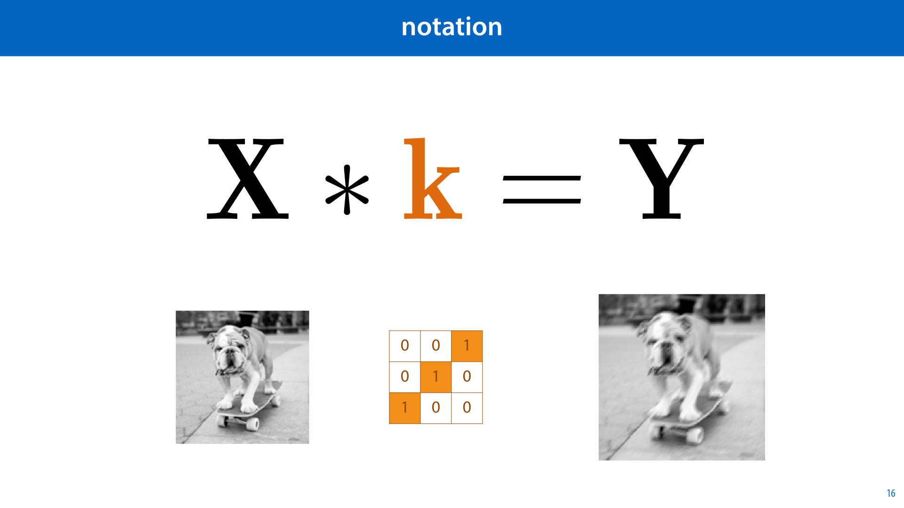

            <figcaption>
            
The mathematical notation for the convolution is the asterisk. This is used in code for plain multiplication, so it can get confusion. Usually the context is enough to help you figure out what you’re looking at.

            </figcaption>
       </section>

       <section id="slide-017">
            <a class="slide-link" href="https://dlvu.github.io/details#slide-017" title="Link to this slide.">link here</a>
            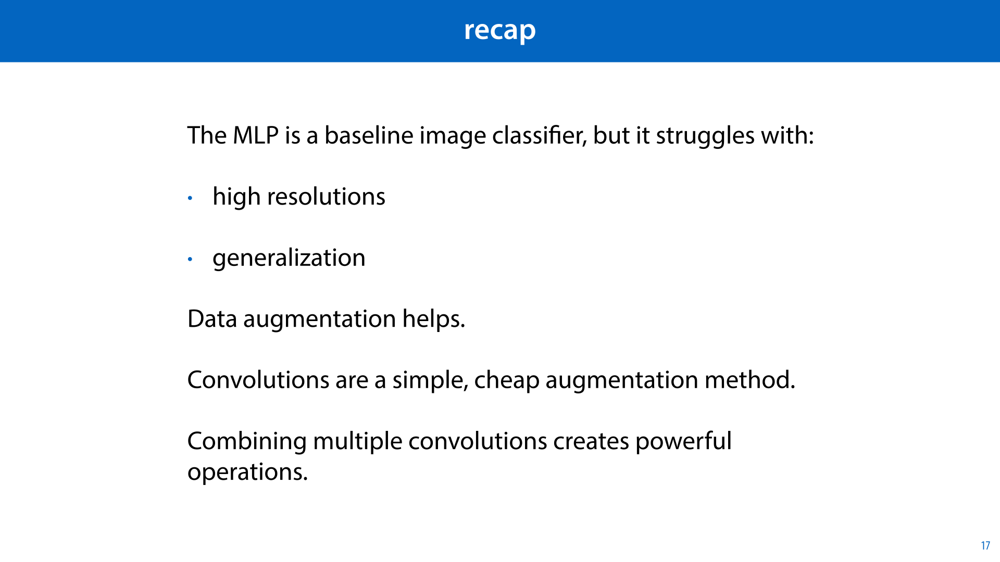

            <figcaption>
            

            </figcaption>
       </section>

       <section id="slide-018">
            <a class="slide-link" href="https://dlvu.github.io/details#slide-018" title="Link to this slide.">link here</a>
            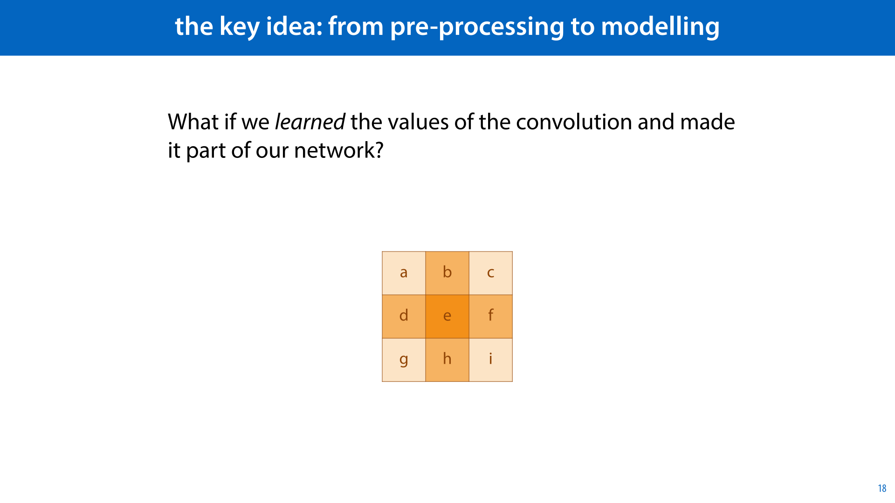

            <figcaption>
            

            </figcaption>
       </section>

       <section id="slide-019">
            <a class="slide-link" href="https://dlvu.github.io/details#slide-019" title="Link to this slide.">link here</a>
            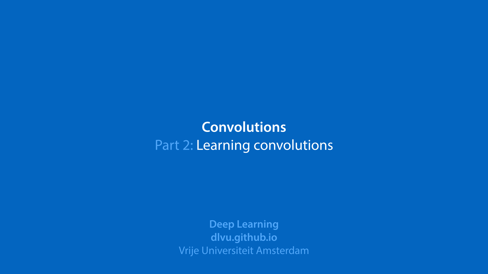

            <figcaption>
            
 

            </figcaption>
       </section>

       <section id="slide-020">
            <a class="slide-link" href="https://dlvu.github.io/details#slide-020" title="Link to this slide.">link here</a>
            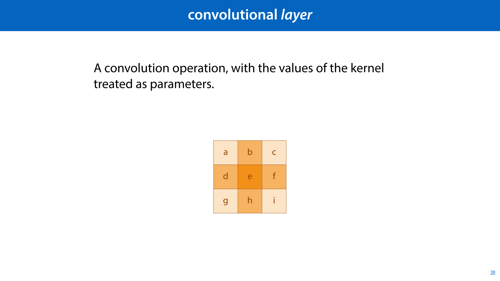

            <figcaption>
            

            </figcaption>
       </section>

       <section id="slide-021" class="anim">
            <a class="slide-link" href="https://dlvu.github.io/details#slide-021" title="Link to this slide.">link here</a>
            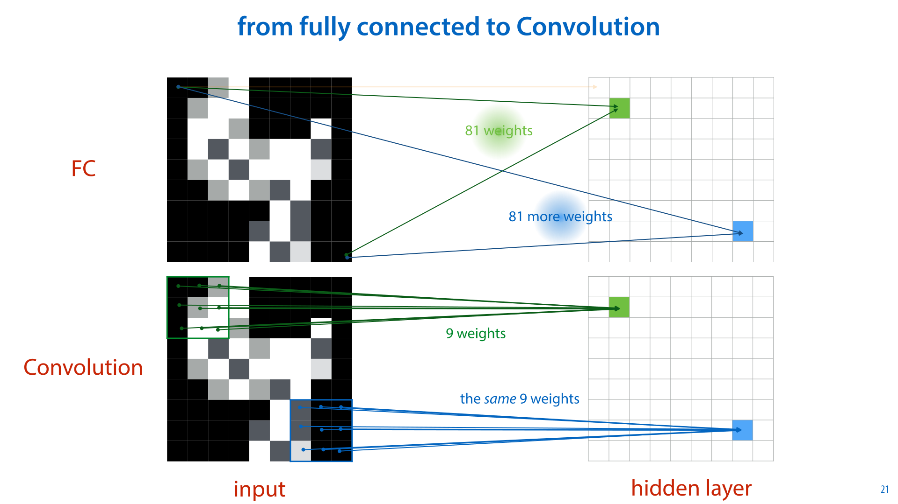

            <figcaption>
            
Here’s how a single fully connected layer looks if we don’t flatten the input image first, and we give it a hidden layer with the same number of units. 

We’ve arranged the hidden layer in the shape of a grid as well, although with a fully connected layer, that means little. Every output pixel is connected with every input pixel. For a 9x9 input image, this gives us 81 weight for every node in the hidden layer, and 81^2 = 6561 distinct weights in total.  

To turn this into a (3x3) convolutional layer, we do two things. First, we remove all connections that are ont in the output pixels 3x3 neighborhood. This leav es us with just 9 connections per output pixel. Second, we <em>share </em>the weights between the convolutions. Whatever weight we apply to the middle pixel of the green patch (top left), we apply the same weight to the middle pixel of the blue patch (bottom right), and for every other patch.  

This means that as a whole, the convolution has only 9 weights. Each weight is applied 81 times. This means it will also get 81 different signals from the backpropagation algorithm, which will work into a single gradient. If we follow the backpropogation algorithm carefully, the right way to do this will emerge clearly. 

            </figcaption>
            click image for animation
       </section>

       <section id="slide-022">
            <a class="slide-link" href="https://dlvu.github.io/details#slide-022" title="Link to this slide.">link here</a>
            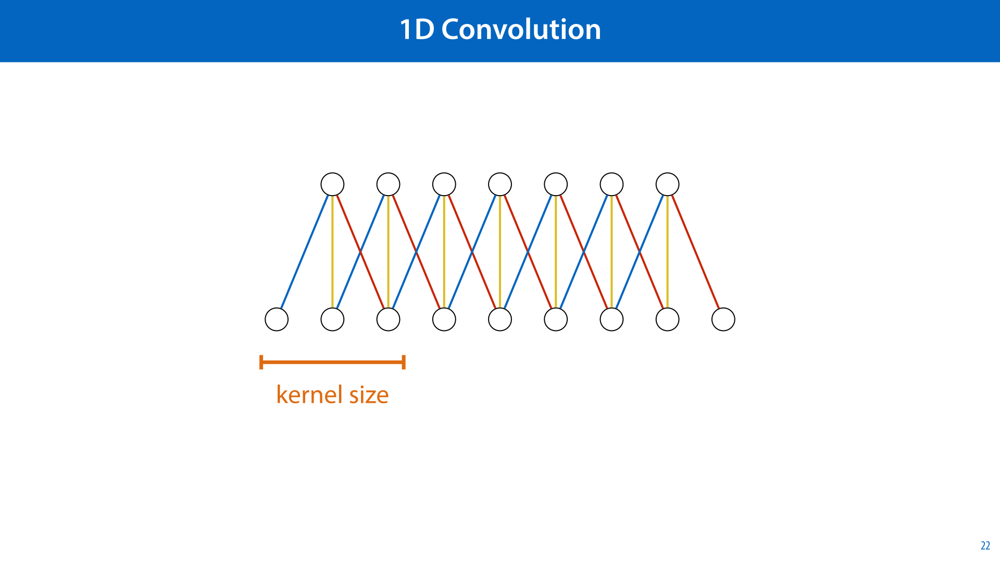

            <figcaption>
            
Here is how it looks if the input is 1D (a sequence of units rather than a grid). Note that the connection colors indicate shared weights (that is, every blue connection has the same weight). 

The set of weights we apply to each "patch" is called a kernel. The kernel size here is 3, and in the previous slide it was 2x2. 
<aside    >Not to be confused with the kernels we used in the SVM lecture, which were entirely different. </aside><aside    ></aside>
            </figcaption>
       </section>

       <section id="slide-023">
            <a class="slide-link" href="https://dlvu.github.io/details#slide-023" title="Link to this slide.">link here</a>
            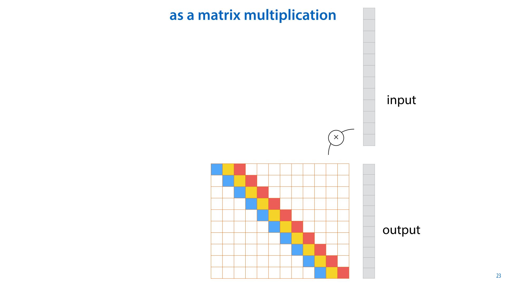

            <figcaption>
            
In the 1D convolution we can perfectly visualize that the convolution is just a specific instance of the fully connected layer. Remember that the fully connected layer is just a matrix multiplication with the inputs represented as a vector. If we take that matrix, and zero out many of the entries, and set some entries around the diagonal to three shared values that are the same over each row, we get the matrix mulitplication that  computes a convolution (with a size 3 kernel).  
<aside    >In the 2D case the convolutional is still equivalent to a matrix multiplication, but because we would have to flatten the image into a vector, it wouldn’t lok nearly this clean. </aside><aside    ></aside>
            </figcaption>
       </section>

       <section id="slide-024">
            <a class="slide-link" href="https://dlvu.github.io/details#slide-024" title="Link to this slide.">link here</a>
            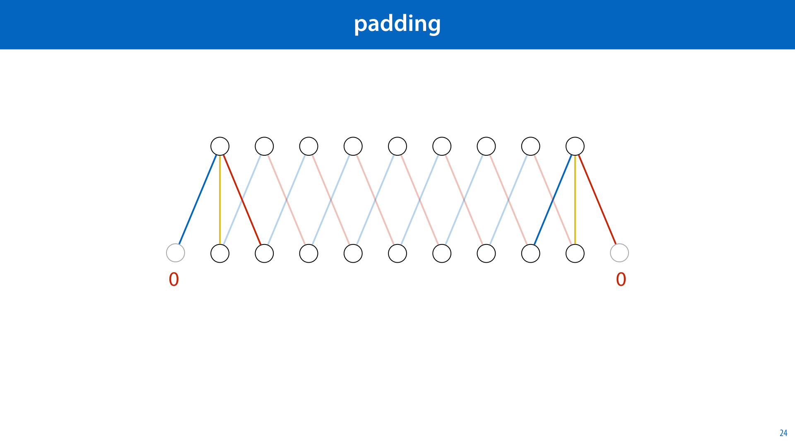

            <figcaption>
            
One drawback with the previous picture is that the inputs on the sides contribute to only one hidden unit, and the ones next to them to only two 

To combat this, we can add <em>padding</em>: extra units, usually with a fixed value set to zero. Because of this padding, the number of outputs becomes the same as the number of inputs, and the actual units on the side contribute to more nodes.  

To achieve the same number of units in the output as in the input (before padding), we must set the number of units padded on both sides to floor(kernel_size/2). This is sometimes called “same padding”.

            </figcaption>
       </section>

       <section id="slide-025">
            <a class="slide-link" href="https://dlvu.github.io/details#slide-025" title="Link to this slide.">link here</a>
            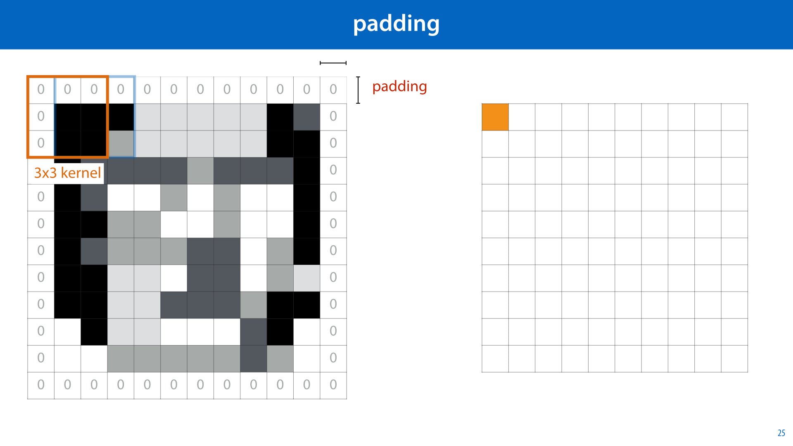

            <figcaption>
            
Here’s what it looks like in 2D. Padding is usually set so that the input resolution is the same as the output resolution before the padding. That is, if we consider the addition of the padding part of the convolution, then a convolution with the right padding doesn’t change the resolution of the image. 

This is a tradeoff: it <em>mitigates</em> the issue that the pixels on the edge contribute to fewer hidden nodes, but not entirely: they now contribute to 2 instead of 1 node in the same row, but the other pixels contribute to 3 hidden nodes per row. On the other hand keeping the resolution equal as you add more layers is nice from an engineering perspective, so this is a common choice. 

If your kernel size is bigger than 3x3, you need to add more padding to keep the resolution the same.

            </figcaption>
       </section>

       <section id="slide-026">
            <a class="slide-link" href="https://dlvu.github.io/details#slide-026" title="Link to this slide.">link here</a>
            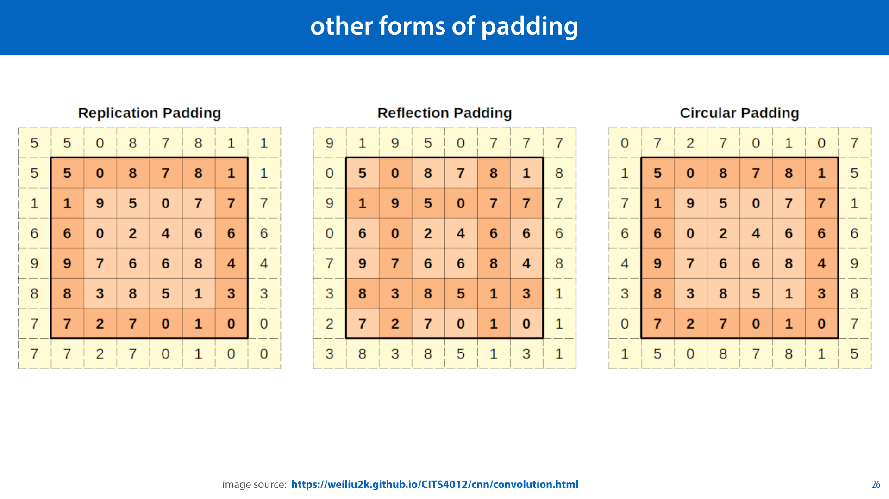

            <figcaption>
            
Here are some other forms of padding. The aim is to make the added pixels look more like they are a natural part of the image. This can be important, because the patterns the kernel learns at the edges are re-used everywhere else in the image. Zero padding is the most common default, but if you think you need something else you can try somethin like this.  

Replication padding just copies the value of the nearest pixel. Reflection padding copies the value of the pixel on the opposite side of the neighboring edge pixel. Circular padding “wraps the image around” copying the value of the edge pixel on the other side.  

 

 

image source: <a href="https://weiliu2k.github.io/CITS4012/cnn/convolution.html"><strong>https://weiliu2k.github.io/CITS4012/cnn/convolution.html</strong></a>

<a href="https://weiliu2k.github.io/CITS4012/cnn/convolution.html"><strong></strong></a>

            </figcaption>
       </section>

       <section id="slide-027" class="anim">
            <a class="slide-link" href="https://dlvu.github.io/details#slide-027" title="Link to this slide.">link here</a>
            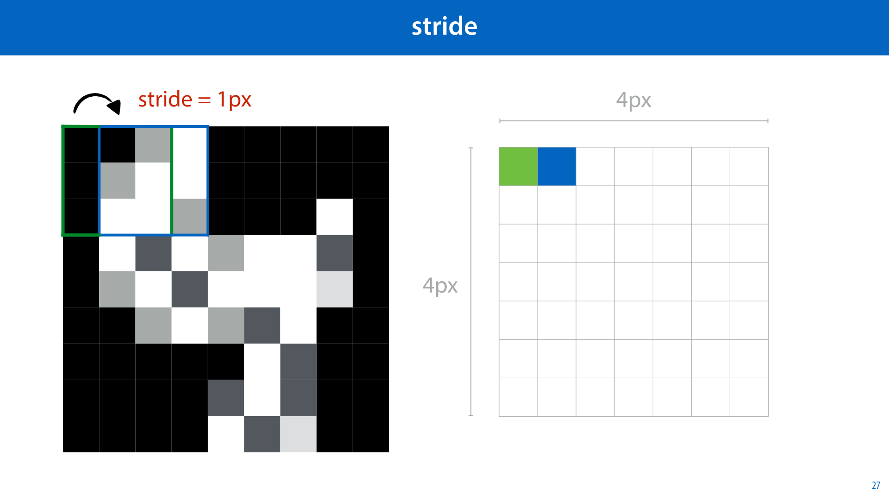

            <figcaption>
            
We usually describe a convolution in terms of a fixed window that is slid across the input image. We then create an output node for each unique position in the input. 

            </figcaption>
            click image for animation
       </section>

       <section id="slide-028" class="anim">
            <a class="slide-link" href="https://dlvu.github.io/details#slide-028" title="Link to this slide.">link here</a>
            

            <figcaption>
            
We usually describe a convolution in terms of a fixed window that is slid across the input image. We then create an output node for each unique position in the input. 

            </figcaption>
            click image for animation
       </section>

       <section id="slide-029" class="anim">
            <a class="slide-link" href="https://dlvu.github.io/details#slide-029" title="Link to this slide.">link here</a>
            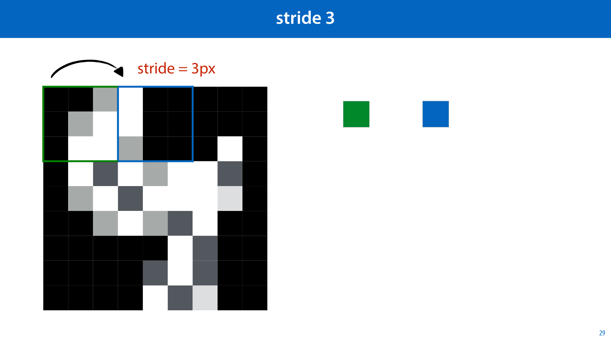

            <figcaption>
            
We usually describe a convolution in terms of a fixed window that is slid across the input image. We then create an output node for each unique position in the input.  

This mean that stride, kernel size and padding determine the size of the resulting tensor.  
<aside    >By far the most common setting is stride 1, and padding half the kernel size, rounded down, which leads to the same input and output resolution. </aside><aside    ></aside>
            </figcaption>
            click image for animation
       </section>

       <section id="slide-030">
            <a class="slide-link" href="https://dlvu.github.io/details#slide-030" title="Link to this slide.">link here</a>
            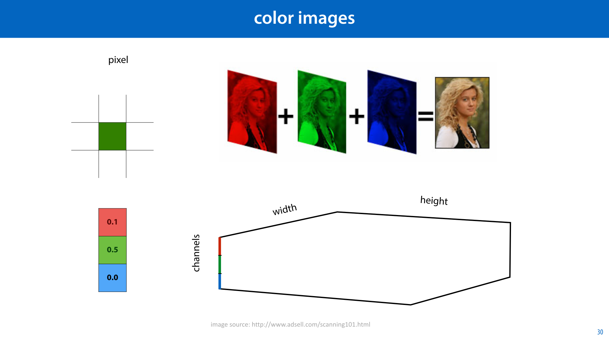

            <figcaption>
            

            </figcaption>
       </section>

       <section id="slide-031" class="anim">
            <a class="slide-link" href="https://dlvu.github.io/details#slide-031" title="Link to this slide.">link here</a>
            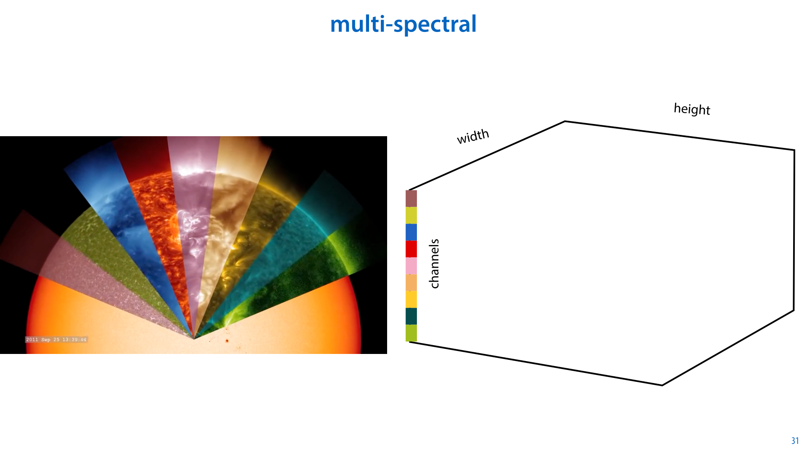

            <figcaption>
            

            </figcaption>
            click image for animation
       </section>

       <section id="slide-032">
            <a class="slide-link" href="https://dlvu.github.io/details#slide-032" title="Link to this slide.">link here</a>
            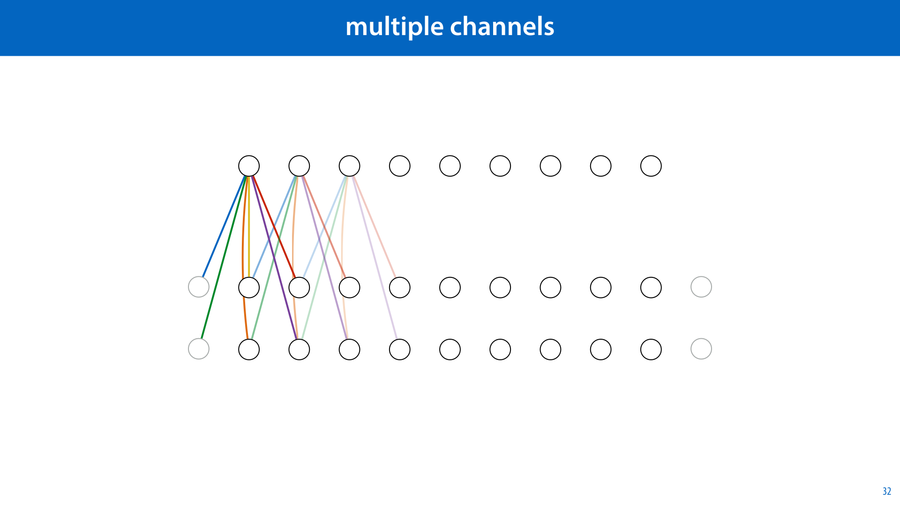

            <figcaption>
            
The standard approach is to add new weights for the new channel. Note that these are repeated along the spatial dimension(s) just like the other weights. The same approach is used to create multiple output channels.

            </figcaption>
       </section>

       <section id="slide-033">
            <a class="slide-link" href="https://dlvu.github.io/details#slide-033" title="Link to this slide.">link here</a>
            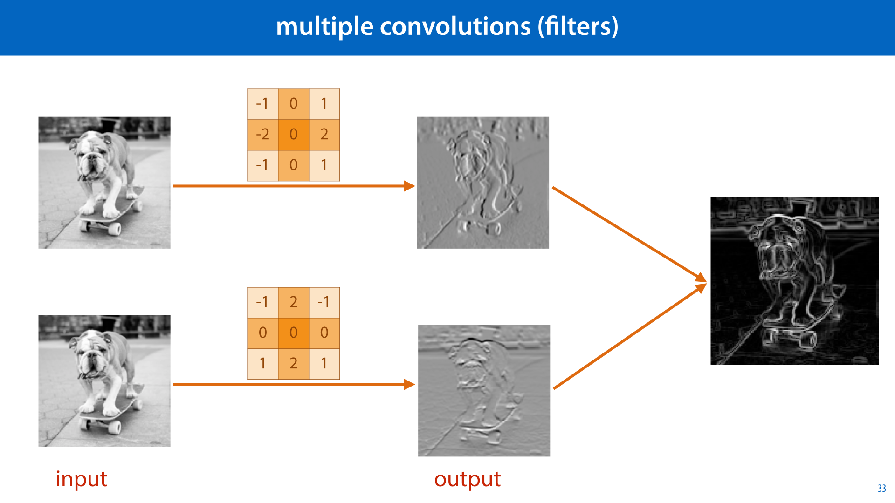

            <figcaption>
            
What we saw in the previous section was that while one convolution by itself could be useful, combining multiple convolutions could be an even more powerful 

            </figcaption>
       </section>

       <section id="slide-034">
            <a class="slide-link" href="https://dlvu.github.io/details#slide-034" title="Link to this slide.">link here</a>
            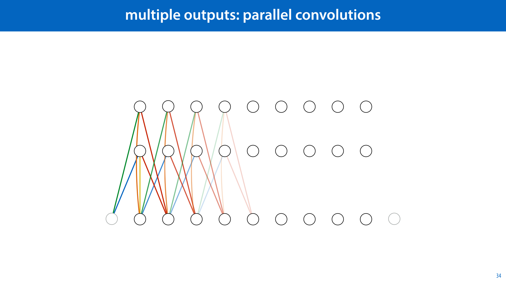

            <figcaption>
            
To apply multiple convolutions in parallel, we can just add the result of the second convolution as an extra channel in the output. This way, the output gets multiple channels, just like input.  

Unlike the color/multi-spectral images, these channels don’t have clear meanings: they contain just whatever information the network has learned to extract from the neighborhood around the current pixel. 

            </figcaption>
       </section>

       <section id="slide-035">
            <a class="slide-link" href="https://dlvu.github.io/details#slide-035" title="Link to this slide.">link here</a>
            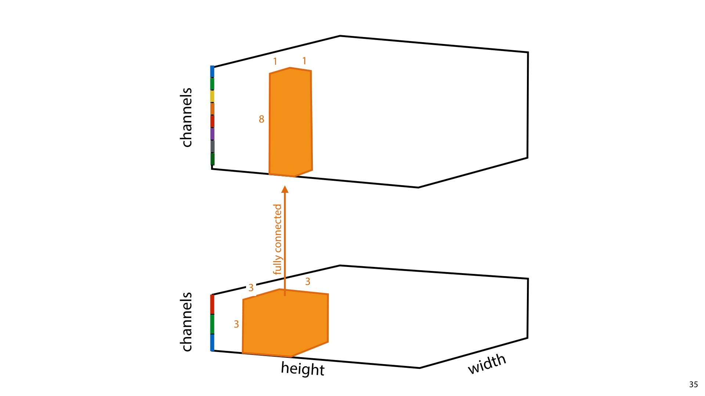

            <figcaption>
            
We can (and do) of course combine both ideas. We usually have multiple input channels and multipe output channels The simplest way to think about this kind of convolution is that in maps input <em>patches</em> to output <em>pixels </em>(all channels in the input patch to all channels in the output pixel). 

Between all nodes in the input patch and all nodes in the output pixel, everything is connected with everything else, with a uniqueweight for every pair of an input and an output node: it’s like a local fully connected network. the wieghts of this network are shared for every place we can put an input patch in the input image.  
<aside    >If the input to this layer is the raw image, then the channels of the input have clear meanings: the levels or red, green and blue in each pixel of the input. This is no longer true for the channels of the tensor at the top. We still call them channels, but what they represent is entirely dependent on the weights of the network.</aside><aside    ></aside>
            </figcaption>
       </section>

       <section id="slide-036" class="anim">
            <a class="slide-link" href="https://dlvu.github.io/details#slide-036" title="Link to this slide.">link here</a>
            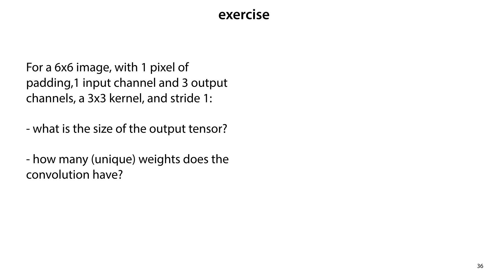

            <figcaption>
            
Here’s an exercise to see if you get the basic idea. 

Note first that the padding gives us an 8x8 image. Sliding a 3x3 kernel over this image, we see that we can fit 6 such kernels horizontally (this is one per column, minus 2 because the kernel window hits the right edge). The same thing holds for the rows, to we get 6 by 6 distinct windows. Since the output has 3 channels, we repeat this trick with 3 different kernels, so that we get an output tensor with dimensions 3 x 6 x 6. 

Each 3 x 3 kernel has 9 weights, and there are repeated at each position in the image. That means that no matter how big the image is, we never get more than 9 weights. However, the output has 3 channels, so we have 3 different kernels. The result is that we have 3 · 9 = 27 distinct weights.

            </figcaption>
            click image for animation
       </section>

       <section id="slide-037">
            <a class="slide-link" href="https://dlvu.github.io/details#slide-037" title="Link to this slide.">link here</a>
            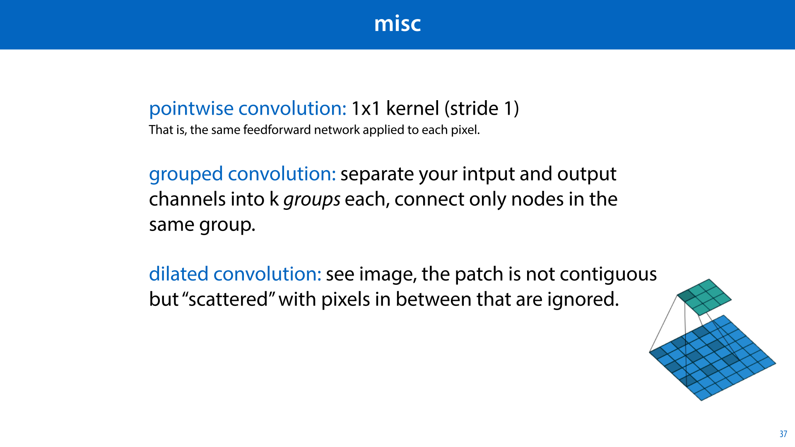

            <figcaption>
            

            </figcaption>
       </section>

       <section id="slide-038">
            <a class="slide-link" href="https://dlvu.github.io/details#slide-038" title="Link to this slide.">link here</a>
            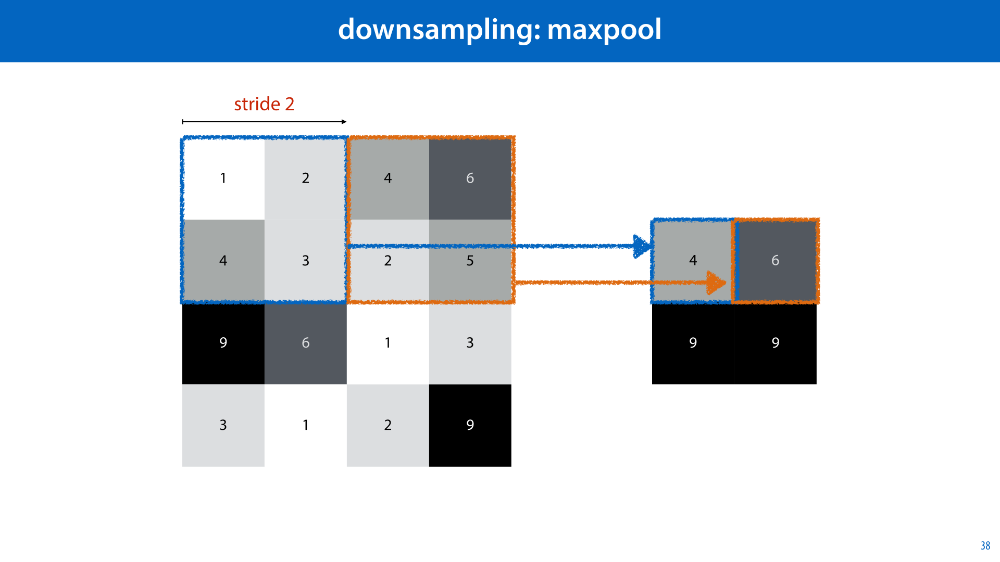

            <figcaption>
            
We chain these convolutions together, but after a while (as the number of channels grows) we’d like the resolution to decrease so we’re gradually looking a lower resolution version of the image, but we have more information (more channels) about each part of the image.  

The most common for of downsampling is maxpooling.  

The max pooling operation it divides the image into n-by-n patches, and returns the maximum value from each square. Average pooling (returning the average over each patch) is also possible, but max pooling is usually more effective.  
<aside    >Most likely, this is because during the backward pass, the whole gradient flows back down one of the pixels, instead of dividing over all four. This gives the backpropagation a sparse character: it focuses only on the most important paths in the computation graph instead of dividing its attention over all of them. </aside>
Note that the maxpool is a layer without weights. It just removes some of the information coming in based on what the layers below it have done. We need to backpropagate through it to train the layers below, but it doesn't have any trainable properties of its own.

            </figcaption>
       </section>

       <section id="slide-039">
            <a class="slide-link" href="https://dlvu.github.io/details#slide-039" title="Link to this slide.">link here</a>
            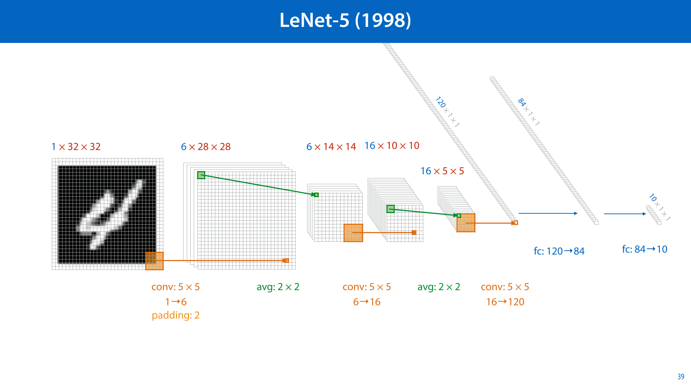

            <figcaption>
            
To see how convolutions are used in a complete architecture, here is the LeNet, one of the first successful, end-to-end trained convolutional neural nets. 

It contains three 5x5 convolutions without padding. As we increase the information per pixel, (by extracting more channels) we occasionally downsample the image: that is, we reduce the number of pixels. The downsampling is done by average pooling. Each convolution and fully connected layer is followed  by a sigmoid, except for the last layer, which has a softmax activation (so that the 10 output units map to the 10 classes in MNIST). 

The idea of this architecture, and of pretty much each subsequent convolutional network, is toreduce the height and width of the tensor representing the image step by step, and at the same time to increase the number of channels per pixel. Essentially, the spatial information encoded in the output activations (where in the pixel grid are things happening) is becoming coarser and coarser, but the semantic information (what is happening) is becoming richer and richer, because we have more and more channels, which are fed with more and more layers.  

In the end, we have one pixel that represents the whole image in 120 “channels”. That is, we have lost all spatial information, but these 120 channels hopefully capture everything that is going on in the whole image. That means that this 120 element vector can now be used to decide on our classification of the image.  

            </figcaption>
       </section>

       <section id="slide-040">
            <a class="slide-link" href="https://dlvu.github.io/details#slide-040" title="Link to this slide.">link here</a>
            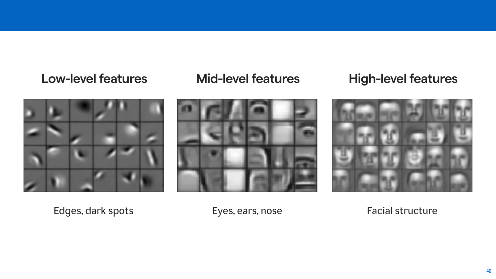

            <figcaption>
            

            </figcaption>
       </section>

       <section id="slide-041">
            <a class="slide-link" href="https://dlvu.github.io/details#slide-041" title="Link to this slide.">link here</a>
            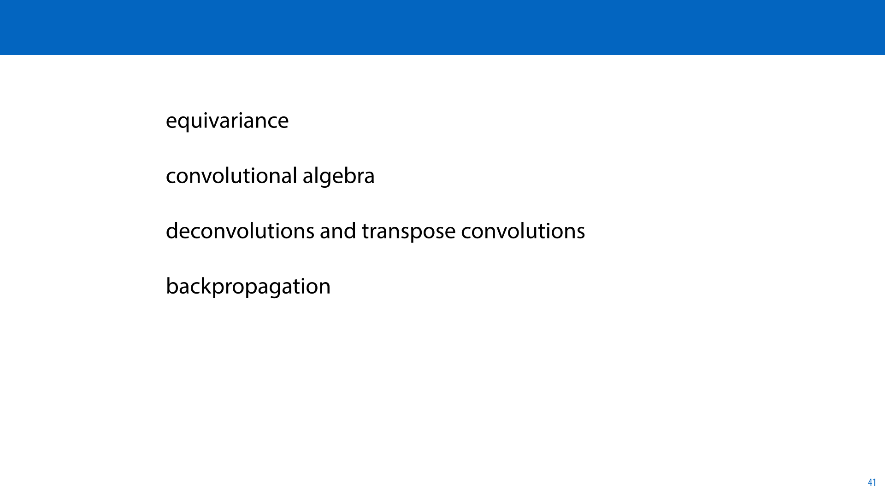

            <figcaption>
            

            </figcaption>
       </section>

       <section id="slide-042">
            <a class="slide-link" href="https://dlvu.github.io/details#slide-042" title="Link to this slide.">link here</a>
            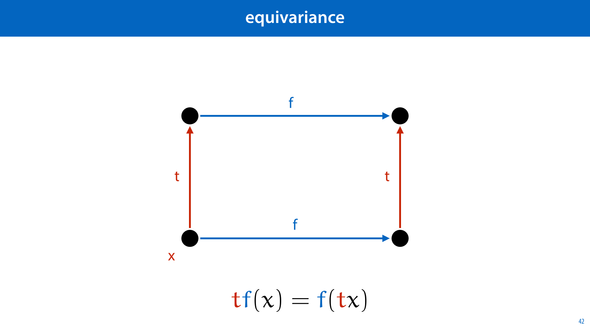

            <figcaption>
            
<em>Equivariance</em> is a simple idea that will come up a lot in deep learning. It’s a powerful intuition behind why some of our architectures work so well, and for what we might be looking for in new architectures.  

Imagine you have a function f and a transformation t. The transformation can be applied to the input of f or to the output of f.  

The function f is equivariant to the transformation t, if applying the tranformation to x and then feeding x to f results in the same result as feeding x to f, and then applying the transformation afterwards.  
<aside    >This is essentially just saying that the functions f and t commute. The subtlety lies in the perspective: we see t as a transformation of our data, and f as a function we can learn. </aside><aside    ></aside>
            </figcaption>
       </section>

       <section id="slide-043">
            <a class="slide-link" href="https://dlvu.github.io/details#slide-043" title="Link to this slide.">link here</a>
            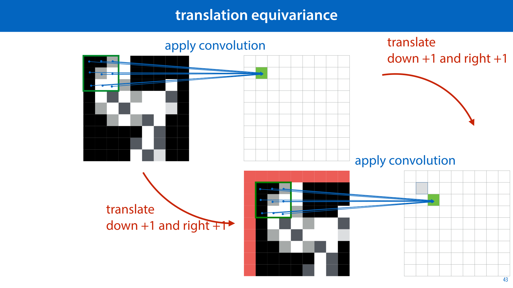

            <figcaption>
            <aside    >The equivarance breaks at the edges. In the theory we usually assume that the image is infinitely tall and wide (so it has no edges) and accept that the theory only applies with a little bit of equivariance breaking around the edges. </aside><aside    ></aside>
            </figcaption>
       </section>

       <section id="slide-044" class="anim">
            <a class="slide-link" href="https://dlvu.github.io/details#slide-044" title="Link to this slide.">link here</a>
            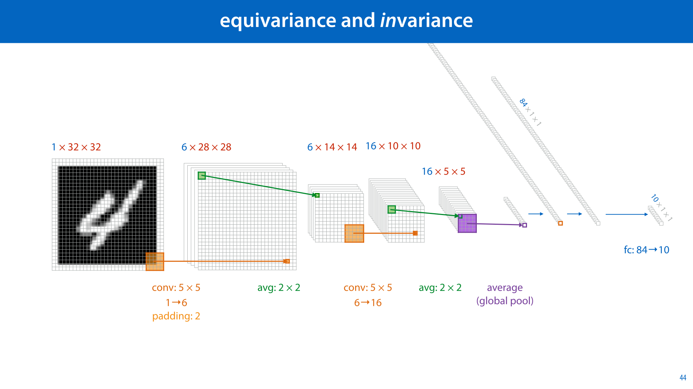

            <figcaption>
            
A powerful idea in deep learning is to make an architecture that consists of many operations that are equivariant to an operation, followed by a global pooling operation that makes the network as a whole invariant to the operation. 

Invariance (to translation) here simply means that the classification that the network doesn’t change what it does if we shift the image left or right.  
<aside    >Again, we have to ignore edge effects. If we shift it so much that the subject disappears out of frame, then the network should no longer be invariant. Assume the image is large enough and the shift small enough that the pixels that disappear don’t affect the classification very much. </aside>
In the slide, we’ve adapted the LeNet slightly to make this clearer. Instead of the last convolution we now do a <em>global pool</em>. This is a pooling operation (like the downsampling ones) that completely eliminates one or more dimensions. In this case, we average out the height and width, leaving only the 6 channels.  

Now, imagine what happens to the output activations if we shift the image. All the values stay the same, except shifted along as well (ignoring the ones near the edges). Once we get to the global pool, all the averages will be the same (ignoring edge effects) and the vector after the global pool will not be affected. This means that the classification will be the same regardless of whether we’ve shifted the picture or not.  

 

            </figcaption>
            click image for animation
       </section>

       <section id="slide-045">
            <a class="slide-link" href="https://dlvu.github.io/details#slide-045" title="Link to this slide.">link here</a>
            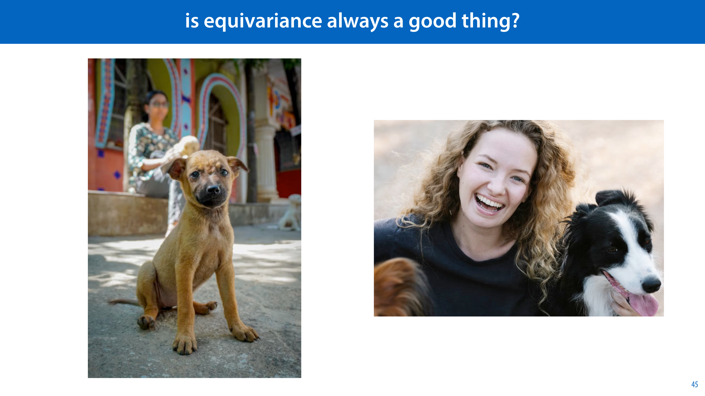

            <figcaption>
            
Imagine classfiying these two images. Among the classes available are “woman” and “dog”. Both pictures contain a woman and a dog, but the one on the left should probably be classified as a picture of a dog that happens to contain a woman, while the picture of the right is probably a pocture of a woman that happens to contain a dog.  

A key piece of evidence for the difference is where the dog’s face appears. In the center, as it does on the left, or off-center as it does on the right.  

A network that is truly invariant do translation would not be able to tell the difference. The presence of a dogs face fill steer the classifier to twards the classification “dog” whether it appears in the center or at the edge of the picture. 

Thus, even equivariance is very powerful, and it essentially means that the network doesn’t need to learn a “dog detector” separately for each location in the image, sometimes we want to allow the network to break the equivariance a little, if it helps. 

            </figcaption>
       </section>

       <section id="slide-046" class="anim">
            <a class="slide-link" href="https://dlvu.github.io/details#slide-046" title="Link to this slide.">link here</a>
            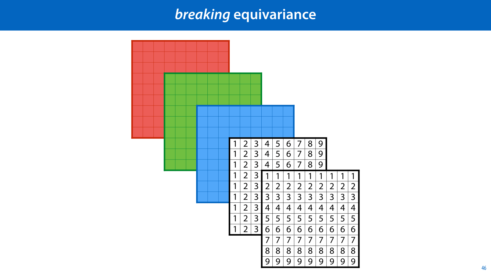

            <figcaption>
            
Designing deep learning architectures is a strange business of a first building in equivariances and then, if necessary, breaking them. The key idea is that sometimes we don’t want full equivarance, we want to start the network off with the option of being equivariant, and also the option to break it.  

Here is a simple trick, call CoordConv (for coordinate convolution). Before we apply the convolution we simply add two channels to our input tensor. These encode the pixel coordinates. If we do this for the first layer of a neural network that consumes color images, the input goes from a 3 channel image to a 5 channel image. However, we can do the same thing for all the intermediate convolution layers. 

This way, the neural network<em> can</em> be equivariant if it “wants” to be: It just sets all weights corresponding to these added inputs to zero, and it behaves as if we never addd them at all. However, if the information in these extra channels is useful, it can learn to use it, and for example, represent a dog’s face slightly differently if it appears in the top right of the picture than if it appears in the center.  
<aside    >You could even initialize the weights for these extra channels to 0, so that at the start of training, the network behaves perfectly equivariantly, and the non-equivariant behavior can slowly emerge with training. In practice, however, this doesn’t seem to be necessary.  </aside><aside    >We’ve used integer coordinates here for simplicity, but in practice you’d want to normalize these to the range (0,1) so the activations don’t blow up. </aside><aside    ></aside>
            </figcaption>
            click image for animation
       </section>

       <section id="slide-047">
            <a class="slide-link" href="https://dlvu.github.io/details#slide-047" title="Link to this slide.">link here</a>
            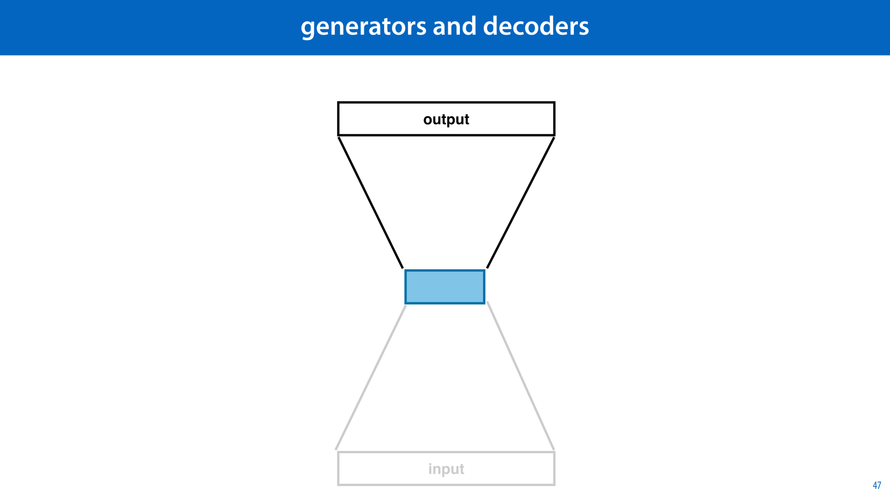

            <figcaption>
            

            </figcaption>
       </section>

       <section id="slide-048">
            <a class="slide-link" href="https://dlvu.github.io/details#slide-048" title="Link to this slide.">link here</a>
            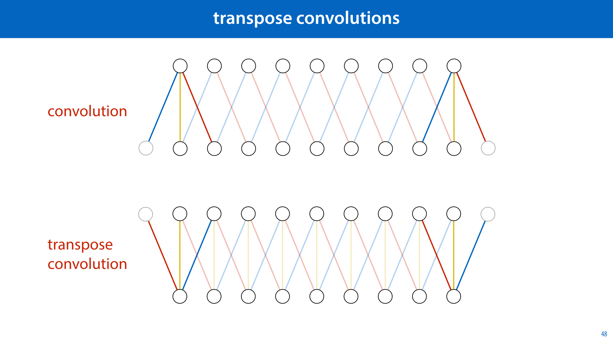

            <figcaption>
            
Transpose convolutions are sometimes called deconvolutions, but this also means something else (the inverse of a convolution), so transpose convolution is preferred. 

            </figcaption>
       </section>

       <section id="slide-049">
            <a class="slide-link" href="https://dlvu.github.io/details#slide-049" title="Link to this slide.">link here</a>
            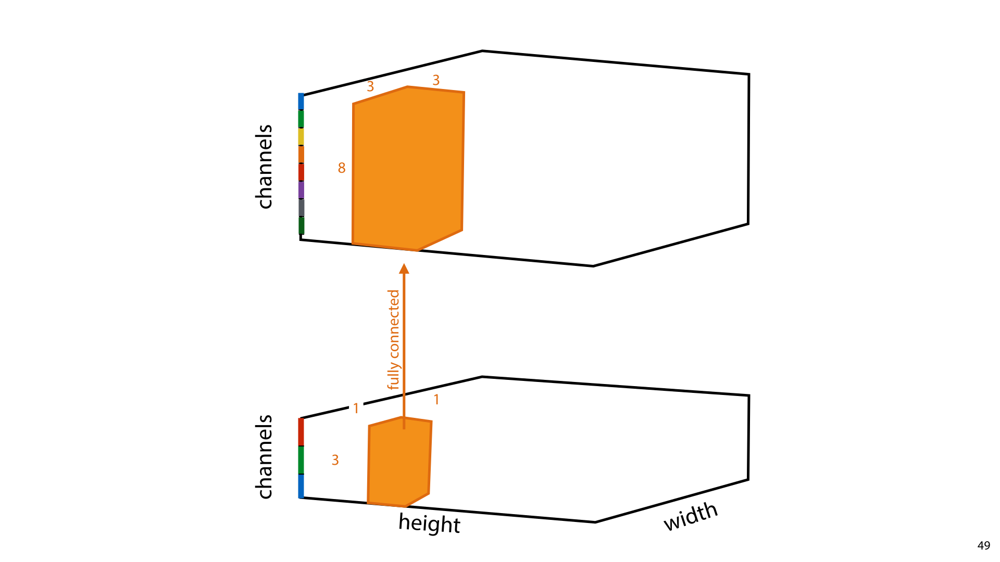

            <figcaption>
            
In the 2D case, the idea is the same. We just wire a single pixel in the input to a patch in the output.

            </figcaption>
       </section>

       <section id="slide-050">
            <a class="slide-link" href="https://dlvu.github.io/details#slide-050" title="Link to this slide.">link here</a>
            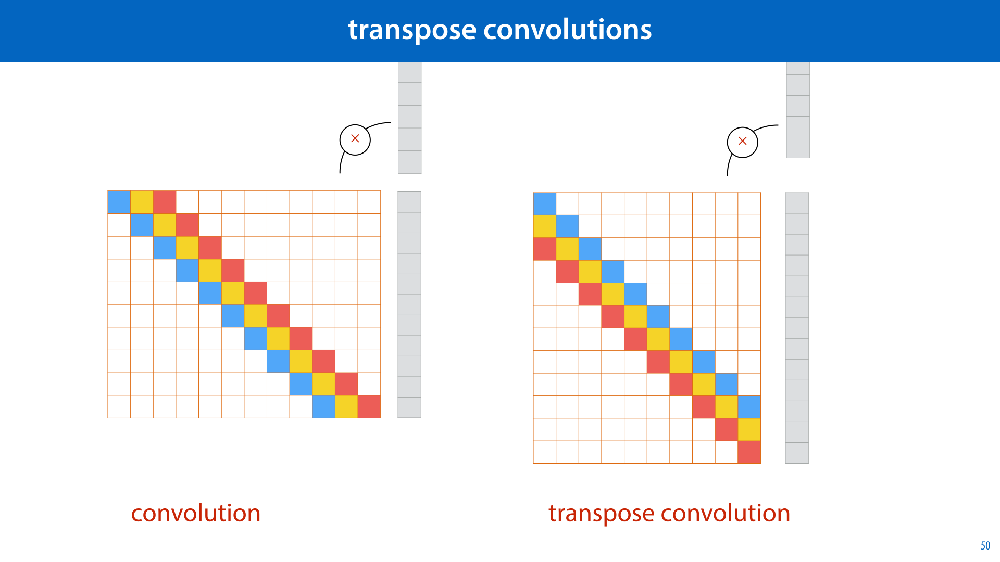

            <figcaption>
            
When we 

            </figcaption>
       </section>

       <section id="slide-051">
            <a class="slide-link" href="https://dlvu.github.io/details#slide-051" title="Link to this slide.">link here</a>
            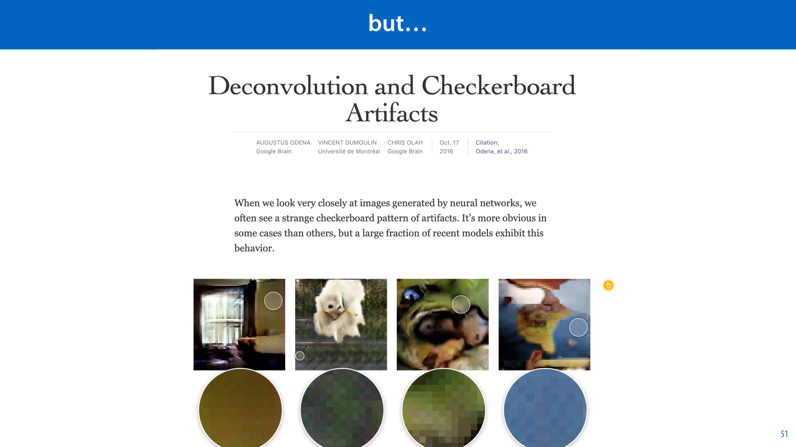

            <figcaption>
            
Transpose convolutions can produce checkboard artifacts when you use a large stride to create the increase in resolution.  

The common solution is to use explicit upsampling to increase the resolution and to keep the input and output resolution equal for the convolution layers.  

It turns out you can then just use plain convolutions in your decoder or generator. You can also use transpose convolutions, but the benefit of regular ones is that you can reuse the same building blocks in your encoder and decoder. 

<a href="https://distill.pub/2016/deconv-checkerboard/"><strong>https://distill.pub/2016/deconv-checkerboard/</strong></a> 
<aside    >If you’re now wondering whether you can also wire up arbitrary patches in the input to arbitrary patches in the output, both with their own strides and padding, this can be done, but it doesn’t seem to have been investigated yet. Standard libraries don’t support it. </aside><aside    ></aside>
            </figcaption>
       </section>

       <section id="slide-052">
            <a class="slide-link" href="https://dlvu.github.io/details#slide-052" title="Link to this slide.">link here</a>
            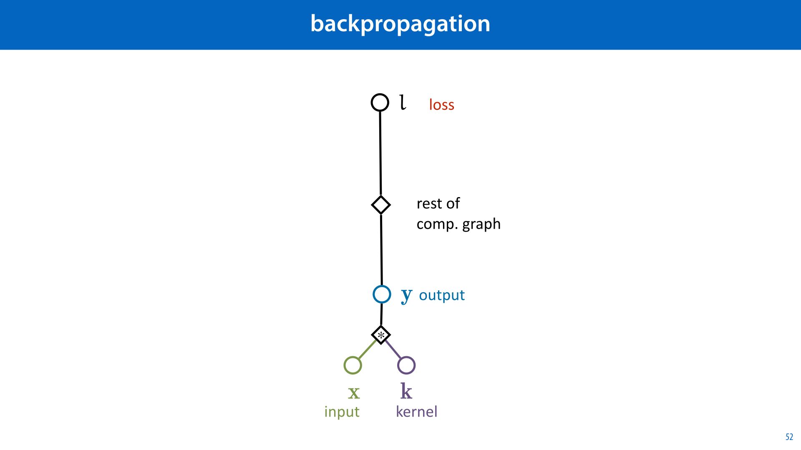

            <figcaption>
            
naive first, to show how multiple gradients are integrated.

            </figcaption>
       </section>

       <section id="slide-053">
            <a class="slide-link" href="https://dlvu.github.io/details#slide-053" title="Link to this slide.">link here</a>
            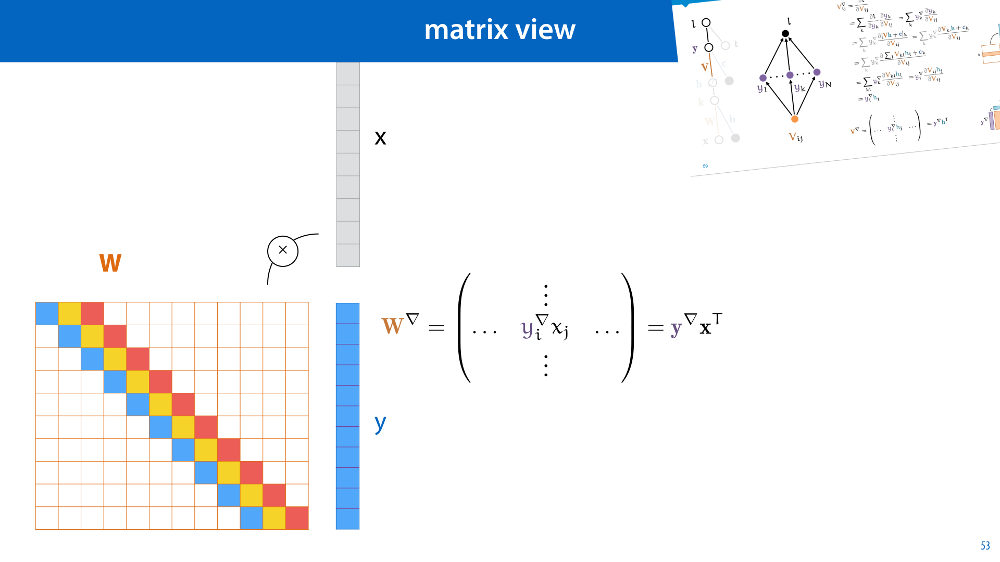

            <figcaption>
            

            </figcaption>
       </section>

       <section id="slide-054">
            <a class="slide-link" href="https://dlvu.github.io/details#slide-054" title="Link to this slide.">link here</a>
            

            <figcaption>
            
 
<aside    > </aside><aside    >There is an alternative convention to have the sum from -m to m with the kernel size 2m+1 and  with the indices being negative for the input and the kernel. This has some theoretical niceties, but the negative indices get a bit confusing, so we stick with this definition, which indexes all vectors and matrices from 1. </aside><aside    ></aside>
            </figcaption>
       </section>

       <section id="slide-055" class="anim">
            <a class="slide-link" href="https://dlvu.github.io/details#slide-055" title="Link to this slide.">link here</a>
            

            <figcaption>
            
In these few slides, we will go through how a convolution operator is implemented in an automatic differentation system. 

The forward function is very simple to state in scalar terms: Every element of the output vector is just a dot product of a small part of the input (a <em>patch</em>) and the parameters of our kernel. 

To vectorize this, we can just take all these patches, stack them together in a matrix, and compute all the dot products in a single matrix multiplication. 

This operation of slicing out the patches is one of the rare operations for which we can't make do with standard linear algebra operators. The problem is that the patches overlap. We need a function that slices out the right overlapping patches from the input x (the points at which we apply the kernel), and arranges them in a matrix. We call this function get_patches, and we’ll assume somebody has implemented it for us in an efficient way. 
<aside    >In pytorch, this function is called unfold. </aside>
Once we have this matrix, we can multiply it with k (using broadcasting) to get the result we need.

            </figcaption>
            click image for animation
       </section>

       <section id="slide-056" class="anim">
            <a class="slide-link" href="https://dlvu.github.io/details#slide-056" title="Link to this slide.">link here</a>
            

            <figcaption>
            
Next, we need to figure out the backward. As before, we do this in scalar terms first and then vectorize. 

Note that the gradient for the i-th output is another dot product: of the output gradient, with a <em>patch</em> of the input. 

            </figcaption>
            click image for animation
       </section>

       <section id="slide-057" class="anim">
            <a class="slide-link" href="https://dlvu.github.io/details#slide-057" title="Link to this slide.">link here</a>
            

            <figcaption>
            
This means that we can vectorize the backward with the same get_patches operation we used for the forward.

            </figcaption>
            click image for animation
       </section>

       <section id="slide-058">
            <a class="slide-link" href="https://dlvu.github.io/details#slide-058" title="Link to this slide.">link here</a>
            

            <figcaption>
            
 

            </figcaption>
       </section>

       <section id="slide-059">
            <a class="slide-link" href="https://dlvu.github.io/details#slide-059" title="Link to this slide.">link here</a>
            

            <figcaption>
            
<a href="https://people.idsia.ch/~juergen/deep-learning-history.html#cnn%5C"><strong>https://people.idsia.ch/~juergen/deep-learning-history.html#cnn\</strong></a>

<a href="https://people.idsia.ch/~juergen/deep-learning-history.html#cnn%5C"><strong></strong></a>

            </figcaption>
       </section>

       <section id="slide-060">
            <a class="slide-link" href="https://dlvu.github.io/details#slide-060" title="Link to this slide.">link here</a>
            

            <figcaption>
            
LeNet, a convolutional network built by Yann Lecun is often seen as the first Convolutional Neural Network as we recognize it today. It didn’t introduce anything that hadn’t been done before but it collected all the ingredients together, composed them into the architecture that later became standard and showed strong performance on the MNIST task.  

This did not cause an immediate watershed. For decades, people still focused on using SVMs and explicit feature detectors for image classification tasks. This was partly because of a community preference for convex optimization (which brings certain theoretical guarantees), but mostly because a deep convolutional network only really shines in a regime of large data. To train a big network on a lot of data, we needed to wait for the hardware to catch up. Around 2010 people started seriously looking at using GPUs to train NNs, which is when the deep learning era really began.  

Who has priority here is a bit controversial. AlexNet’s performance on the ImageNet challenge is often seen as the “watershed” moment when people began to realize that this method was the way forward. However, before that, the very similar DanNet was already winning many other competitions.  
<aside    >Schmidhuber, whose lab built the DanNet has for years argued that his contribution is erased in the standard narrative.  </aside>
We will sidestep the issue by mentioning them, both, but looking in detail at a late network: the VGG net by Karen Simonyan and Andrew Zisserman from 2014. This network is not first in anything, but both the DanNet and AlexNet contain some odd architectural choices that are really only motivated by hardware constraints of their day. The VGG net removes these tweaks and shows a very typical well-performing architecture that is very typical for this time. It highlights the main features that are still required to make this kind of model work, while ignoring the quirks and tweaks that we important for the hardware of its day. 

            </figcaption>
       </section>

       <section id="slide-061">
            <a class="slide-link" href="https://dlvu.github.io/details#slide-061" title="Link to this slide.">link here</a>
            

            <figcaption>
            
Prefer two 3x3 ones over one 11x11 one (ref AlexNet). 

            </figcaption>
       </section>

       <section id="slide-062">
            <a class="slide-link" href="https://dlvu.github.io/details#slide-062" title="Link to this slide.">link here</a>
            

            <figcaption>
            

            </figcaption>
       </section>

       <section id="slide-063">
            <a class="slide-link" href="https://dlvu.github.io/details#slide-063" title="Link to this slide.">link here</a>
            

            <figcaption>
            
To understand this, imagine a network with just a single weight per layer (and no biases). First, consider what happens if you have linear activations, and set all weights higher than 1. As the network gets deeper, the output of each layer grows exponentially. If we get a gradient over the loss, the chain rule tells us to multiply it by the weights, so the gradient also grows exponentially. In theory, this is no problem: the gradients are correct so if we need smaller values, they should shrink quickly. It does mean, however, that unless we carefully tune our learning rate, we are taking very big steps at the start of learning. There is also the problem of numerical instability: the bigger our output, the less stable our nonlinear computations (like the loss) get. 

If we try to avoid it by setting the weights less than 1, we get the opposite problem: as the network gets deeper, the output shrinks exponentially and with it the gradients. Here, we have a situation, where learning never starts, because the initial gradient is far too small. And again, in this regime, there is a big probability of numerical instability. 

The sweet spot is a network with activations all equal to 1. That way, however big the input is, that's how big the output is, and the same goes for the gradient traveling back down the network. 

Of course, we never stack linear layers like this in practice. Let's see what happens when we add sigmoid activations. We see that for positive inputs the activations get squished into the interval (0, 1). Large activations are mapped to 0 and 1 and small activations are mapped to 0.5. In both cases, the sigmoid does something to counter the activation explosion/shrinkage problem. But we pay a large price in the backward pass.

            </figcaption>
       </section>

       <section id="slide-064" class="anim">
            <a class="slide-link" href="https://dlvu.github.io/details#slide-064" title="Link to this slide.">link here</a>
            

            <figcaption>
            
The very largest derivative the sigmoid will give us is 0.25. This means that as it propagates down the network, the gradient now shrinks exponentially in the number of sigmoids it encounters. 

We could fix this by squeezing the sigmoid, so its derivative is 1 in the middle, but that would increase the regions where the sigmoid is close to flat. If backpropagation encounters anything in these region, the gradient is multiplied by something very close to zero, so it dies immediately.

            </figcaption>
            click image for animation
       </section>

       <section id="slide-065">
            <a class="slide-link" href="https://dlvu.github.io/details#slide-065" title="Link to this slide.">link here</a>
            

            <figcaption>
            
The ReLU activation preserves the derivatives for the nodes whose activations it lets through. It kills it for the nodes that produce a negative value, of course, but so long as your network is properly initialised, about half of the values in your batch will always produce a positive input for the ReLU. 

One way to think about the difference between the sigmoid and the ReLU is that the sigmoid preserves a gradient for every weight, but shrinks the magnitude exponentially. The ReLU exponentially shrinks the number of weights for which it preserves a gradient, but for those it preserves the<em> magnitude </em>perfectly. This is much preferable. In gradient descent, we take many steps, so it's fine to take a step for only an arbitrary subset of our weights each time.  

The only thing we must watch out for is that for each weight there is some input for which the weight gets a gradient. If any input to a ReLU is negative for all possible inputs to the network, its derivative will always be 0 and it will never change. This is what we call a <strong>dead neuron</strong>. 

We can avoid dead neurons by normalization: if all the inputs look standard-normally distributed, then half of them will always get a gradient. 

            </figcaption>
       </section>

       <section id="slide-066">
            <a class="slide-link" href="https://dlvu.github.io/details#slide-066" title="Link to this slide.">link here</a>
            

            <figcaption>
            
The VGG Net was one of the first networks built around “blocks” a set of layers arranges in a standard ways that could be repeated a variable number of times. This allowed the researchers to study in a controlled way, how architectural hyper-parameters should be tuned as networks get bigger.  

In between the convolutional blocks and the fully connected layers, the output tensor is <em>flattened</em>. That is, the convolution outputs a 4-tensor of size (batch, channels, height, width). In some convolutional nets the height and width have been reduced to 1 and all we need to do is remove the last two dimensions (using the squeeze operation). Usually, however, not all spatial information has been removed by the max pooling and we end up with a 4-tensor of very low spatial resolution and a large number of channels, say (batch, channels=1024, height=4, width=4). In that case, we can remove the spatial structure by flattening this tensor into a tensor of size (batch, 1024*4*4).  

That is, all the elements of the tensor are still there, but we don’t care how they’re arranged in a grid anymore. The fully connected layers will learn how to map the information to classes.  
<aside    >Flattening is usually done with a “view” operation, which you will learn about in the homework. This keeps the elements of the tensor in the order they are arranged in memory, which is the cheapest way. since we no longer care about the structure (except to keep the instances in the batch separate) this is the logical choice. </aside><aside    ></aside>
            </figcaption>
       </section>

       <section id="slide-067" class="anim">
            <a class="slide-link" href="https://dlvu.github.io/details#slide-067" title="Link to this slide.">link here</a>
            

            <figcaption>
            
Another cheap trick to help your gradients propagate during early training is to simply add a connection around a block of layers. We take the input of the block and add it to the output (sometimes multiplied by a single scalar parameter, but this isn't usually necessary).  

This does require that the input of the block has the same dimensions as the output, but it's usually possible to design your network in these kinds of blocks. This is called a <strong>residual connection</strong>. 

The benefit of the residual connection is that at the start of training, when the gradient signal through the block is weak because of the limits of initialization, there is a second signal through the residual that doesn't suffer this decay. The lower layers can start training based on this signal, and later, when the layers in the block start to do something useful, integrate the gradient from the block. 

 

            </figcaption>
            click image for animation
       </section>

       <section id="slide-068" class="anim">
            <a class="slide-link" href="https://dlvu.github.io/details#slide-068" title="Link to this slide.">link here</a>
            

            <figcaption>
            

            </figcaption>
            click image for animation
       </section>

       <section id="slide-069">
            <a class="slide-link" href="https://dlvu.github.io/details#slide-069" title="Link to this slide.">link here</a>
            

            <figcaption>
            
<a href="https://gestalt.ink/residual-connection"><strong>https://gestalt.ink/residual-connection</strong></a> 

            </figcaption>
       </section>

       <section id="slide-070">
            <a class="slide-link" href="https://dlvu.github.io/details#slide-070" title="Link to this slide.">link here</a>
            

            <figcaption>
            
In many ways, the residual connection is the simplest of the family. All the others were introduced before the ResNet, and the main takeaway of the ResNet is that the simplest approach is all we need. This is a common pattern in deep learning: we start with complicated architectures and we slowly learn to strip them down to their simplest form. 

            </figcaption>
       </section>

       <section id="slide-071">
            <a class="slide-link" href="https://dlvu.github.io/details#slide-071" title="Link to this slide.">link here</a>
            

            <figcaption>
            
Even with sound initialization, however, in a very deep neural net, your gradients and activations will start to wander away from the standard mean and covariance. One good way to avoid this—both at initialization and as training takes hold—is to insert a layer that specifically normalizes its input, whatever the values. 

The most popular layer that does this is called a<strong> batch normalization</strong> layer. It takes a batch of tensors (vectors here, but any tensor shape works), and computes, for each dimension in the tensor, the mean and variance. It then normalizes the input by subtracting the mean and dividing by the standard deviation. All of these are simple, differentiable operations, so we can easily chain them together and let our AD system take care of the backpropagation. 

Optionally we can add two learnable parameters: an element-wise multiplication and a bias. This gives us the best of both worlds: the output of the batch norm can have any mean and variance, but we still get perfectly controlled gradients (this last step is linear, so the gradients are scaled linearly as well). 

Batch normalization works extremely well. In fact much better than any other approach that should work similarly (like controlling normalization through extra loss terms, or training the initial values to for normal activations). Many papers have been written about exactly why this is the case, but there doesn't seem to be a clear answer yet. For now, we can just remember that the basic idea is to stabilize the activations and the gradients.

            </figcaption>
       </section>

       <section id="slide-072">
            <a class="slide-link" href="https://dlvu.github.io/details#slide-072" title="Link to this slide.">link here</a>
            

            <figcaption>
            
Remember leakage? Batch norm is a typical example of a mechanism that can leak during evaluation. If we use batch norm the same way in evaluation as we do during training, we are aggregating information over the batch dimension. This is not usually a realistic way to use a neural net. In production, instances come in one at a time. Even if they don't in your setting and you can actually batch them together, you are likely comparing to a model that doesn't. 

Moreover, your evaluation performance is an average of several independent samples of the performance on a single instance.  

To eliminate this unfair advantage, batch norm behaves differently during evaluation than during training. Like the data normalization should do, it takes the mean and variance from the training data and normalizes by that. Since it's difficult in a library like pytorch to compute the training data mean/variance from inside a layer (in some cases, there may not be fixed dataset at all), batch norm usually computes a running mean  and variance using the exponential moving average to use during evaluation. 

This does mean that when you use batch norm your network needs to know whether its training or predicting. All DL libraries have a simple functionality for telling your network this, but if you forget to do so, you are inflating the performance of your network.

            </figcaption>
       </section>

       <section id="slide-073">
            <a class="slide-link" href="https://dlvu.github.io/details#slide-073" title="Link to this slide.">link here</a>
            

            <figcaption>
            
The batch dimension isn't the only dimension along which you can normalize. You can pick other directions and even subsets of the dimensions of your batch tensor. Depending on which dimension you pick this is called instance normalization, layer normalization or group normalization. 

Not normalizing over the batch dimension has several benefits. First, you don't have the leakage issue from the previous slide: group normalization can operate in exactly the same way during training and testing (only the batch dimension is "protected"). Second, the performance doesn't degrade for smaller batches. Batch norm requires a large number of instances to get strong estimates. If we don't have many instances in the input, but we do have, for instance, many pixels, then it may be better to normalize in another direction. 

In practice, however, for reasonable batch sizes, batch normalization appears to work best, and remains the most popular option for small models.

            </figcaption>
       </section>

       <section id="slide-074">
            <a class="slide-link" href="https://dlvu.github.io/details#slide-074" title="Link to this slide.">link here</a>
            

            <figcaption>
            
Batchnorm, residual connections, blocks, and <em>depth</em>. 

            </figcaption>
       </section>

       <section id="slide-075">
            <a class="slide-link" href="https://dlvu.github.io/details#slide-075" title="Link to this slide.">link here</a>
            

            <figcaption>
            
Here are the results of a real convolutional network trained to detect faces. The small grayscale images shows a typical image that each node in one of the layers responds to. Those for the first layers can be thought of as edge detectors: if there is a strong edge in a particular part of the image, the node lights up. The second combine these into detectors for parts of images: eyes noses, mouths, etc. The third combine these into detectors for complete faces. 

 
<aside    >source: <a href="https://devblogs.nvidia.com/parallelforall/deep-learning-nutshell-core-concepts/"><strong>https://devblogs.nvidia.com/parallelforall/deep-learning-nutshell-core-concepts/</strong></a> </aside><aside    ></aside>
            </figcaption>
       </section>

       <section id="slide-076">
            <a class="slide-link" href="https://dlvu.github.io/details#slide-076" title="Link to this slide.">link here</a>
            

            <figcaption>
            
Here is a feature visualisation example for the VGG net, trained on imagenet. 

To find the image on the right, the authors took one node high up in the network, and instead of optimising the weights to minimise the loss, they optimised the input to maximise the activation of that node. 

They also searched the dataset for natural  images that caused a high activation in that particular node. 

You can look through these visualizations yourself at  <a href="https://distill.pub/2017/feature-visualization/"><strong>https://distill.pub/2017/feature-visualization/</strong></a>

<a href="https://distill.pub/2017/feature-visualization/"><strong></strong></a>

            </figcaption>
       </section>

       <section id="slide-077">
            <a class="slide-link" href="https://dlvu.github.io/details#slide-077" title="Link to this slide.">link here</a>
            

            <figcaption>
            
The opposite is also possible: searching for an input that causes minimal activation. 

<a href="https://distill.pub/2017/feature-visualization/"><strong>https://distill.pub/2017/feature-visualization/</strong></a>

<a href="https://distill.pub/2017/feature-visualization/"><strong></strong></a>

            </figcaption>
       </section>

       <section id="slide-078">
            <a class="slide-link" href="https://dlvu.github.io/details#slide-078" title="Link to this slide.">link here</a>
            

            <figcaption>
            

            </figcaption>
       </section>

</article>
