<nav class="menu">
    <ul>
        <li class="home"><a href="/">Home</a></li>
        <li class="name">Convolutions</li>
                <li><a href="#video-000">Why convolutions?</a></li>
                <li><a href="#video-021">Learning convolutions</a></li>
                <li><a href="#video-062">Convolutional architectures</a></li>
        <li class="pdf"><a href="https://dlvu.github.io/pdfs/lecture03.convolutions.pdf">PDF</a></li>
    </ul>
</nav>

<article class="slides">

       <section id="slide-001">
            <a class="slide-link" href="https://dlvu.github.io/cnns#slide-001" title="Link to this slide.">link here</a>
            

            <figcaption>
            
 

            </figcaption>
       </section>

       <section id="slide-002">
            <a class="slide-link" href="https://dlvu.github.io/cnns#slide-002" title="Link to this slide.">link here</a>
            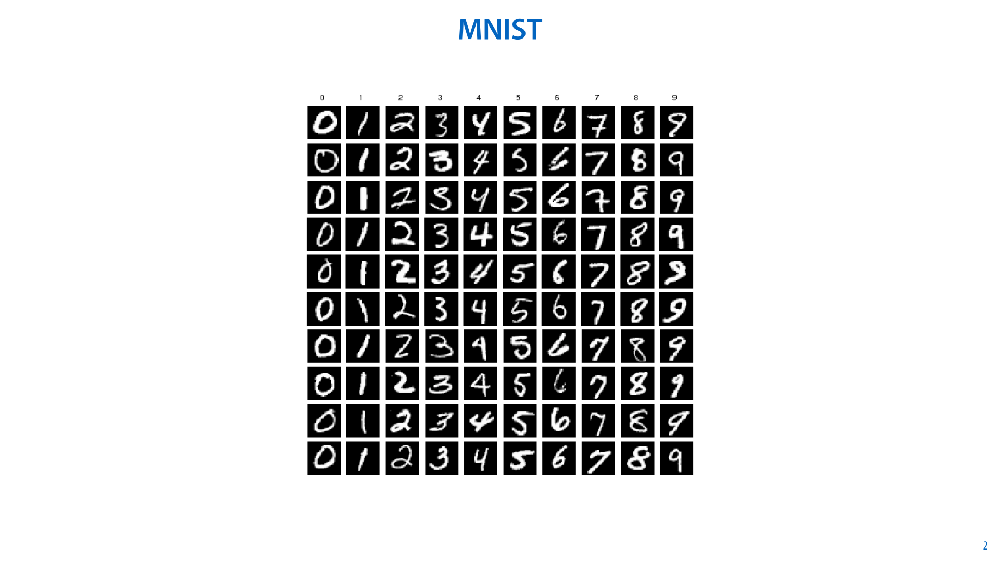

            <figcaption>
            
One of the biggest drivers of early deep learning research was the MNIST dataset. A collection of 60 000 handwritten digits, originally built to evaluate OCR systems for ZIP code recognition by the US postal system.  

The digits are represented as 28x28 pixel images, in white on a black background. 

            </figcaption>
       </section>

       <section id="slide-003">
            <a class="slide-link" href="https://dlvu.github.io/cnns#slide-003" title="Link to this slide.">link here</a>
            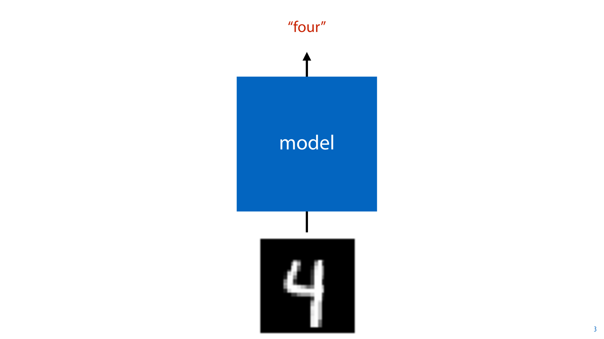

            <figcaption>
            
This was most commonly framed as a <em>classification problem</em>.  

We feed some model the image in some way, and we ask it to choose (or provide a probability distribution) over the classes 0, 1,…, 8, 9. 

            </figcaption>
       </section>

       <section id="slide-004" class="anim">
            <a class="slide-link" href="https://dlvu.github.io/cnns#slide-004" title="Link to this slide.">link here</a>
            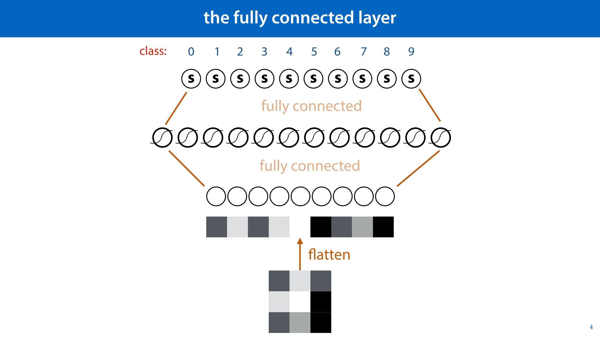

            <figcaption>
            
We can build this kind of classifier already with the the neural network parts we’ve seen so far. 

The only thing we do is to <em>flatten</em> the image. The slide shows the idea for a 3x3 image: we just arrange the pixels into a vector in some arbitrary, but standardized order and feed it to the network as a vector.  
<aside    >In this case, we flatten the image in “row major order” by scanning along the rows first, and then the columns. However, any order will do, so long as we do it the same way for all images.  </aside>
Once we have a vector that captures all the information in the image, we can just feed that to the classic feedforward network that we’ve already seen. We’ve given it one hidden layer, with sigmoid activations, and an output layer with 10 units (one for each class) and a softmax activation. We could also give it more layers, or change the activation.  
<aside    >A common rule for MLPs is that one hidden layer should be wider than the output, but otherwise, we need to come up with a good structure experimentally.</aside><aside    ></aside>
            </figcaption>
            click image for animation
       </section>

       <section id="slide-005">
            <a class="slide-link" href="https://dlvu.github.io/cnns#slide-005" title="Link to this slide.">link here</a>
            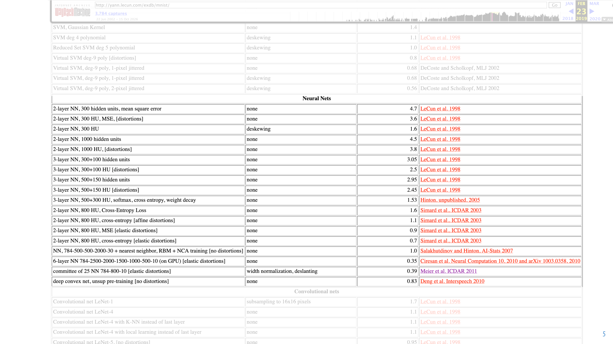

            <figcaption>
            
Using this approach on MNIST (possibly with a few other tricks like data augmentation), you can get the test accuracy above 99% already. So why would we need anything more? 
<aside    >This screenshot is from Yann Lecuns now defunct website for MNIST where he kept a ranking of the best performing models for MNIST. It’s still available in the wayback machine here:<a href="https://web.archive.org/web/20190223235504/http://yann.lecun.com/exdb/mnist/"><strong>https://web.archive.org/web/20190223235504/http://yann.lecun.com/exdb/mnist/</strong></a> with results going up to 2012. </aside><aside    ></aside>
            </figcaption>
       </section>

       <section id="slide-006">
            <a class="slide-link" href="https://dlvu.github.io/cnns#slide-006" title="Link to this slide.">link here</a>
            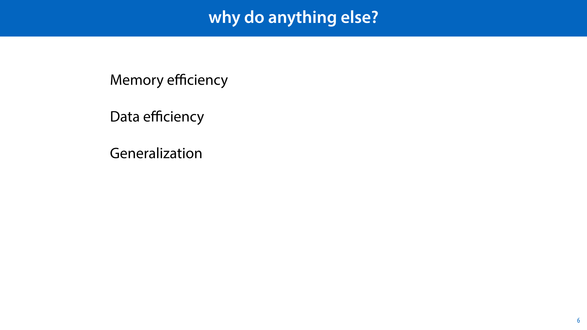

            <figcaption>
            

            </figcaption>
       </section>

       <section id="slide-007" class="anim">
            <a class="slide-link" href="https://dlvu.github.io/cnns#slide-007" title="Link to this slide.">link here</a>
            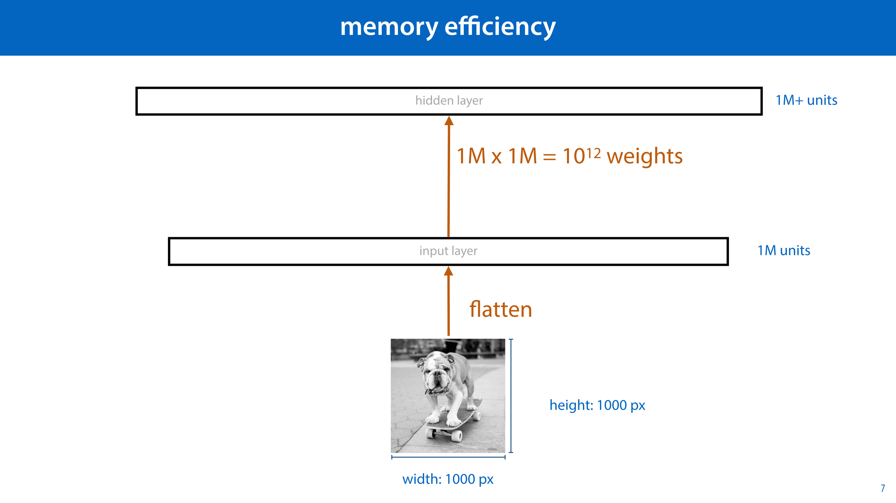

            <figcaption>
            
The first problem is easy to explain. Let’s look at what happens when we try to train a classifier for a one megapixel image (that is, an image with a million pixels).  
<aside    >This is not a lot: a medium budget phone can easily take photos up to 50 megapixels.  </aside>
Flattening this image into a vector gives us  one million input nodes. In order to learn certain shapes, the hidden layer should be a bit bigger than the input layer, so we’ll need to make that one at least a million nodes as well. The result is that between the first and the second layer, we already have a thousand billion weights. Even at just 16 bits per weight, that’s 2 terabytes of memory, far too much for even a modern compute node. 

            </figcaption>
            click image for animation
       </section>

       <section id="slide-008">
            <a class="slide-link" href="https://dlvu.github.io/cnns#slide-008" title="Link to this slide.">link here</a>
            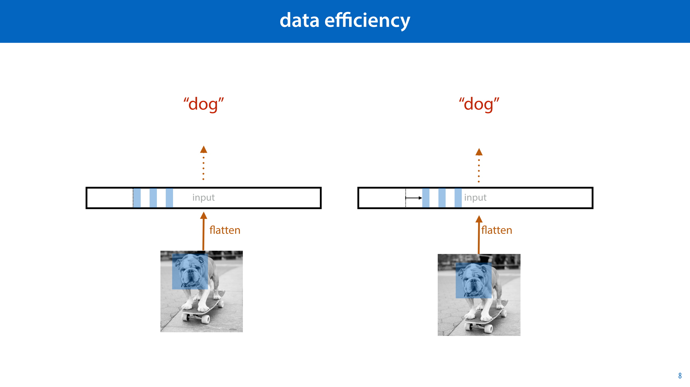

            <figcaption>
            
Another, perhaps deeper reason, is that the fully connected network end up learning a lot of things over and over again.  

To illustrate, imagine that we show our network the same image twice, but shifted a few pixels down and to the right. The content of the image doesn’t meaningfully change, and the basic classification (“dog”) doesn’t change. Let’s imagine that the network looks mostly at the dog’s face, and ignores the rest. 

In the example on the left, the pixels corresponding to the dog’s face end up, after flattening, in a certain region of the  input layer. After we shift the image a bit, all pixels of the dog’s face are mapped to different input units.  

In the remainder of the network these are connected to completely different weights to the rest of the network, because every input gets unique weights. The conclusion is that the network has a completely different<em> subnetwork </em>for each part of the image. If it learns to recognize a dog’s face in the top left and the bottom right of the image, it does that with two completely separate subnetworks (at least in the first layer).  

Put differently, for each part of the image, the network needs to re-learn a separate network for recognizing dogs. Each such subnetwork needs to see dog’s faces appearing in that location. That means we don’t just need a lot of dogs in our data to learn what they look like, we need a lot of dogs <em>for each location in the image</em>.  

            </figcaption>
       </section>

       <section id="slide-009">
            <a class="slide-link" href="https://dlvu.github.io/cnns#slide-009" title="Link to this slide.">link here</a>
            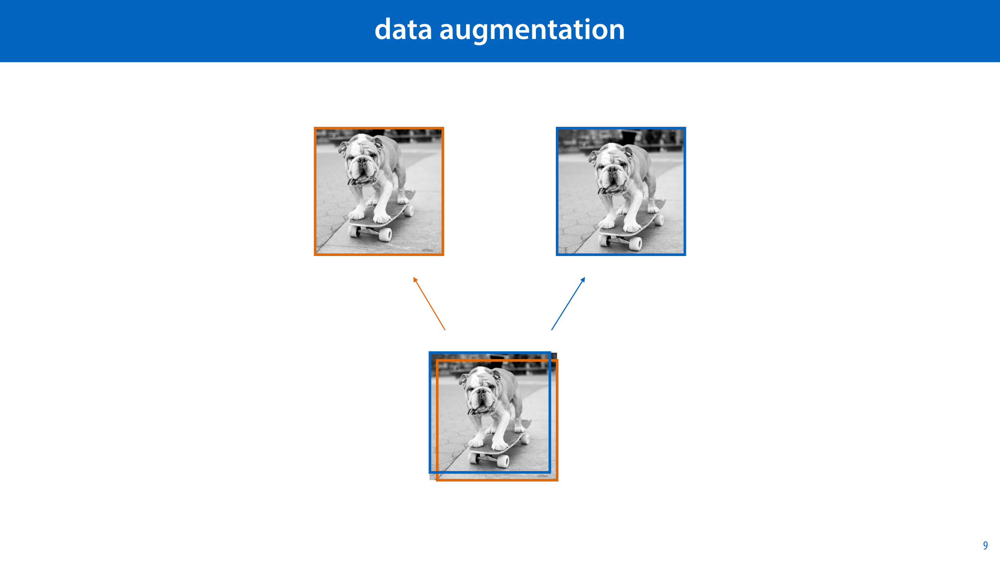

            <figcaption>
            
A cheap trick to mitigate this issue is data augmentation. If we have very few images of dogs in our dataset, we can just create sightly shifted versions of each dog image by cropping them and scaling them up.  

This works, and it’s a good way to start thinking about what kind of patterns we are trying to learn, but it’s a bit unsatisfying to have the network learn the same thing for every position in the image. A truly intelligent system would surely be able to re-use the things it learns for one part of the image elsewhere in the image. 

It’s also inefficient, of course, and this inefficiency gets worse as the resolution of the images gets higher: the more pixels, the more regions the image has and the more subnetworks we need to train. 
<aside    >A pattern we often see in deep learning is that people devise a data augmentation that works well for their problem, and then develop a way to change the architecture of the model so that the transformation is wired into the model, and the augmentation is no longer necessary. The convolutional network is an example of that for this particular data augmentation. </aside><aside    ></aside>
            </figcaption>
       </section>

       <section id="slide-010">
            <a class="slide-link" href="https://dlvu.github.io/cnns#slide-010" title="Link to this slide.">link here</a>
            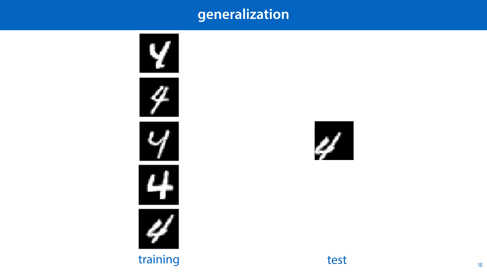

            <figcaption>
            
A final issue is the deep problem of <em>generalization</em>. What happens if your test data (or rather, the examples you will see in production) have a slightly different distribution than those you will see during training? For example, what if all the fours you train on are perfectly centered but during test you see a four that is a little off center.  

As we’ve already seen, a fully connected network will not have a subnetwork to recognize fours in the bottom left of the image. It’s never seen a four here, so it won’t be able to make a good classification, even though it would classify it perfectly if the four was in the center of the image.  
<aside    >We call generalization a deep problem, because it’s ultimately about what patterns from the dataset you remember and what patterns you forget. This depends on what the test set will look like, which you don’t know at training time. In this sense, it’s an underspecified problem: you can’t do this well in general. The fact that people can still do this is a bit of a mystery. For this lecture, we will simply hardcode certain patterns into the model for it to generalize over, but the more general problem of generalization goes quite deep. It’s discussed in more detail here: <a href="https://mlvu.github.io/introduction/#video-107"><strong>https://mlvu.github.io/introduction/#video-107</strong></a>. </aside><aside    ></aside>
            </figcaption>
       </section>

       <section id="slide-011" class="anim">
            <a class="slide-link" href="https://dlvu.github.io/cnns#slide-011" title="Link to this slide.">link here</a>
            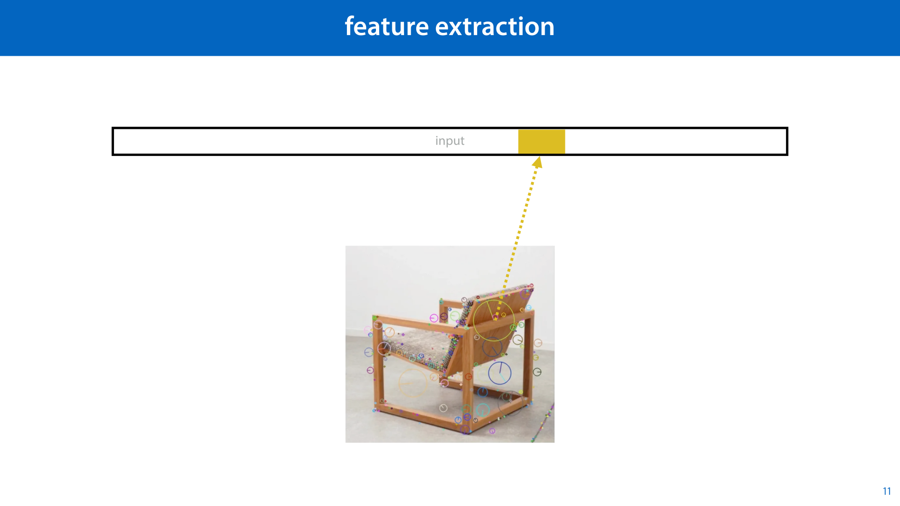

            <figcaption>
            
Another solution to these problems that was used a lot before deep learning was <em>feature extraction</em>. Instead of flattening the pixel values into a big vector, we translate the image into a vector in a cleverer way.  

The slide shows an advanced example SIFT keypoint detection. The SIFT algorithm detects points in the image that are likely to be important (mostly based on how much the color values change in various directions). For each keypoint, it also assigns a scale and a direction. The key property of the algorithm is that of the image is translated, rotated or scaled, the keypoints that the SIFT algorithm throws up are translated scaled and shifted along.  

Then, we just have to extract some values from each keypoint in a consistent way, and use these as inputs to our model. Since the keypoints don’t change if we shift (or scale or rotate) the image, neither do the features. A model that can detect a four in the middle of an image based on its SIFT features, can also detect it in the corner of the image. 

We say the the model is <em>invariant</em> to translation (and to scaling and to rotation). 

Neural networks are often framed as “learned feature extractors”. Instead of designing a feature extractor like SIFT by hand, we feed the network the raw data and have it learn interesting features.  

image source: <a href="https://www.geeksforgeeks.org/computer-vision/describe-the-concept-of-scale-invariant-feature-transform-sift/"><strong>https://www.geeksforgeeks.org/computer-vision/describe-the-concept-of-scale-invariant-feature-transform-sift/</strong></a> 

            </figcaption>
            click image for animation
       </section>

       <section id="slide-012" class="anim">
            <a class="slide-link" href="https://dlvu.github.io/cnns#slide-012" title="Link to this slide.">link here</a>
            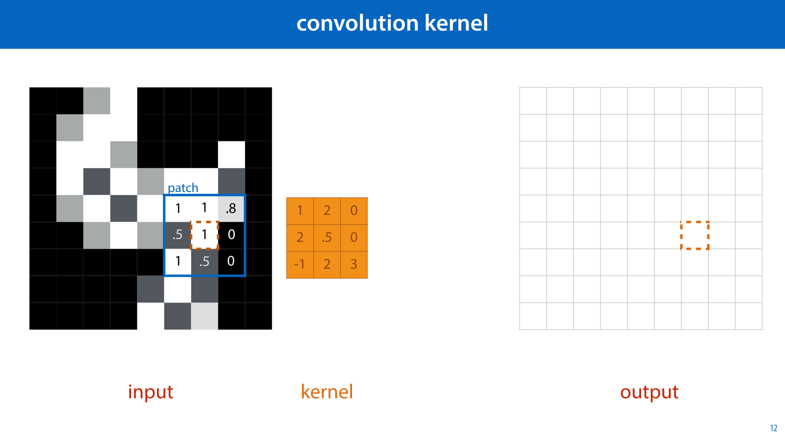

            <figcaption>
            
To inspire us, we’ll look at a simple and popular data augmentation and feature extraction method from before deep learning. The convolution kernel.  

Note that this is not (yet) a learning method. It’s just a cheap and versatile way to modify an image, into another image 

A convolution is defined by a small matrix called a <em>kernel</em>: we’ll stick to 3×3 for most of the lecture. It’s filled with some numbers which can be any real value. <em>Applying</em> it to an image results in another image with the same resolution.  

To compute the value of some pixel in the output, we first look at the corresponding pixel in the input, and the 3×3 <em>patch</em> around that pixel. We extract that patch, and element-wise multiply it by the the kernel. We then sum up the result, and that’s our answer.  

Doing this for every pixel in the output image, we get another image of the same resolution. What that image looks like, depends on the values we pick for the kernel. We’ll look at a few examples. 
<aside    >You may wonder what we do for the pixels whose patches overlap the edges of the input. A common approach is to ignore the parts of the kernel that fall over the edge. This is equivalent to “padding” the image with a border of pixels set to zero.  </aside><aside    >Another technical detail to deal with is that the output image may have negative values of values larger than 1 (which we’ve equated with white here). We can clip the output image to (0,1) if we need to display it, but otherwise, we don’t need to worry about the range: it’s just a representtion of the input image with values (-∞ ,∞). </aside>
 

 

            </figcaption>
            click image for animation
       </section>

       <section id="slide-013" class="anim">
            <a class="slide-link" href="https://dlvu.github.io/cnns#slide-013" title="Link to this slide.">link here</a>
            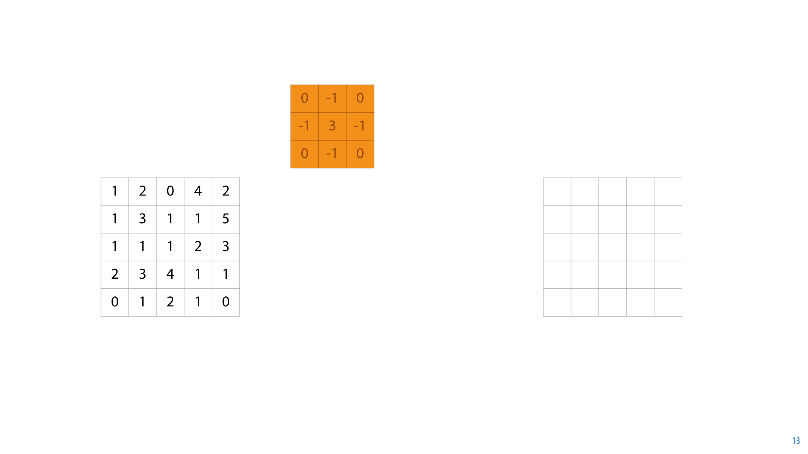

            <figcaption>
            

            </figcaption>
            click image for animation
       </section>

       <section id="slide-014">
            <a class="slide-link" href="https://dlvu.github.io/cnns#slide-014" title="Link to this slide.">link here</a>
            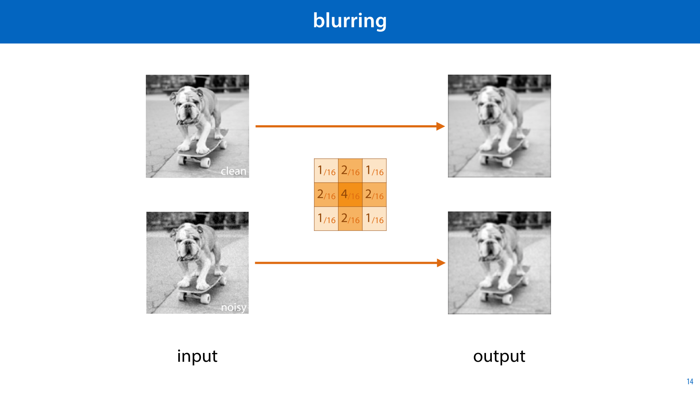

            <figcaption>
            
One very common use of the convolution kernel is to approximate Gaussian blurring. In Gaussian blurring each output pixel is a mixture of the input pixels weighted by distances to the output. That, is the output pixel is mostly the same as the corresponding input pixels, but the values of the nearby pixels are mixed in a little bit, with their weight dropping off with distances the same way a Gaussian or normal distribution drops off.  

Because only the very nearby pixels get any substantial weight, a small kernel approximates this blur very well. 

It may seem counter-intuitive to use blurring as a feature extraction since it removes details, rather than creating variations. However, the detail it removes may be detail that we know we’re not interested in. In this case, if we have slight noise in some of our images, the blurring operation removes that noise, and makes all the images look the same. This reduces the chances of the classifier overfitting on random noise. 

In a sense, applying the blur kernel before flattening the image and feeding it to an MLP makes the model invariant to noise. No matter what noise there is in the image, the model gives the same classification. This can be very useful, because noise is something a model can latch onto when it’s overfitting. 
<aside    >We’ve downsampled the image to 128×128 to make the effect of the kernel clearer. Normally you’d use a larger kernel for an image of this size, but for the Convolutional networks which we’re workong toward, a 3×3 kernel is the standard for reasons we’ll explain later. </aside><aside    ></aside>
            </figcaption>
       </section>

       <section id="slide-015">
            <a class="slide-link" href="https://dlvu.github.io/cnns#slide-015" title="Link to this slide.">link here</a>
            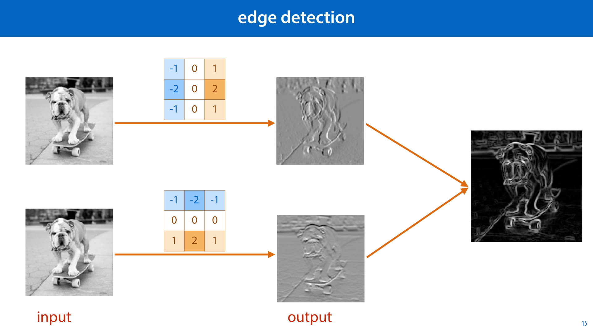

            <figcaption>
            
Here’s another application. These kernels detect how much the pixel values change in the horizontal and vertical directions. They look primarily at the central band, but take the neighbouring bands into account as well. For the horizontal one at the top, the resulting pixel is white if the change is increasing from left to right and black if it is decreasing.  

If we want to detect edges in the image, regardless of direction, we can take both outputs and combine them: we sum their (squared) magnitude and we get an image that is white where there is a strong edge in some direction. 
<aside    >This is called the Sobel edge detector.  </aside>
This operation, again, extracts some important information and removes other information. For some purposes, this version of the image may be more informative than the orginal. 

Another conclusion we can draw is that taking multiple convolutions and combining their results, with some linear or non-linear function, can lead to even better features. 

            </figcaption>
       </section>

       <section id="slide-016">
            <a class="slide-link" href="https://dlvu.github.io/cnns#slide-016" title="Link to this slide.">link here</a>
            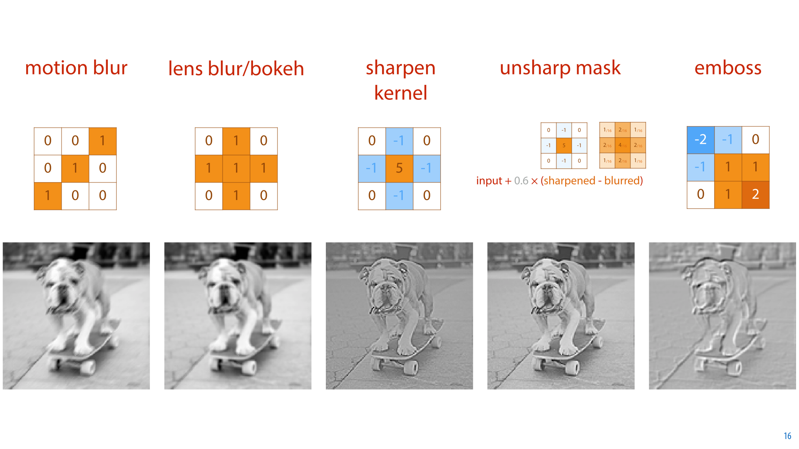

            <figcaption>
            
Here are some other things you can achieve with convolution kernels. 
<aside    >For simplicity we haven’t normalized the kernels to sum to 1, but instead normalized the output image in the plot.  </aside>
The motion bur goes from the bottom left to the top right here, but any kernel that looks like a line of 1s on background of 0s works.  

The lens blur doesn’t look much different from the Gaussian blur here, but for larger kernels a filled disc of 1s of a certain shape creates <a href="https://maxvanleeuwen.com/project/unblurring-images/"><strong>a kind of bokeh effect</strong></a>.  

The sharpen kernel is a slightly weak sharpening effect. Combining it with the blurring kernel in a linear operation creates a more convincing inverse of the blurring operation. 

            </figcaption>
       </section>

       <section id="slide-017">
            <a class="slide-link" href="https://dlvu.github.io/cnns#slide-017" title="Link to this slide.">link here</a>
            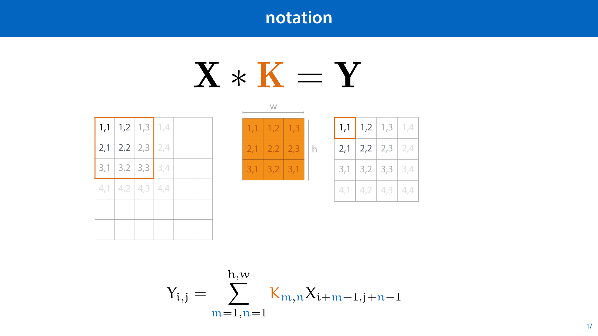

            <figcaption>
            
The mathematical notation for the convolution is the asterisk.  
<aside    >This is used in code for plain multiplication, so it can get confusing. Usually the context is enough to help you figure out what you’re looking at. </aside>
Note that the indexing can be a bit counter-intuitive when you define the convolution like this. The pixel (i,j) in the output Y does not “represent” pixel (i,j) in the input (that Xij is not the center of the patch). Rather, it represents pixel Xi+1,j+1. 
<aside    >For this reason, the convolution is sometimes defined with its indices “aligned” on the center pixel and allowed to be negative (so -1, 0,and 1 for the kernel). For our purposes, this notation is clearer. </aside><aside    >In settings where cross correlation is kept distinct from true convolution, you will often see * used for true convolution and ⋆ for cross-correlation (which is what is shown on the slide).</aside><aside    ></aside>
            </figcaption>
       </section>

       <section id="slide-018">
            <a class="slide-link" href="https://dlvu.github.io/cnns#slide-018" title="Link to this slide.">link here</a>
            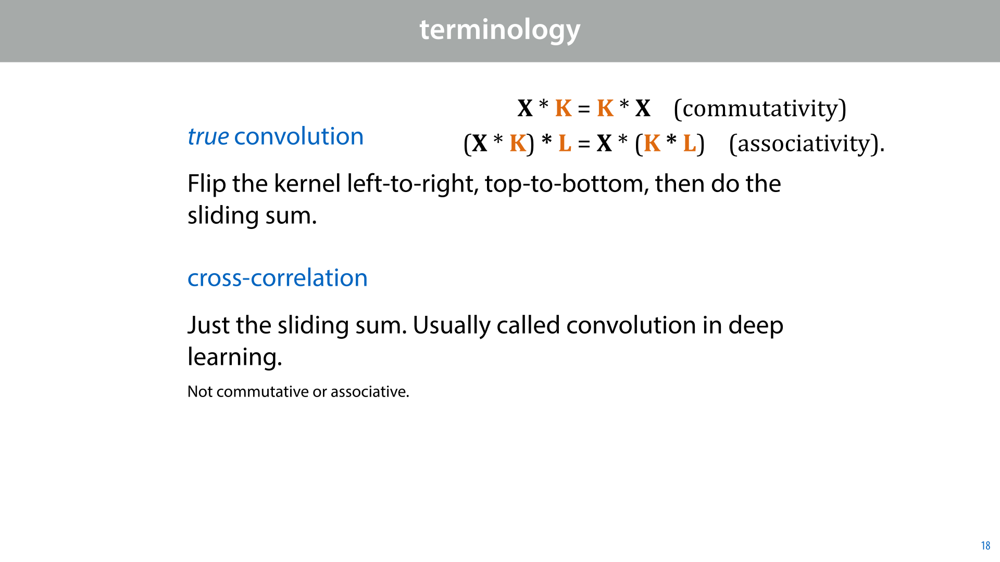

            <figcaption>
            
In some fields, what we’ve described here is not actually called a convolution, but a <em>cross correlation</em>. A “true” convolution actually flips the given kernel left to right and top-to-bottom first and then does the sliding window sum that we’ve described. This has the nice properties that <strong>X</strong> *<strong> </strong><strong>K</strong> = <strong>K</strong> * <strong>X</strong> (commutativity) and that (<strong>X</strong> *<strong> </strong><strong>K</strong>)<strong> * </strong><strong>L</strong> = <strong>X</strong> *<strong> </strong>(<strong>K</strong><strong> * </strong><strong>L</strong>) (associativity). 

We don’t usually bother with the flipping, since our kernels are learned anyway (as we will see later). It’s a matter of perspective: you could say we are computing the true convolution, but we are just storing the flipped kernel in memory, instead of the original one. The distinction is important only for theoretical analyses.  

Within these lectures, we will refer to cross-correlation as convolution when the distinction does not matter. 

If you encounter some written analysis of convolutions, you may need to make sure whether the authors are talking about true convolutions or cross-correlations.

            </figcaption>
       </section>

       <section id="slide-019">
            <a class="slide-link" href="https://dlvu.github.io/cnns#slide-019" title="Link to this slide.">link here</a>
            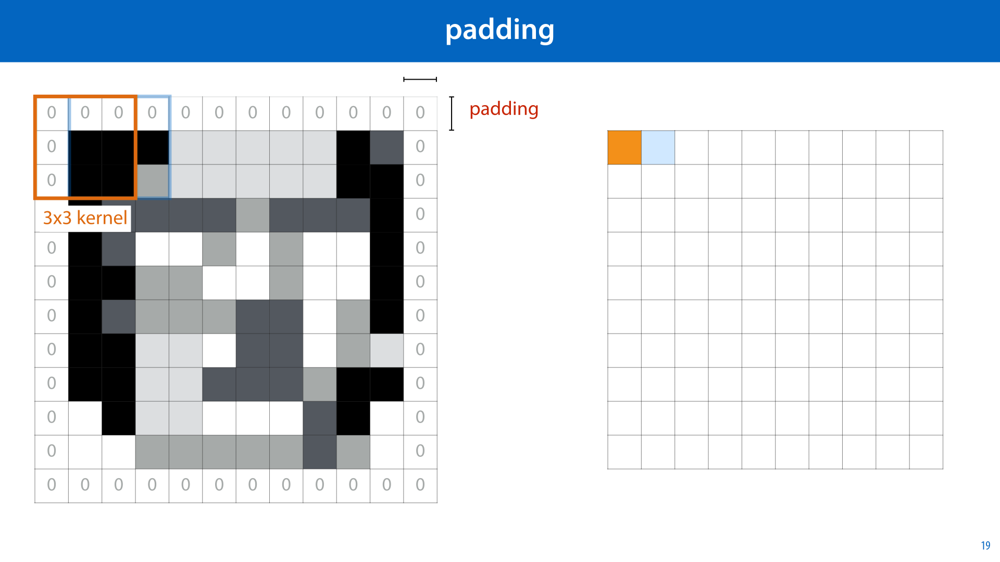

            <figcaption>
            
Note that in the definition we use, the convolution actually shrinks the image by one pixel vertically and horizontally. We can fix this by introducing <em>padding</em>: extra pixels set to 0 around the edges of the image. The output of a 3x3 convolution is the same as the resolution of the original image<em> before we added padding</em>.  

If we use a bigger kernel, we need to add more padding to compensate. If your kernel has size 2m+1, then you need to add m pixels of padding on every side. 

            </figcaption>
       </section>

       <section id="slide-020">
            <a class="slide-link" href="https://dlvu.github.io/cnns#slide-020" title="Link to this slide.">link here</a>
            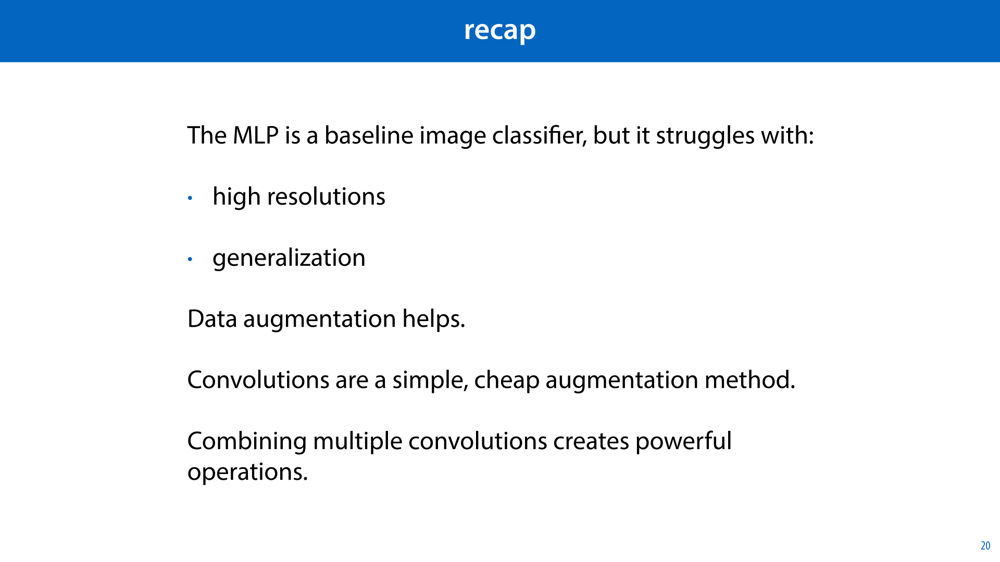

            <figcaption>
            

            </figcaption>
       </section>

       <section id="slide-021">
            <a class="slide-link" href="https://dlvu.github.io/cnns#slide-021" title="Link to this slide.">link here</a>
            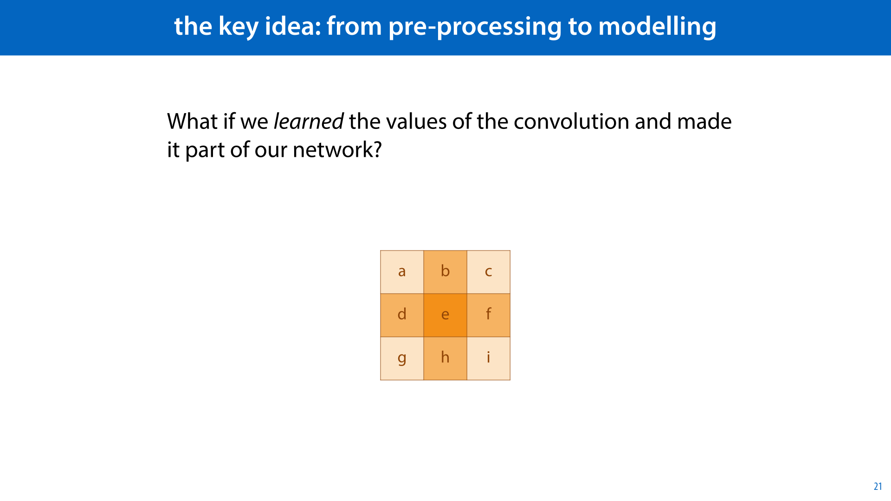

            <figcaption>
            

            </figcaption>
       </section>

       <section id="slide-022">
            <a class="slide-link" href="https://dlvu.github.io/cnns#slide-022" title="Link to this slide.">link here</a>
            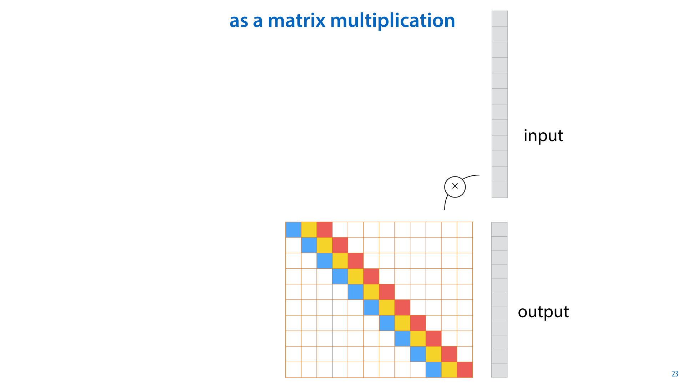

            <figcaption>
            
 

            </figcaption>
       </section>

       <section id="slide-023">
            <a class="slide-link" href="https://dlvu.github.io/cnns#slide-023" title="Link to this slide.">link here</a>
            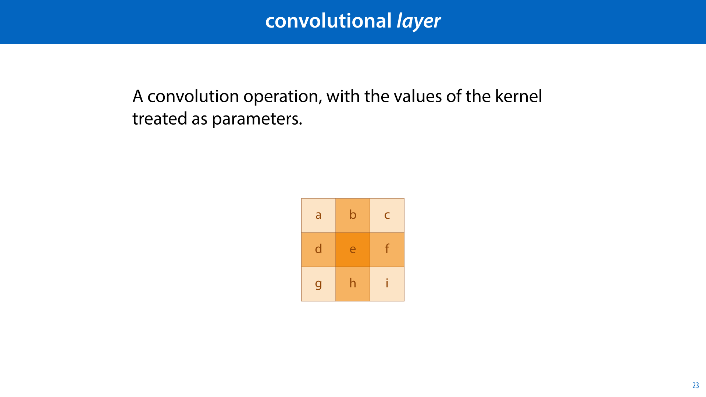

            <figcaption>
            

            </figcaption>
       </section>

       <section id="slide-024" class="anim">
            <a class="slide-link" href="https://dlvu.github.io/cnns#slide-024" title="Link to this slide.">link here</a>
            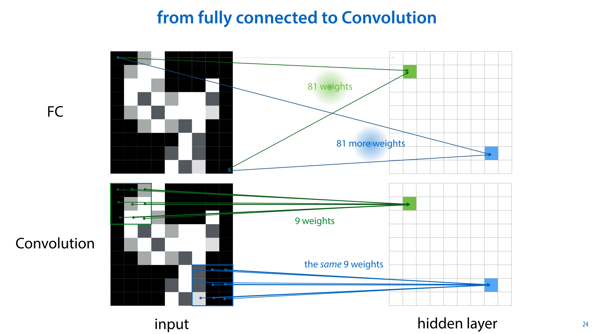

            <figcaption>
            
Here’s how a single fully connected layer looks if we don’t flatten the input image first, and we give it a hidden layer with the same number of units. 

We’ve arranged the hidden layer in the shape of a grid as well, although with a fully connected layer, that means little. Every output pixel is connected with every input pixel. For a 9×9 input image, this gives us 81 weight for every node in the hidden layer, and 812 = 6561 distinct weights in total.  

To turn this into a (3×3) convolutional layer, we do two things. First, we remove all connections that are not in the output pixels 3×3 neighborhood. This leaves us with just 9 connections per output pixel. Second, we <em>share </em>the weights between the convolutions. Whatever weight we apply to the middle pixel of the green patch (top left), we apply the same weight to the middle pixel of the blue patch (bottom right), and for every other patch.  

This means that as a whole, the convolution has only 9 weights. Each weight is applied 81 times. This means it will also get 81 different signals from the backpropagation algorithm, which will work into a single gradient. If we follow the backpropogation algorithm carefully, the right way to do this will emerge clearly. 

            </figcaption>
            click image for animation
       </section>

       <section id="slide-025">
            <a class="slide-link" href="https://dlvu.github.io/cnns#slide-025" title="Link to this slide.">link here</a>
            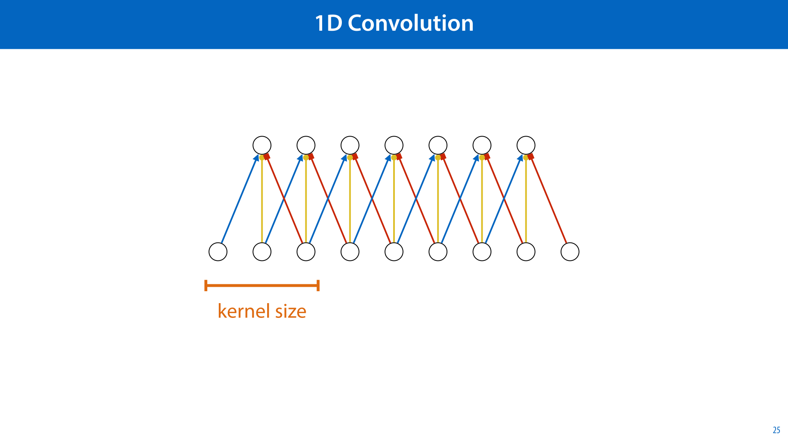

            <figcaption>
            
Here is how it looks if the input is 1D (a sequence of units rather than a grid). Note that the connection colors indicate shared weights (that is, every blue connection has the same weight).

            </figcaption>
       </section>

       <section id="slide-026">
            <a class="slide-link" href="https://dlvu.github.io/cnns#slide-026" title="Link to this slide.">link here</a>
            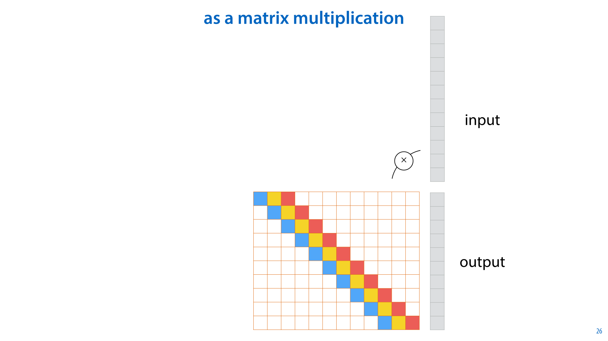

            <figcaption>
            
In the 1D convolution we can perfectly visualize that the convolution is just a specific instance of the fully connected layer. Remember that the fully connected layer is just a matrix multiplication with the inputs represented as a vector. If we take that matrix, and zero out many of the entries, and set some entries around the diagonal to three shared values that are the same over each row, we get the matrix mulitplication that  computes a convolution (with a size 3 kernel).  
<aside    >In the 2D case the convolutional is still equivalent to a matrix multiplication, but because we would have to flatten the image into a vector, it wouldn’t look nearly this clean. </aside><aside    ></aside>
            </figcaption>
       </section>

       <section id="slide-027">
            <a class="slide-link" href="https://dlvu.github.io/cnns#slide-027" title="Link to this slide.">link here</a>
            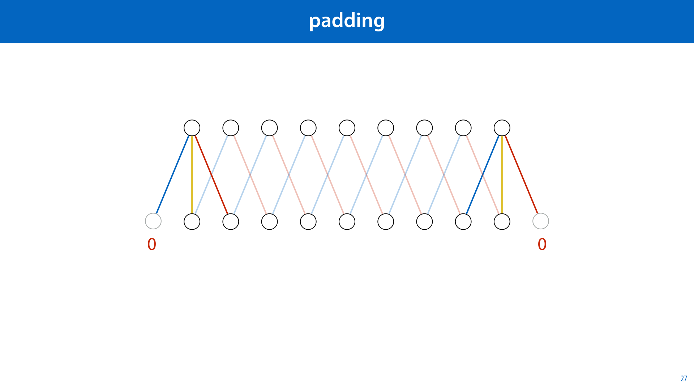

            <figcaption>
            
One drawback with the previous picture is that the inputs on the sides contribute to only one hidden unit, and the ones next to them to only two 

To combat this, we can add <em>padding</em>: extra units, usually with a fixed value set to zero. Because of this padding, the number of outputs becomes the same as the number of inputs, and the actual units on the side contribute to more nodes.  

To achieve the same number of units in the output as in the input (before padding), we must set the number of units padded on both sides to floor(kernel_size/2). This is sometimes called “same padding”.

            </figcaption>
       </section>

       <section id="slide-028">
            <a class="slide-link" href="https://dlvu.github.io/cnns#slide-028" title="Link to this slide.">link here</a>
            

            <figcaption>
            

            </figcaption>
       </section>

       <section id="slide-029">
            <a class="slide-link" href="https://dlvu.github.io/cnns#slide-029" title="Link to this slide.">link here</a>
            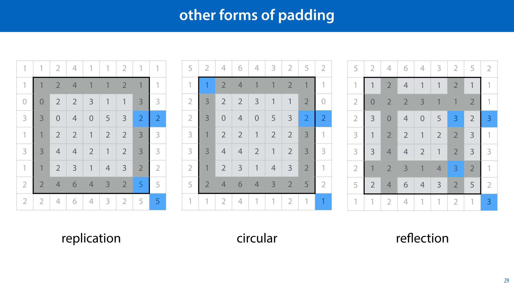

            <figcaption>
            
Here are some other forms of padding. The aim is to make the added pixels look more like they are a natural part of the image. This can be important, because the patterns the kernel learns at the edges are re-used everywhere else in the image. Zero padding is the most common default, but if you think you need something else you can try something like this.  

<strong>Replication</strong> padding just copies the value of the nearest pixel. <strong>Circular</strong> padding “wraps the image around” copying the value of the edge pixel on the other side. <strong>Reflection</strong> padding copies the value of the pixel on the opposite side of the neighboring edge pixel. 

            </figcaption>
       </section>

       <section id="slide-030" class="anim">
            <a class="slide-link" href="https://dlvu.github.io/cnns#slide-030" title="Link to this slide.">link here</a>
            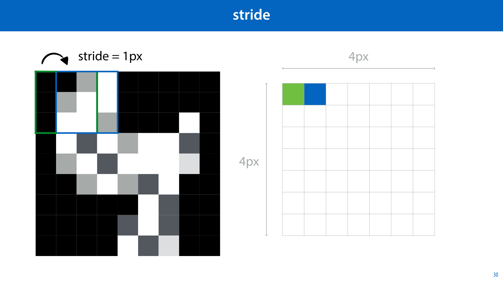

            <figcaption>
            
We usually describe a convolution in terms of a fixed window that is slid across the input image. We then create an output node for each unique position in the input.  

We normally slide the window over one pixel at a time. This is called the <em>stride </em>of the convolution (as in, a stride of one pixel). 

We can also use higher strides, skipping some possible places where we can overlay the kernel.

            </figcaption>
            click image for animation
       </section>

       <section id="slide-031" class="anim">
            <a class="slide-link" href="https://dlvu.github.io/cnns#slide-031" title="Link to this slide.">link here</a>
            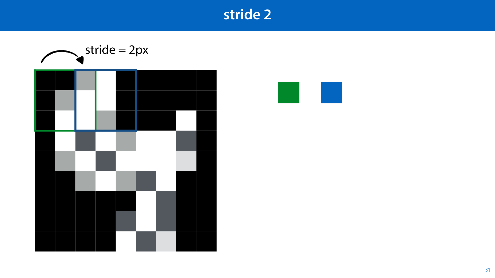

            <figcaption>
            
Here’s a stride of 2. The result is that we get fewer pixels in the output. 

            </figcaption>
            click image for animation
       </section>

       <section id="slide-032">
            <a class="slide-link" href="https://dlvu.github.io/cnns#slide-032" title="Link to this slide.">link here</a>
            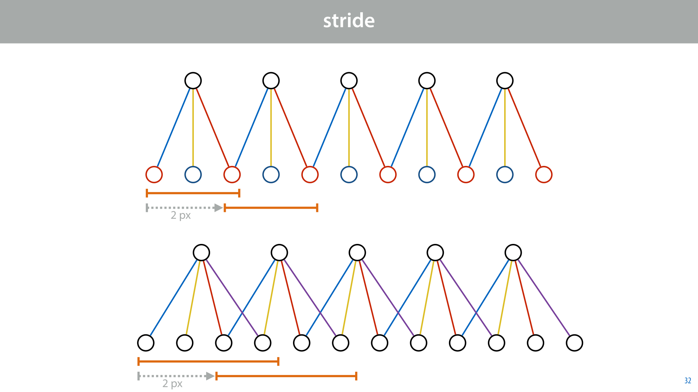

            <figcaption>
            
In 1D, we can clearly see the effect of a larger stride. The odd pixels contribute to two output units each, while the even pixels only contribute to one output unit. This creates a kind of checkerboard pattern in the amount of information that feeds into the network from the different pixels.  

This pattern—different input pixels feed into different numbers of output nodes—happens whenever the kernel size is not a multiple of the stride. If we extend the kernel to size 4, we see that (ignoring the edges) every input pixel feeds into exactly 2 hidden nodes. 

<em>It depends on your task whether the above situation is a problem. It can lead to a visible checkerboard artefact if you’re doing image generation. If you’re doing classification, the effect may be more difficult to notice. The checkerboard pattern should show up if you plot your gradients. In depends on your inputs and your tasks whether it’s a problem.</em> 

            </figcaption>
       </section>

       <section id="slide-033" class="anim">
            <a class="slide-link" href="https://dlvu.github.io/cnns#slide-033" title="Link to this slide.">link here</a>
            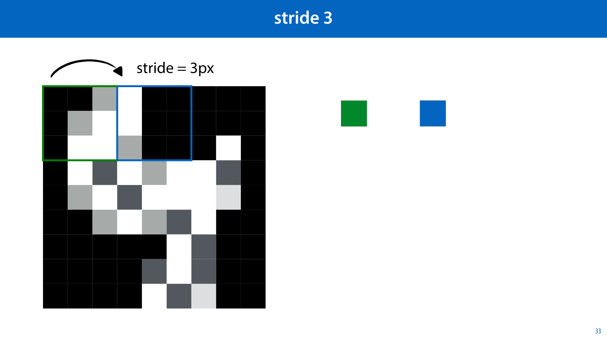

            <figcaption>
            
If the stride is the same as the kernel size, we get a kind of segmentation of the image in non-overlapping blocks, with one output pixel per block. 

            </figcaption>
            click image for animation
       </section>

       <section id="slide-034">
            <a class="slide-link" href="https://dlvu.github.io/cnns#slide-034" title="Link to this slide.">link here</a>
            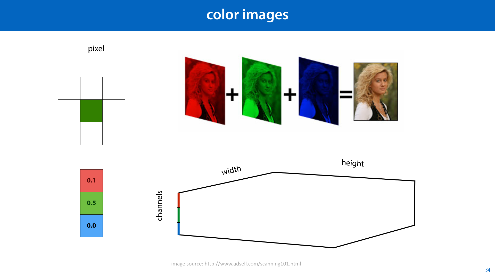

            <figcaption>
            
So far, we have only talked about grayscale images. What do we do if images come in color? 

By far the most common representation of color images in machine learning is the RGB representation. Each pixel is described by three numbers between 0 and 1: how much red there is in it, how much green there is in it and how much blue there is in it. If all numbers are 1, we get white, if all numnbers are 0 we get black.  

This means that a color image is the result of three matrices: one per color channel. If we stack these three matrices, we get a 3-tensor with dimensions “channels”, “width” and “height”. This is how images are usually represented in deep learning. 

            </figcaption>
       </section>

       <section id="slide-035" class="anim">
            <a class="slide-link" href="https://dlvu.github.io/cnns#slide-035" title="Link to this slide.">link here</a>
            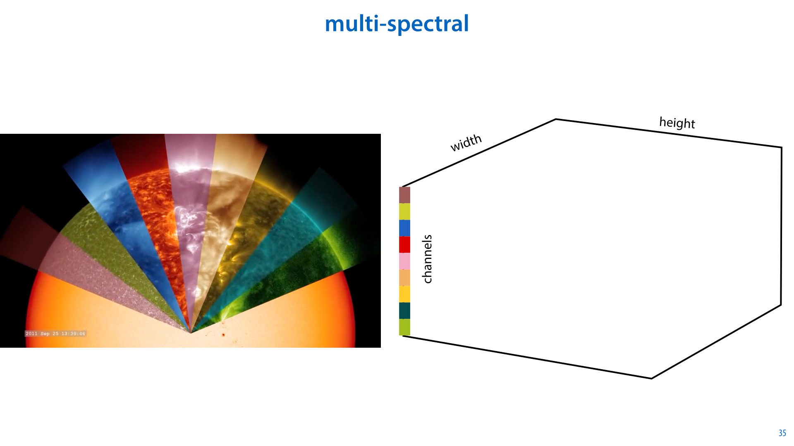

            <figcaption>
            
We can also have other kinds of images with multitple channels. A common example is satellite imagery. Satellites often have cameras that take grayscale pictures at a specific wavelength (if the signal is string at that wavelength, the pixel is bright). They then take these kinds of pictures for several wavelengths and stack them together. This is similar to the RGB image, except that red green and blue are wavelengths that we can see, and satellites usually look at a broader range of wavelengths, far outside what we can see (like infrared and ultraviolet). 

The result is that when you look at satellite imagery, you will get a 3 tensor with more than three channels.

            </figcaption>
            click image for animation
       </section>

       <section id="slide-036">
            <a class="slide-link" href="https://dlvu.github.io/cnns#slide-036" title="Link to this slide.">link here</a>
            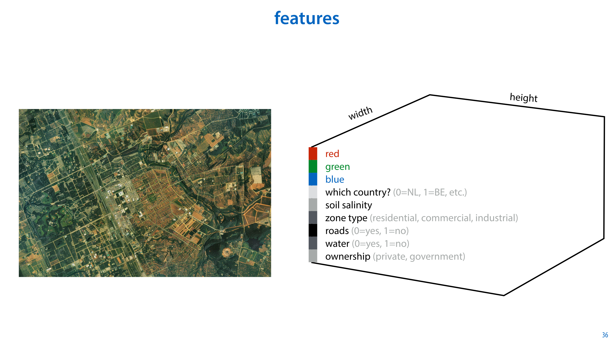

            <figcaption>
            
Another reason you might have more than 3 input channels is if you want to add some <em>features</em> to the pixels in your data. The slide shows an example: imagine you have a satellite photograph of earth.  
<aside    >These are usually multi-spectral too, but here we’ve assumed that it’s been converted to RGB.  </aside>
Since each pixel corresponds to a point on Earth you can annotate it with what you know about that point: what country it belongs to, the state of the soil and so on. You can encode this into a feature vector, as you would do with any normal machine learning instance, and add each feature as a channel.  

If the features are useful in your downstream task, the convolution will pick them up and work them into your pixel representations.

            </figcaption>
       </section>

       <section id="slide-037">
            <a class="slide-link" href="https://dlvu.github.io/cnns#slide-037" title="Link to this slide.">link here</a>
            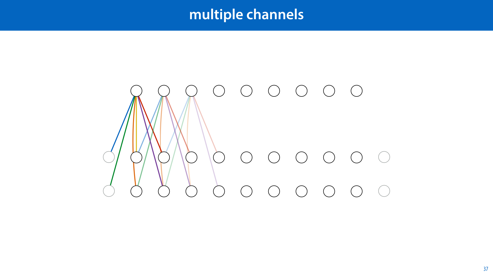

            <figcaption>
            
This means that we need to extend our convolution to handle multiple channels.  

The standard approach is to add new weights for the new channel. Note that these are repeated along the spatial dimension(s) just like the other weights. The same approach is used to create multiple output channels.

            </figcaption>
       </section>

       <section id="slide-038">
            <a class="slide-link" href="https://dlvu.github.io/cnns#slide-038" title="Link to this slide.">link here</a>
            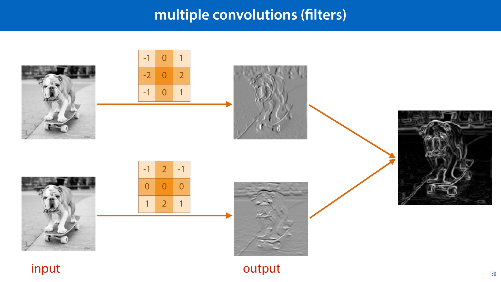

            <figcaption>
            
What we saw in the previous section was that while one convolution by itself could be useful, combining multiple convolutions (with a non-linear pixel-wise operation) could be an even more powerful. 

This suggests that if we run multiple learned convolutions in parallel and apply nonlinearities, we may learn to do things like edge detection automatically, if it’s useful for our task. 

            </figcaption>
       </section>

       <section id="slide-039">
            <a class="slide-link" href="https://dlvu.github.io/cnns#slide-039" title="Link to this slide.">link here</a>
            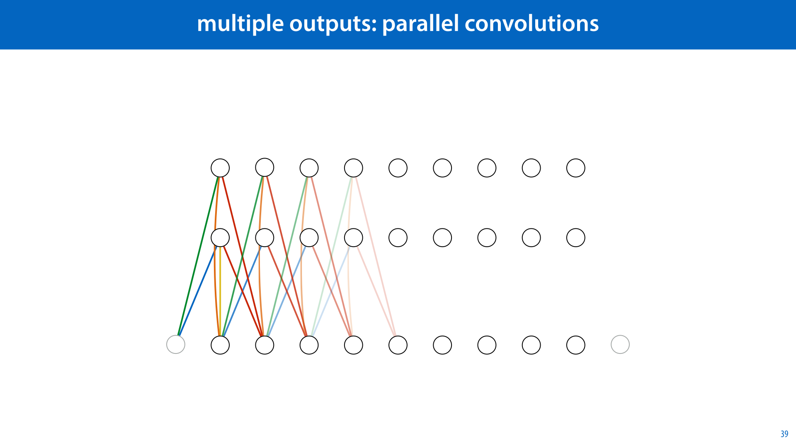

            <figcaption>
            
To apply multiple convolutions in parallel, we can just add the result of the second convolution as an extra channel in the output. This way, the output gets multiple channels, just like input.  

Unlike the color/multi-spectral images, these channels don’t have clear meanings: they contain just whatever information the network has learned to extract from the neighborhood around the current pixel. 

            </figcaption>
       </section>

       <section id="slide-040">
            <a class="slide-link" href="https://dlvu.github.io/cnns#slide-040" title="Link to this slide.">link here</a>
            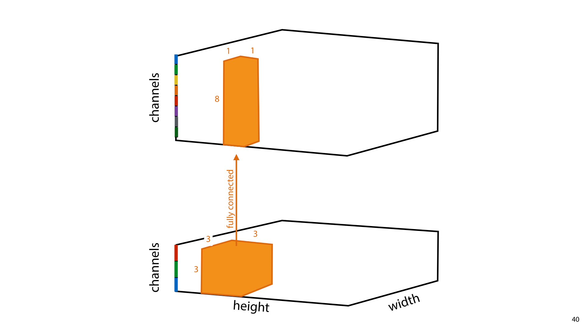

            <figcaption>
            
We can (and do) of course combine both ideas. We usually have multiple input channels and multipe output channels The simplest way to think about this kind of convolution is that in maps input <em>patches</em> to output <em>pixels </em>(all channels in the input patch to all channels in the output pixel). 

Between all nodes in the input patch and all nodes in the output pixel, everything is connected with everything else, with a uniqueweight for every pair of an input and an output node: it’s like a local fully connected network. the wieghts of this network are shared for every place we can put an input patch in the input image.  
<aside    >If the input to this layer is the raw image, then the channels of the input have clear meanings: the levels or red, green and blue in each pixel of the input. This is no longer true for the channels of the tensor at the top. We still call them channels, but what they represent is entirely dependent on the weights of the network.</aside><aside    ></aside>
            </figcaption>
       </section>

       <section id="slide-041" class="anim">
            <a class="slide-link" href="https://dlvu.github.io/cnns#slide-041" title="Link to this slide.">link here</a>
            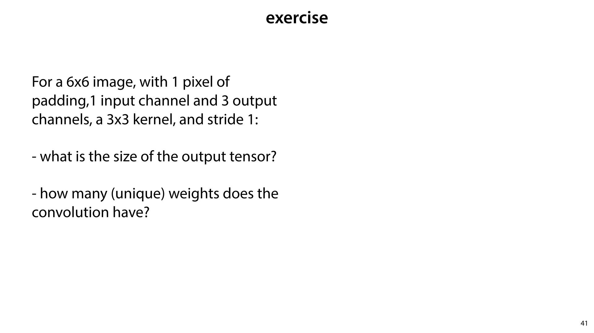

            <figcaption>
            
Here’s an exercise to see if you get the basic idea. 

Note first that the padding gives us an 8x8 image. Sliding a 3x3 kernel over this image, we see that we can fit 6 such kernels horizontally (this is one per column, minus 2 because the kernel window hits the right edge). The same thing holds for the rows, to we get 6 by 6 distinct windows. Since the output has 3 channels, we repeat this trick with 3 different kernels, so that we get an output tensor with dimensions 3 x 6 x 6. 

Each 3 x 3 kernel has 9 weights, and there are repeated at each position in the image. That means that no matter how big the image is, we never get more than 9 weights. However, the output has 3 channels, so we have 3 different kernels. The result is that we have 3 · 9 = 27 distinct weights.

            </figcaption>
            click image for animation
       </section>

       <section id="slide-042">
            <a class="slide-link" href="https://dlvu.github.io/cnns#slide-042" title="Link to this slide.">link here</a>
            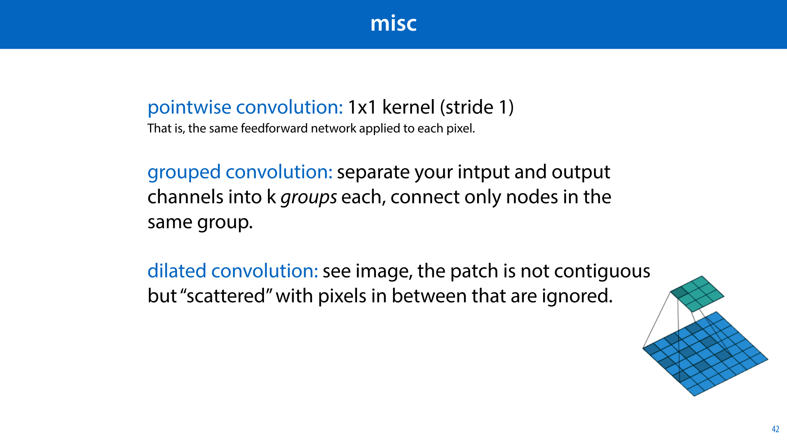

            <figcaption>
            

            </figcaption>
       </section>

       <section id="slide-043">
            <a class="slide-link" href="https://dlvu.github.io/cnns#slide-043" title="Link to this slide.">link here</a>
            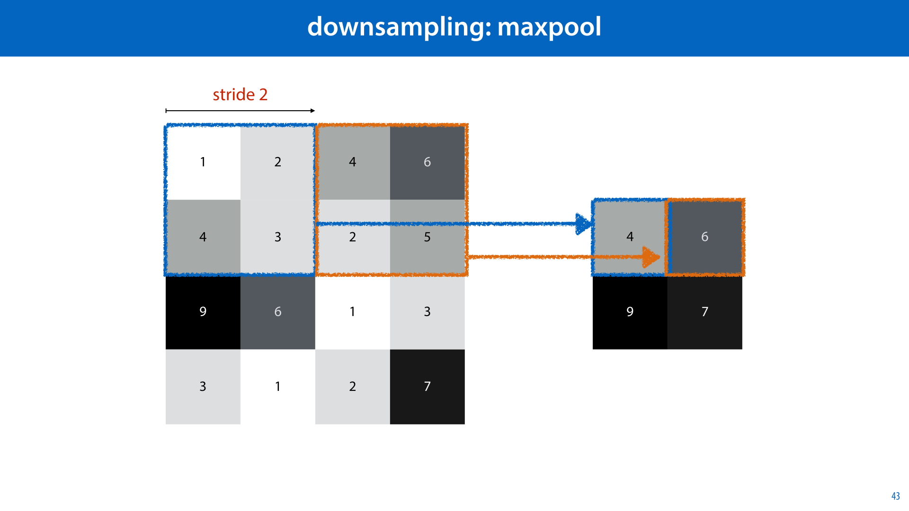

            <figcaption>
            
We chain these convolutions together, but after a while (as the number of channels grows) we’d like the resolution to decrease so we’re gradually looking a lower resolution version of the image, but we have more information (more channels) about each part of the image.  

The most common for of downsampling is maxpooling.  

The max pooling operation it divides the image into n-by-n patches, and returns the maximum value from each square. Average pooling (returning the average over each patch) is also possible, but max pooling is usually more effective.  
<aside    >Most likely, this is because during the backward pass, the whole gradient flows back down one of the pixels, instead of dividing over all four. This gives the backpropagation a sparse character: it focuses only on the most important paths in the computation graph instead of dividing its attention over all of them. </aside>
Note that the maxpool is a layer without weights. It just removes some of the information coming in based on what the layers below it have done. We need to backpropagate through it to train the layers below, but it doesn't have any trainable properties of its own.

            </figcaption>
       </section>

       <section id="slide-044">
            <a class="slide-link" href="https://dlvu.github.io/cnns#slide-044" title="Link to this slide.">link here</a>
            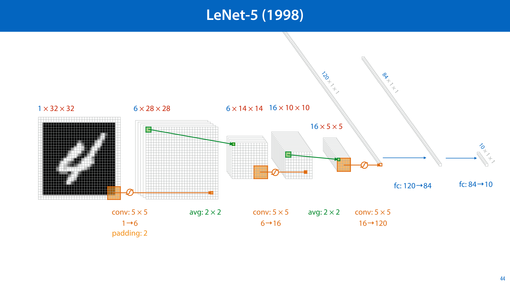

            <figcaption>
            
To see how convolutions are used in a complete architecture, here is the LeNet, one of the first successful, end-to-end trained convolutional neural nets. 

It contains three 5×5 convolutions without padding. As we increase the information per pixel, (by extracting more channels) we occasionally downsample the image: that is, we reduce the number of pixels. The downsampling is done by average pooling. Each convolution and fully connected layer is followed  by a sigmoid, except for the last layer, which has a softmax activation (so that the 10 output units map to the 10 classes in MNIST). 

The idea of this architecture, and of pretty much each subsequent convolutional network, is to reduce the height and width of the tensor representing the image step by step, and at the same time to increase the number of channels per pixel. Essentially, the spatial information encoded in the output activations (where in the pixel grid are things happening) is becoming coarser and coarser, but the semantic information (what is happening) is becoming richer and richer, because we have more and more channels, which are fed with more and more layers.  

In the end, we have one pixel that represents the whole image in 120 “channels”. That is, we have lost all spatial information, but these 120 channels hopefully capture everything that is going on in the whole image. That means that this 120 element vector can now be used to decide on our classification of the image.  
<aside    >Most convolutional networks these days don’t reduce things all the way down to 1×1 like this. They just flatten the tensor when the resolution is low enough.</aside><aside    ></aside>
            </figcaption>
       </section>

       <section id="slide-045">
            <a class="slide-link" href="https://dlvu.github.io/cnns#slide-045" title="Link to this slide.">link here</a>
            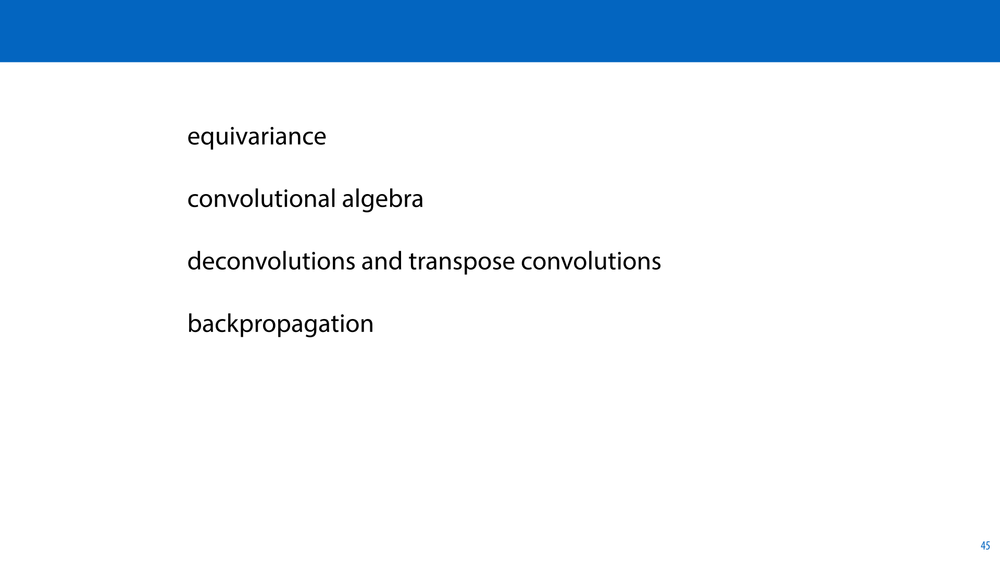

            <figcaption>
            

            </figcaption>
       </section>

       <section id="slide-046">
            <a class="slide-link" href="https://dlvu.github.io/cnns#slide-046" title="Link to this slide.">link here</a>
            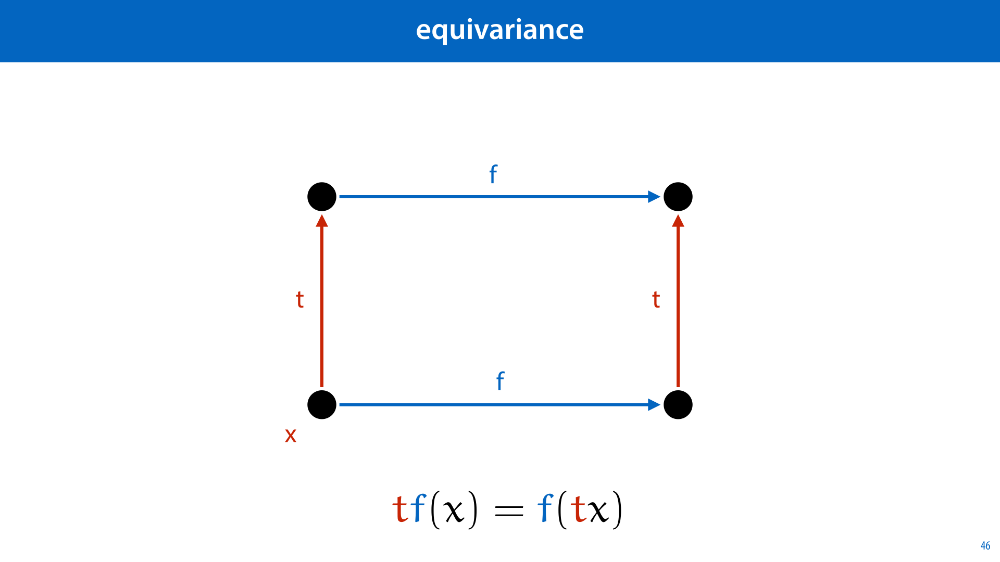

            <figcaption>
            
<em>Equivariance</em> is a simple idea that will come up a lot in deep learning. It’s a powerful intuition behind why some of our architectures work so well, and for what we might be looking for in new architectures.  

Imagine you have a function f and a transformation t. The transformation can be applied to the input of f or to the output of f.  

The function f is equivariant to the transformation t, if applying the tranformation to x and then feeding x to f results in the same result as feeding x to f, and then applying the transformation afterwards.  
<aside    >This is essentially just saying that the functions f and t commute. The subtlety lies in the perspective: we see t as a transformation of our data, and f as a function we can learn. </aside><aside    ></aside>
            </figcaption>
       </section>

       <section id="slide-047">
            <a class="slide-link" href="https://dlvu.github.io/cnns#slide-047" title="Link to this slide.">link here</a>
            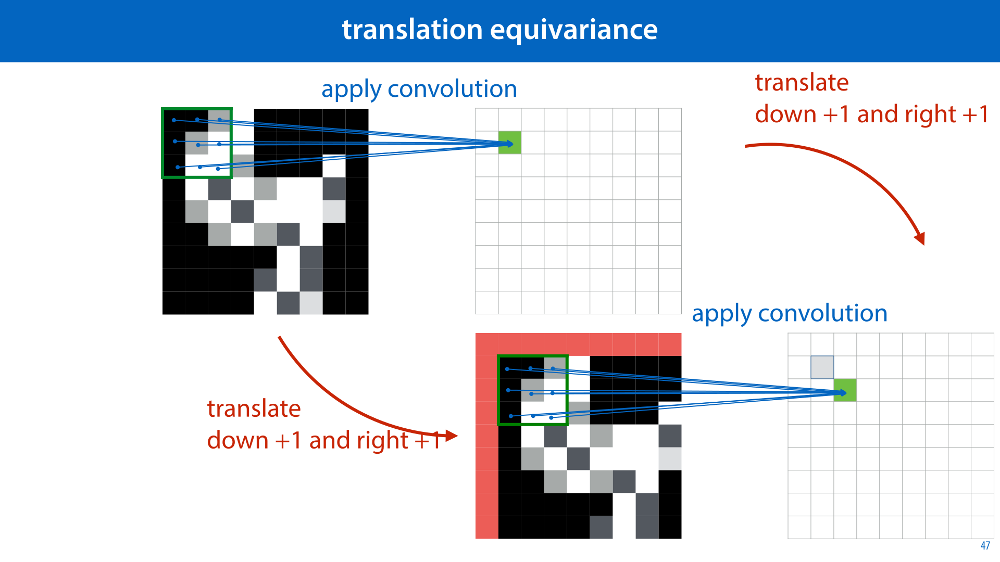

            <figcaption>
            <aside    >The equivarance breaks at the edges. In the theory we usually assume that the image is infinitely tall and wide (so it has no edges) and accept that the theory only applies with a little bit of equivariance breaking around the edges. </aside><aside    ></aside>
            </figcaption>
       </section>

       <section id="slide-048" class="anim">
            <a class="slide-link" href="https://dlvu.github.io/cnns#slide-048" title="Link to this slide.">link here</a>
            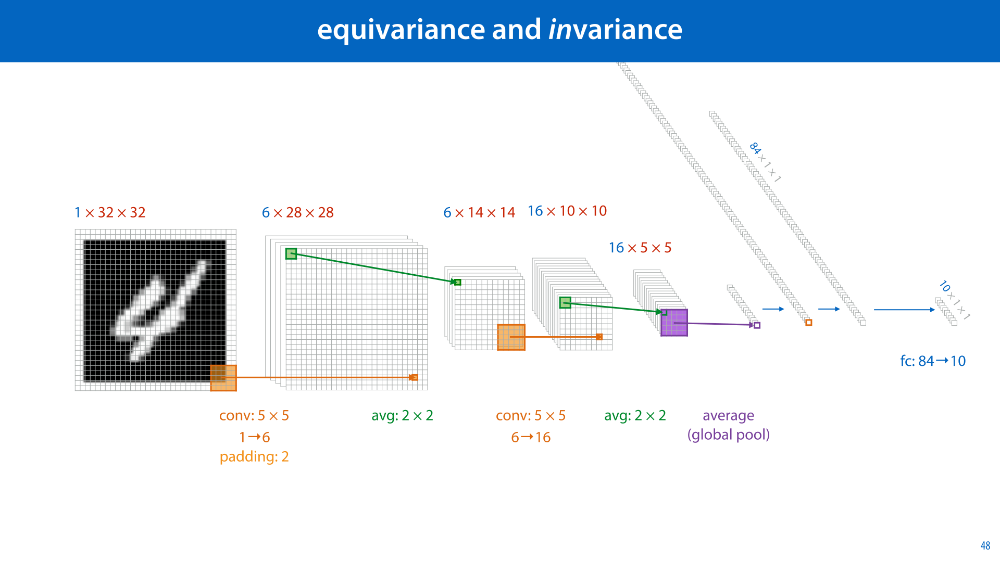

            <figcaption>
            
A powerful idea in deep learning is to make an architecture that consists of many operations that are equivariant to an operation, followed by a global pooling operation that makes the network as a whole invariant to the operation. 

Invariance (to translation) here simply means that the classification that the network doesn’t change what it does if we shift the image left or right.  
<aside    >Again, we have to ignore edge effects. If we shift it so much that the subject disappears out of frame, then the network should no longer be invariant. Assume the image is large enough and the shift small enough that the pixels that disappear don’t affect the classification very much. </aside>
In the slide, we’ve adapted the LeNet slightly to make this clearer. Instead of the last convolution we now do a <em>global pool</em>. This is a pooling operation (like the downsampling ones) that completely eliminates one or more dimensions. In this case, we average out the height and width, leaving only the 6 channels.  

Now, imagine what happens to the output activations if we shift the image. All the values stay the same, except shifted along as well (ignoring the ones near the edges). Once we get to the global pool, all the averages will be the same (ignoring edge effects) and the vector after the global pool will not be affected. This means that the classification will be the same regardless of whether we’ve shifted the picture or not.  

 

            </figcaption>
            click image for animation
       </section>

       <section id="slide-049">
            <a class="slide-link" href="https://dlvu.github.io/cnns#slide-049" title="Link to this slide.">link here</a>
            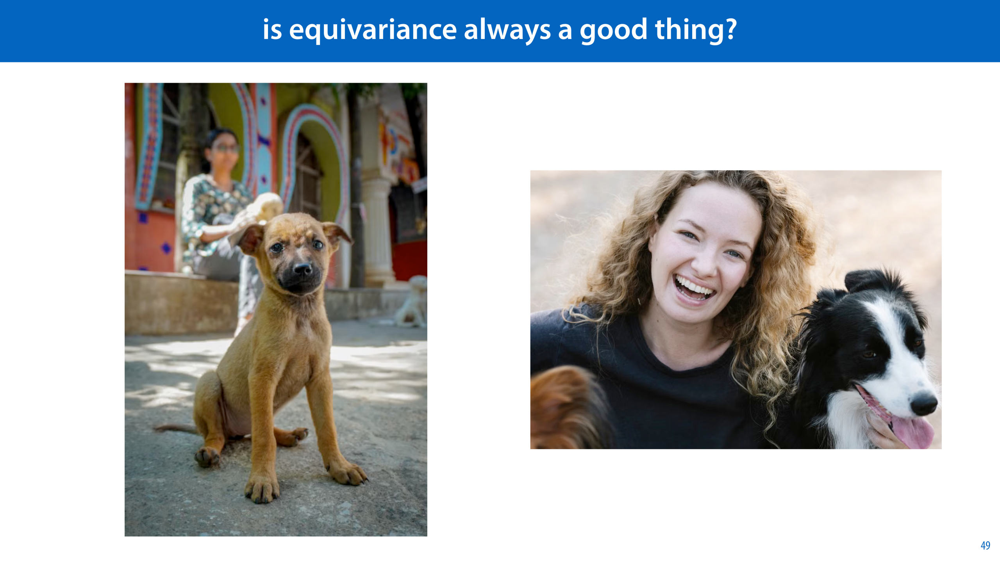

            <figcaption>
            
Imagine classfiying these two images. Among the classes available are “woman” and “dog”. Both pictures contain a woman and a dog, but the one on the left should probably be classified as a picture of a dog that happens to contain a woman, while the picture of the right is probably a pocture of a woman that happens to contain a dog.  

A key piece of evidence for the difference is where the dog’s face appears. In the center, as it does on the left, or off-center as it does on the right.  

A network that is truly invariant do translation would not be able to tell the difference. The presence of a dogs face fill steer the classifier to twards the classification “dog” whether it appears in the center or at the edge of the picture. 

Thus, even equivariance is very powerful, and it essentially means that the network doesn’t need to learn a “dog detector” separately for each location in the image, sometimes we want to allow the network to break the equivariance a little, if it helps. 

            </figcaption>
       </section>

       <section id="slide-050" class="anim">
            <a class="slide-link" href="https://dlvu.github.io/cnns#slide-050" title="Link to this slide.">link here</a>
            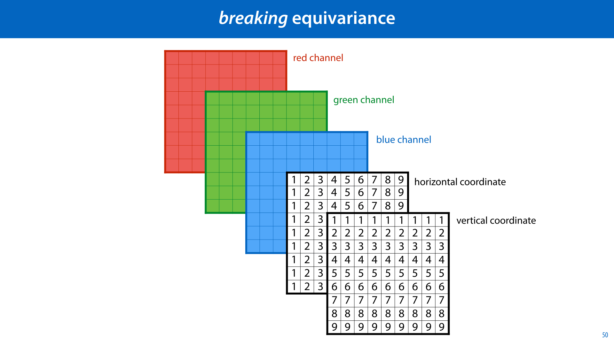

            <figcaption>
            
Designing deep learning architectures is a strange business of a first building in equivariances and then, if necessary, breaking them. The key idea is that sometimes we don’t want full equivarance, we want to start the network off with the option of being equivariant, and also the option to break it.  

Here is a simple trick, call CoordConv (for coordinate convolution). Before we apply the convolution we simply add two channels to our input tensor. These encode the pixel coordinates. If we do this for the first layer of a neural network that consumes color images, the input goes from a 3 channel image to a 5 channel image. However, we can do the same thing for all the intermediate convolution layers. 

This way, the neural network<em> can</em> be equivariant if it “wants” to be: It just sets all weights corresponding to these added inputs to zero, and it behaves as if we never addd them at all. However, if the information in these extra channels is useful, it can learn to use it, and for example, represent a dog’s face slightly differently if it appears in the top right of the picture than if it appears in the center.  
<aside    >You could even initialize the weights for these extra channels to 0, so that at the start of training, the network behaves perfectly equivariantly, and the non-equivariant behavior can slowly emerge with training. In practice, however, this doesn’t seem to be necessary.  </aside><aside    >We’ve used integer coordinates here for simplicity, but in practice you’d want to normalize these to the range (0,1) so the activations don’t blow up. </aside><aside    ></aside>
            </figcaption>
            click image for animation
       </section>

       <section id="slide-051">
            <a class="slide-link" href="https://dlvu.github.io/cnns#slide-051" title="Link to this slide.">link here</a>
            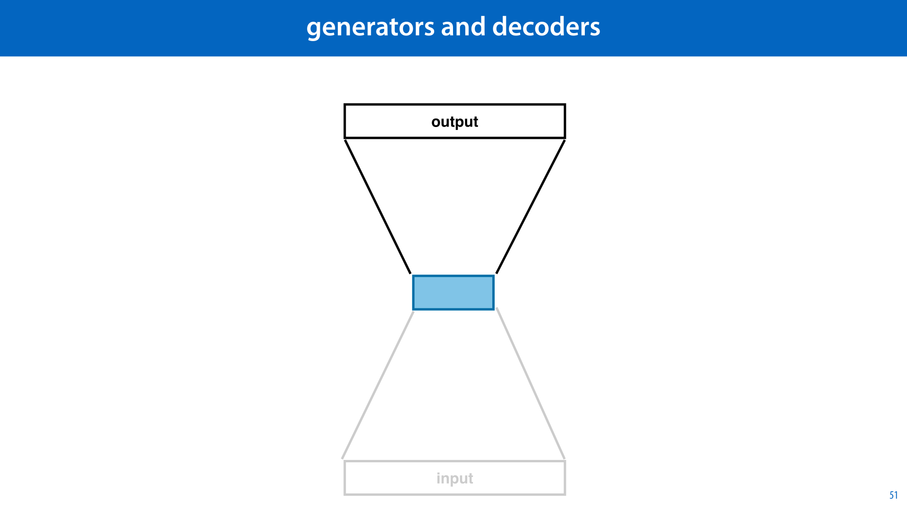

            <figcaption>
            

            </figcaption>
       </section>

       <section id="slide-052">
            <a class="slide-link" href="https://dlvu.github.io/cnns#slide-052" title="Link to this slide.">link here</a>
            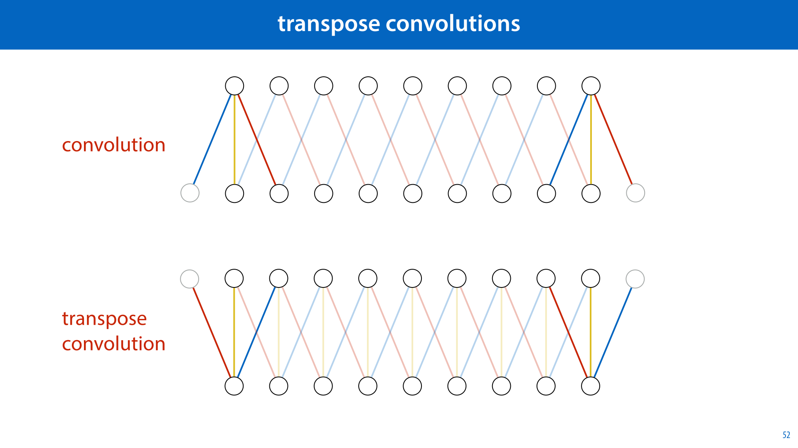

            <figcaption>
            
Transpose convolutions are sometimes called deconvolutions, but this also means something else (the inverse of a convolution), so transpose convolution is preferred. 

            </figcaption>
       </section>

       <section id="slide-053">
            <a class="slide-link" href="https://dlvu.github.io/cnns#slide-053" title="Link to this slide.">link here</a>
            

            <figcaption>
            
In the 2D case, the idea is the same. We just wire a single pixel in the input to a patch in the output.

            </figcaption>
       </section>

       <section id="slide-054">
            <a class="slide-link" href="https://dlvu.github.io/cnns#slide-054" title="Link to this slide.">link here</a>
            

            <figcaption>
            
Looking at it in 1D, it’s easy to see why these are called transpose convolutions: when we look at a convolution as a sparse matrix multiplication, the transpose conolution has the same structure, but with the matrix transposed. 

            </figcaption>
       </section>

       <section id="slide-055">
            <a class="slide-link" href="https://dlvu.github.io/cnns#slide-055" title="Link to this slide.">link here</a>
            

            <figcaption>
            
Transpose convolutions can produce checkboard artifacts when you use a large stride to create the increase in resolution.  
<aside    >Specifially, when the kernel size is not a multiple of the stride. </aside>
The common solution is to use explicit upsampling to increase the resolution and to keep the input and output resolution equal for the convolution layers.  

It turns out you can then just use <em>plain </em>convolutions in your decoder or generator. You can also use transpose convolutions, but the benefit of regular ones is that you can reuse the same building blocks in your encoder and decoder. 

<a href="https://distill.pub/2016/deconv-checkerboard/"><strong>https://distill.pub/2016/deconv-checkerboard/</strong></a> 
<aside    >If you’re now wondering whether you can also wire up arbitrary patches in the input to arbitrary patches in the output, both with their own strides and padding, this can be done, but it doesn’t seem to have been investigated yet. Standard libraries don’t support it. </aside><aside    ></aside>
            </figcaption>
       </section>

       <section id="slide-056" class="anim">
            <a class="slide-link" href="https://dlvu.github.io/cnns#slide-056" title="Link to this slide.">link here</a>
            

            <figcaption>
            
Finally, to use convolutions in a deep learning system, we need to work out its backward. We’ll do this for the 1D convolution here. The 2D version looks the same. You’ll work this out in detail in the CNN version of exercise 3.  

First, we draw the computation graph. Our goal is to work out the gradients for the kernel <strong>k</strong>. <strong>k</strong> are our parameters, so we’ll need the gradient for them to train the convolution. We will also need the gradients for the input <strong>x</strong>. We can’t train the input directly, but we’ll need to backpropagate these gradients if any part of our network feeds into <strong>x</strong>.  

We can draw the upper part of the computation graph, from the output of the convolution to the loss, as one computation. In practice this may consist of many separate modules, but for our analysis, we can see it as one computation node. This is because we can assume that the gradient for our output y has already been compute. The backward is the gradient for the inputs, given the gradients for the output(s). 

            </figcaption>
            click image for animation
       </section>

       <section id="slide-057">
            <a class="slide-link" href="https://dlvu.github.io/cnns#slide-057" title="Link to this slide.">link here</a>
            

            <figcaption>
            
Here is the definition of the 1D convolution, using our earlier indexing convention. 
<aside    >As we noted before, there is an alternative convention to have the sum from -m to m with the kernel size 2m+1 and  with the indices being negative for the input and the kernel. This has some theoretical niceties, but the negative indices get a bit confusing, so we stick with this definition, which indexes all vectors and matrices from 1. </aside><aside    ></aside>
            </figcaption>
       </section>

       <section id="slide-058" class="anim">
            <a class="slide-link" href="https://dlvu.github.io/cnns#slide-058" title="Link to this slide.">link here</a>
            

            <figcaption>
            
The forward function is simple enough to state in scalar terms: Every element of the output vector is just a dot product of a small part of the input (a <em>patch</em>) and the parameters of our kernel. 

To vectorize this, we can just take all these patches, stack them together in a matrix, and compute all the dot products in a single matrix multiplication. 

This operation of slicing out the patches is one of the rare operations for which we can't make do with standard linear algebra operators. The problem is that the patches overlap. We need a function that slices out the right overlapping patches from the input x (the points at which we apply the kernel), and arranges them in a matrix. We call this function get_patches, and we’ll assume somebody has implemented it for us in an efficient way. 
<aside    >In pytorch, this function is called “unfold”. </aside>
Once we have this matrix, we can multiply it with <strong>k</strong> to get the result we need. 
<aside    >@ represents a matrix multiplication. The “None” in the index inserts a dimension, to minimize the risk of broadcasting errors. </aside><aside    ></aside>
            </figcaption>
            click image for animation
       </section>

       <section id="slide-059" class="anim">
            <a class="slide-link" href="https://dlvu.github.io/cnns#slide-059" title="Link to this slide.">link here</a>
            

            <figcaption>
            
Next, we need to figure out the backward. As before, we do this in scalar terms first and then vectorize. 

Note that the gradient for the i-th output is another dot product: of the output gradient, with <em>a patch of the input</em>. 

            </figcaption>
            click image for animation
       </section>

       <section id="slide-060" class="anim">
            <a class="slide-link" href="https://dlvu.github.io/cnns#slide-060" title="Link to this slide.">link here</a>
            

            <figcaption>
            
In fact, the patch slides one step along as we move to the next element of <strong>k</strong>∇. In other words, <strong>k</strong>∇ is a convolution itself! It’s the convolution of the “kernel” <strong>y</strong>∇ with the input <strong>x</strong>.  

This means that we can vectorize the backward with the same get_patches operation we used for the forward.

            </figcaption>
            click image for animation
       </section>

       <section id="slide-061" class="anim">
            <a class="slide-link" href="https://dlvu.github.io/cnns#slide-061" title="Link to this slide.">link here</a>
            

            <figcaption>
            
For <strong>x</strong>∇, the derivation looks similar to that of <strong>k</strong>∇, but we need to be careful when we apply the recipe from the backpropagation lecture.  
<aside    >This is the risk with these mathematical recipes: if you apply them too mechanically, without thinking about what you’re doing, you can occasionally do things that don’t make sense.  </aside>
In this case, we should be careful when applying the multivariate chain rule: a given element of <strong>x</strong> does not feed into <em>every</em> element of <strong>y</strong>: only into a patch.  

As a result, we should apply the chain rule only over that patch. For a node j away from the edges, the patch ranges from j-K to j (where K is the kernel size). This is easy to work into our derivation, we just set bounds on the sum.  

The problem is that at the edges, these bounds run outside the elements of <strong>y</strong>. You can see this in the diagram: x1 actually feeds only into  one element of <strong>y</strong>. We could fix this in the range of the sum, but it would get a bit messy. Instead, we will briefly allow any index on <strong>y</strong>∇. That is, if we index it with a value of zero or lower or larger than its size, we assume its value is 0. That means that those terms disappear from the sum over t, and our application of the multivariate chain rule is correct for all <strong>x</strong>∇j. 

            </figcaption>
            click image for animation
       </section>

       <section id="slide-062" class="anim">
            <a class="slide-link" href="https://dlvu.github.io/cnns#slide-062" title="Link to this slide.">link here</a>
            

            <figcaption>
            
This one takes a little puzzling out to vectorize, but we can see from the shape of the formula that <strong>x</strong>∇ is just a collection of dot products, like <strong>k</strong>∇. Furthermore, note that while the indexing of <strong>k</strong> looks complicated, if we fill in the values of t, we see that the sum just ranges from 1 to K every time. We can make this explicit by renaming the variable we range over to l = j-t+1. 

Note however, that the index runs over <strong>y</strong> <em>backward</em>. We can achieve this by flipping the patches left-to-right after we extract them, or more simply, by flipping the kernel.   

We then see that the sum is just another convolution. The only thing we need to worry about is the index of <strong>y</strong>∇ running out of bounds. We decided earlier that when this happens, the value should be set to 0. For a kernel of size K the index can run at most K-1 elements out of bounds (2 in our example), so if we zero-pad <strong>y</strong>∇ with two elements, we can simply apply the convolution: we extract the patches into a matrix and multiply the matrix by the kernel.  
<aside    >The flipping operation shows the distinction between cross-correlations and true convolutions again. If we make that distinction, then if the forward pass is a cross correlation and the backward pass is a true convolution. The reverse is also true.  </aside><aside    >This makes sense if you think back to the backward for a matrix multiplication, as worked out in the backpropagation lecture. For <strong>y</strong> = <strong>Mx</strong>, the backward is <strong>x</strong>∇ = <strong>M</strong>T<strong>y</strong>∇. Looking back at the drawing of the convolution as a matrix multiplication, we see that for the backward, the transposition of the matrix flips the kernel. </aside><aside    ></aside>
            </figcaption>
            click image for animation
       </section>

       <section id="slide-063">
            <a class="slide-link" href="https://dlvu.github.io/cnns#slide-063" title="Link to this slide.">link here</a>
            

            <figcaption>
            

            </figcaption>
       </section>

       <section id="slide-064">
            <a class="slide-link" href="https://dlvu.github.io/cnns#slide-064" title="Link to this slide.">link here</a>
            

            <figcaption>
            
It’s hard to say who, if anybody invented the convolution. The heart of the idea comes from studies in the 50s and 60s of the visual cortex of cats. They discovered that the visual cortex builds up representations from simple and local to more complex and more global. That is, neurons have a “receptive field” that determines what part of the animal’s field of vision they respond to, and this receptive field grows as you get deeper down the cortex.  

They also discovered that in the simple part, the same detector was copied over many patches of the field of vision, in a sense implementing weight sharing by copying the same network structure many times.  

This inspired Fukushima in 1979 to build the (Neo)cognitron. It used convolutions more or less as we’ve described, but it was trained in an unsupervised manner, and the weights were not left entirely free. A large part of the architecture was a complex handcrafted design inspired by Hubel and Wiesel. 

In many ways, the modern CNN is a simplification of this design, moving away from the biological mechanisms that inspired it.  

image source: Fukushima, Kunihiko (1980). <a href="https://www.cs.princeton.edu/courses/archive/spr08/cos598B/Readings/Fukushima1980.pdf"><strong>Neocognitron: A Self-organizing Neural Network Model for a Mechanism of Pattern Recognition Unaffected by Shift in Position</strong></a>

<a href="https://www.cs.princeton.edu/courses/archive/spr08/cos598B/Readings/Fukushima1980.pdf"><strong></strong></a>

            </figcaption>
       </section>

       <section id="slide-065">
            <a class="slide-link" href="https://dlvu.github.io/cnns#slide-065" title="Link to this slide.">link here</a>
            

            <figcaption>
            
LeNet-5, a convolutional network built by Yann <em>Le</em>Cun, is often seen as the first CNN as we recognize it today. Most of its components had been established already in some form or other, but LeNet-5 collected all the ingredients together, composed them into the relatively simple architecture that later became standard and showed strong performance on the MNIST task. 

This did not cause an immediate watershed. For over a decade people still focused on using non-neural classifiers like support vector machines and explicit feature detectors to do image classification. This was partly because of a community preference for convex optimization (which brings certain theoretical guarantees), but mostly because a deep convolutional network only really shines in a regime of large data. To train a big network on a lot of data, we needed to wait for the hardware to catch up. Around 2010 people started seriously looking at using GPUs to train NNs, which is when the deep learning era really began.  

Who has priority here is a bit controversial. AlexNet’s performance on the ImageNet challenge is often seen as the moment when people began to realize that this method was the way forward. However, before that, the very similar DanNet was already winning many other competitions.  
<aside    >Schmidhuber, whose lab built the DanNet, has for years argued that his contribution (as well as that of people like Fukushima) is erased in the standard narrative.  </aside>
We will sidestep the issue by mentioning them both, but looking in detail at two later networks: the VGG net from 2014 by Karen Simonyan and Andrew Zisserman and the ResNet, introduced in 2015 by researchers at Microsoft.  

The VGG net shows a kind of bare-bones CNN architecture. The ResNet adds some tricks on top of that to allow us to train deeper networks (some of which it introduces and some of which were already known). We’ve chosen the ResNet (over alternatives like the Inception net) because all the tricks it uses are still commonly used today—not just in CNNs, but in almost all deep neural nets. 

            </figcaption>
       </section>

       <section id="slide-066">
            <a class="slide-link" href="https://dlvu.github.io/cnns#slide-066" title="Link to this slide.">link here</a>
            

            <figcaption>
            
We will talk about several innovations to build up these models. Note that most of these weren’t introduces by the VGG or by the ResNet: these architectures are just good ways to show how they are used. 

            </figcaption>
       </section>

       <section id="slide-067">
            <a class="slide-link" href="https://dlvu.github.io/cnns#slide-067" title="Link to this slide.">link here</a>
            

            <figcaption>
            
An important notion in studying how convolutional architectures are designed is the <em>receptive field</em> of a node. 

In the image, the shaded green nodes are the receptive field of the node n in the second hidden layer. They are the nodes that node n can “see”. Or, more precisely, changing the value of these nodes can change the value of n. Changing the value of a node outside of n’s receptive field cannot change the value of n.  

The idea behind almost all CNNs is that nodes in early layers have small receptive fields—they compute pixel representations based on small local neighborhoods. The receptive field of hidden nods grows as we move deeper down the network. 

            </figcaption>
       </section>

       <section id="slide-068">
            <a class="slide-link" href="https://dlvu.github.io/cnns#slide-068" title="Link to this slide.">link here</a>
            

            <figcaption>
            
One of the takeaways of the VGG was that you are better off using multiple layers with small kernels, than one layer with a big kernel.  

The slide illustrates the idea. One 5x5 kernel gets you a 5x5 receptive field. Two 3x3 kernels gets you the same receptive field at the end, but with fewer weights: 5x5=25 for the single layer and 2 x 3 x3 = 18 for the stacked layers. This means that the network is more constrained in what it can do: it has a stronger <em>inductive bias</em>. One place this manifests is in the connections: in the 1D view, the central node in the receptive field has three paths to the output node. The nodes to its side have two paths and the edge nodes only one. This shows that the main source of information is the central node, which the output node represents, with the strength of connection fading out as we move away form the center. This seems a very intuitive property given how we expect the network to behave.  

Another benefit comes when we add non-linearities: we get two non-linearities on the right and only one on the left. With this, the network on the right can actually compute functions that the network on the left cannot.  
<aside    >So we’re moving in two directions: the network structure means that the stacked network can represent fewer functions, but the nonlinearities mean that it can compute more functions. This is no bad thing, we strengthen the inductive bias in one direction, which is clear and well understood, and then we loosen in again in another direction. </aside>

            </figcaption>
       </section>

       <section id="slide-069">
            <a class="slide-link" href="https://dlvu.github.io/cnns#slide-069" title="Link to this slide.">link here</a>
            

            <figcaption>
            
So, we’re building deeper networks, with more non-linearities. This is a general trend that started in earnest in the 2010s and continues to this day. 

One consequence is that we need to think seriously about gradient propagation.  

The key issue is that whatever a deep model learns to do starts with the first layer. The features it learns there determine entirely what the other layers should do. 

The problem if there is any non-linearity, the gradient will <em>weaken</em> as it backpropagates down the network. The weaker the gradient, the slower we learn. This is one of the main problems of deep learning: the layers that we most need to start learning quickly, get the weakest gradients under backpropagation. 

            </figcaption>
       </section>

       <section id="slide-070">
            <a class="slide-link" href="https://dlvu.github.io/cnns#slide-070" title="Link to this slide.">link here</a>
            

            <figcaption>
            
To see why this happens, imagine a network with just a single weight per layer, no biases, and sigmoid activations 

We see that for positive inputs the activations get squished into the interval (0, 1). Large activations are mapped to 0 and 1 and small activations are mapped to 0.5.  

As we saw in the backpropagation lecture, the gradient for the input of a sigmoid activation is the gradient of the output, multiplied by the local derivative. 

            </figcaption>
       </section>

       <section id="slide-071" class="anim">
            <a class="slide-link" href="https://dlvu.github.io/cnns#slide-071" title="Link to this slide.">link here</a>
            

            <figcaption>
            
The very largest derivative the sigmoid will give us is 0.25. This means that as it propagates down the network, the gradient now shrinks exponentially in the number of sigmoids it encounters. For every layer, it shrinks by a factor of 4.  

We could fix this by squeezing the sigmoid, so its derivative is 1 in the middle, but that would increase the regions where the sigmoid is close to flat. If backpropagation encounters anything in these regions (the saturated regions), the gradient is multiplied by something very close to zero, so it dies immediately. We would end up with worse gradient propagation, unless the inputs were always very close to 0.5. 

For this reason the sigmoid was eventually abandoned as the favored activaiton for the hidden node. 
<aside    >Note that it’s still popular for the output layer if we need values between 0 and 1. For one layer we can take the hit in our gradients. </aside><aside    ></aside>
            </figcaption>
            click image for animation
       </section>

       <section id="slide-072">
            <a class="slide-link" href="https://dlvu.github.io/cnns#slide-072" title="Link to this slide.">link here</a>
            

            <figcaption>
            
A more popular activation these days is the recitfied linear unit. 

The ReLU activation preserves the derivatives for the nodes whose activations it lets through. It kills it for the nodes that produce a negative value, of course, but so long as your network is properly initialised, about half of the values in your batch will always produce a positive input for the ReLU. 

One way to think about the difference between the sigmoid and the ReLU is that the sigmoid preserves a gradient for every weight, but shrinks the magnitude exponentially. The ReLU exponentially shrinks <em>the number</em> of paths in the computation graph for which it preserves a gradient, but for those units it preserves the<em> magnitude </em>perfectly. This is much preferable. In gradient descent, we take many steps, so it's fine to take a step for only an arbitrary subset of our weights each time.  
<aside    >Note that the weights themselves can still shrink the gradient, even if the ReLU preserves it perfectly. We’re only looking at the effect of the nonlinearity here. To stop the weights from shrinking the gradient, we must initialize them correctly, which we’ll talk about in a future lecture.  </aside>
The only thing we must watch out for is that for each weight there is some input for which the weight gets a gradient. If any input to a ReLU is negative for all possible inputs to the network, its derivative will always be 0 and it will never change. This is what we call a <strong>dead neuron</strong>. 

One way to avoid dead neurons is to make sure that the inputs to the ReLU are normalized in some way: if they always look normally distributed, then you can expect half of them to get a gradient. This is the reasoning behind many initialization schemes, as well as behind the normalization layer, which we we see later in this section.  

            </figcaption>
       </section>

       <section id="slide-073">
            <a class="slide-link" href="https://dlvu.github.io/cnns#slide-073" title="Link to this slide.">link here</a>
            

            <figcaption>
            
While the ReLU is still a perfectly sound non-linearity, there are a few variations that are sometimes preferred.  

The <strong>Leaky ReLU</strong> takes the idea of the ReLU, but gives the negative domain a slight slope (usually something like 0.01). This means that dead neurons are not quite dead, and get a small chance to escape into the positive domain, where they will get strong gradients again.  

The GELU and SILU are smooth functions that approximate the ReLU.  
<aside    >There are more complex variants, like SwiGLU which are popular today, but we’ll keep it simple for now. </aside><aside    ></aside>
            </figcaption>
       </section>

       <section id="slide-074">
            <a class="slide-link" href="https://dlvu.github.io/cnns#slide-074" title="Link to this slide.">link here</a>
            

            <figcaption>
            
The VGG net used both tricks: deep stacks of many layers with small kernels and a ReLU activation.  

The VGG Net was one of the first networks built around “blocks”: a set of layers arranged in a standard way that could be repeated a variable number of times. This allowed the researchers to study in a controlled way how architectural hyper-parameters should be tuned as networks get bigger.  
<aside    >We’ve drawn the block with two convolutions for simplicity, but the number of layers per block was also a hyperparameter.  </aside>
After the convolutional blocks and before the fully connected layers, the output tensor is <em>flattened</em>. That is, the convolution outputs a 4-tensor of size (batch, channels, height, width). In the LeNet, the height and width have were reduced to 1 at the end and all we needed to do was to remove the last two dimensions (using the squeeze operation). Usually, however, not all spatial information has been removed by the max pooling and we end up with a 4-tensor of very low spatial resolution and a large number of channels, say (batch, channels=1024, height=4, width=4). In that case, we can remove the spatial structure by flattening this tensor into a tensor of size (batch, 1024*4*4).  

That is, all the elements of the tensor are still there, but we don’t care how they’re arranged in a grid anymore. The fully connected layers will learn how to map the information to classes.  
<aside    >Flattening is usually done with a “view” operation, which you will learn about in the homework. This keeps the elements of the tensor in the order they are arranged in memory, which is the cheapest way. since we no longer care about the structure (except to keep the instances in the batch separate) this is the logical choice. </aside><aside    ></aside>
            </figcaption>
       </section>

       <section id="slide-075">
            <a class="slide-link" href="https://dlvu.github.io/cnns#slide-075" title="Link to this slide.">link here</a>
            

            <figcaption>
            
ReLUs allowed us to train deeper networks , but not <em>arbitrarily</em> deep ones. As we went deeper, the problems of gradient propagation reared their heads again, and we needed further tricks to help the gradient propagate effectively all the way down the network. 

            </figcaption>
       </section>

       <section id="slide-076">
            <a class="slide-link" href="https://dlvu.github.io/cnns#slide-076" title="Link to this slide.">link here</a>
            

            <figcaption>
            
Even with sound initialization in a very deep neural net, your gradients and activations will start to wander away from the standard mean and covariance. One good way to avoid this—both at initialization and as training takes hold—is to insert a layer that specifically <em>normalizes</em> its input, whatever the values. 

Normalization is a standard operation in machine learning: you subtract the mean of each feature and divide by the (sample) standard deviation. This makes the data look like a standard normal distribution as much as possible with a linear operation.  

The idea behind <strong>batch normalization</strong> is that you can also do that in the middle of your network: after you’ve computed a hidden layer, you normalize it (element-wise) by computing the mean of each unit and the standard deviation<em> over the current batch</em>, and applying the normalizing operation. It’s a simple computation, so you can implement it in any autodiff system and backpropagate through it. 

Optionally, we can add two learnable parameters: an element-wise multiplication and a bias. This gives us the best of both worlds: the output of the batch norm can have any mean and variance, but we still get perfectly controlled gradients (this last step is linear, so the gradients are scaled linearly as well). 

            </figcaption>
       </section>

       <section id="slide-077">
            <a class="slide-link" href="https://dlvu.github.io/cnns#slide-077" title="Link to this slide.">link here</a>
            

            <figcaption>
            
Batch norm is a typical example of a mechanism that can <em>leak</em> during evaluation. If we use batch norm the same way in evaluation as we do during training, we are aggregating information over the batch dimension. This is not usually a realistic way to use a neural net. In production, instances come in one at a time. Even if they don't in your setting and you can actually batch them together, you are likely comparing to a model that doesn't. 

Moreover, your evaluation performance is now an average of several independent samples of the performance on a single instance.  

To eliminate this unfair advantage, batch norm behaves differently during evaluation than during training. Like the data normalization should do, it takes the mean and variance from the<em> training </em>data and normalizes by that. Since it's difficult in a library like pytorch to compute the training data mean/variance from inside a layer (in some cases, there may not be fixed dataset at all), batch norm usually computes a running mean and a running variance using the exponential moving average to use during evaluation. 

This does mean that when you use batch norm your network needs to know whether it’s training or predicting. All DL libraries have a simple functionality for telling your network this, but if you forget to do so, you are inflating the performance of your network.

            </figcaption>
       </section>

       <section id="slide-078">
            <a class="slide-link" href="https://dlvu.github.io/cnns#slide-078" title="Link to this slide.">link here</a>
            

            <figcaption>
            
The batch dimension isn't the only dimension along which you can normalize. You can pick other directions and even subsets of the dimensions of your batch tensor. Depending on which dimension you pick this is called instance normalization, layer normalization or group normalization. 

Not normalizing over the batch dimension has several benefits. First, you don't have the leakage issue from the previous slide: group normalization can operate in exactly the same way during training and testing (only the batch dimension is "protected"). Second, the performance doesn't degrade for smaller batches. Batch norm requires a large number of instances to get strong estimates. If we don't have many instances in the input, but we do have, for instance, many pixels, then it may be better to normalize in another direction. 

In practice, however, for reasonable batch sizes, batch normalization appears to work best in CNNs, and remains the most popular option for small models. 

Normalization in general works extremely well. In fact much better than some approaches that should work similarly (like controlling normalization through extra loss terms, or explicitly training the initial values to mimic normal activations). Many papers have been written about exactly why this is the case, but there doesn't seem to be a clear answer yet. For now, we can just remember that the basic idea is to stabilize the activations and the gradients. 
<aside    >Interestingly, the benefit sometimes disappears if you remove other architectural components like residual connections. the real reason is likely an interplay between components rather than a global benefit that always works.</aside><aside    ></aside>
            </figcaption>
       </section>

       <section id="slide-079" class="anim">
            <a class="slide-link" href="https://dlvu.github.io/cnns#slide-079" title="Link to this slide.">link here</a>
            

            <figcaption>
            
A <strong>residual connection</strong> is simply connection around a block of layers. We take the input of the block and add it to the output (sometimes multiplied by a single scalar parameter, but this isn't usually necessary).  

In pytorch, it is implemented exactly as in the one-liner show below the diagram.  

This does require that the input of the block has the same dimensions as the output, but it's usually possible to design your network in these kinds of blocks. 

The benefit of the residual connection is that at the start of training, when the gradient signal through the block is weak, there is a second signal through the residual that doesn't suffer this decay. The lower layers can start training based on this signal, and later, when the layers in the block start to do something useful, integrate the gradient from the block. 

 

            </figcaption>
            click image for animation
       </section>

       <section id="slide-080" class="anim">
            <a class="slide-link" href="https://dlvu.github.io/cnns#slide-080" title="Link to this slide.">link here</a>
            

            <figcaption>
            
The name residual comes from the idea that x is a first approximation to the output we want, and the block of layers, instead of modifying to to be close to the output, predicts the <em>residual:</em> the vector we need to add onto x in order to get the correct answer.  

To highlight this perspective, the operation is sometimes drawn with the residual connection down the middle (as the main component of the answer) and the block of layers off to the side (as an additional improvement on top of x).  

In any case, if we look at these as two different paths through the computation graph, we can see the effect on the final gradient on x.  
<aside    >x is not a weight, so we cannot turn its gradient into a gradient descent update step, but the gradient of x propagates back down the network to become the gradient on the weights of the earlier layers.  </aside>
x receives two gradients over the two paths. The residual is just the upstream gradient. It tells us how we would update x if the residual block didn’t exist 
<aside    >Or equivalently, if the residual block was just a constant added to x independent of the ocntent of x.  </aside>
The gradient through the residual block suffers from all the downsides of gradient propagation. If there are many layers, it weakens. If there are few layers, but they don’t contribute meaningfully through the output, they 

            </figcaption>
            click image for animation
       </section>

       <section id="slide-081" class="anim">
            <a class="slide-link" href="https://dlvu.github.io/cnns#slide-081" title="Link to this slide.">link here</a>
            

            <figcaption>
            
The behavior of the residual connection is most intuitive if we allow ourselves a little tweak. Before adding the residual, we multiply by a single scalar weight α. This weight is initialized to 0 (or something very close to zero).  

This is called a ReZero connection. 

At the start of training, the residual block is essentially turned off. All information passes through the central connection. Backpropagation will start opening the connection slightly, giving the residual layers some gradient information to begin learning. The more they contribute usefully,  the more the connection will open (that is the further away from 0 α will move).  

In practice, it turns out this α is not necessary for the residual connection to work.  
<aside    >It’s still a useful trick to bear in mind: a single scalar like α is easy to plot and gives you a lot of information about the learning dynamics of different parts of your network. If the block ends in a normalization layer (which we’ll discuss next), that usually gives you a natural multiplier to intialize to 0.  </aside>
Why does the residual still work without α? If the residual block is very deep, then the gradients passing through the block are weakened and the gradient passing around the block dominates. In practice, the residual block isn’t very deep: we usually put residuals around just one or two non-linear layers.  

The reason it still works without ReZero is down to initialization and normalization. If we initialize the residual layers to small values, we are getting weak gradients through the block on account of the weights themselves, and it’s no surprise that the gradient through the middles dominates. If we give the layers very large gradients, we see that the benefit of residual connections disappears. 

It turns out that with a good initialization, the slight decay of the gradient through a residual block is enough to help learning get started. 

            </figcaption>
            click image for animation
       </section>

       <section id="slide-082" class="anim">
            <a class="slide-link" href="https://dlvu.github.io/cnns#slide-082" title="Link to this slide.">link here</a>
            

            <figcaption>
            
Here is a small experiment to show the effect. We build a small network with one residual connection and train it on MNIST.  

We measure the gradient norm (the magnitude of the gradient vector) at two points: the input to the residual block and the value of the skip connection around it. These two gradients are added together to form the gradient of x. 

We see that at the start of training, we get a much stronger gradient around the block than through. As training progresses and the loss drops, the magnitude of the gradient around the block drops, and the gradient through the block grows.  

<a href="https://gestalt.ink/residual-connection"><strong>https://gestalt.ink/residual-connection</strong></a> 

            </figcaption>
            click image for animation
       </section>

       <section id="slide-083">
            <a class="slide-link" href="https://dlvu.github.io/cnns#slide-083" title="Link to this slide.">link here</a>
            

            <figcaption>
            
There are a few other ways of introducing computational paths around a main block of computation 

In many ways, the residual connection is the simplest of the family. All the others were introduced before the ResNet, and the main takeaway of the ResNet is that the simplest approach is all we need. This is a common pattern in deep learning: we start with complicated architectures and we slowly learn to strip them down to their simplest form. 

            </figcaption>
       </section>

       <section id="slide-084">
            <a class="slide-link" href="https://dlvu.github.io/cnns#slide-084" title="Link to this slide.">link here</a>
            

            <figcaption>
            
The ResNet combines all these features: blocks of convolutions, residual connections, and (batch) normalization layers. 

            </figcaption>
       </section>

       <section id="slide-085">
            <a class="slide-link" href="https://dlvu.github.io/cnns#slide-085" title="Link to this slide.">link here</a>
            

            <figcaption>
            

            </figcaption>
       </section>

</article>
