<nav class="menu">
    <ul>
        <li class="home"><a href="/">Home</a></li>
        <li class="name">Graphs</li>
                <li><a href="#video-000">Learning from graphs</a></li>
                <li><a href="#slide-016">Node embeddings</a></li>
                <li><a href="#slide-040">Evaluation</a></li>
                <li><a href="#slide-054">Graph neural networks</a></li>
        <li class="pdf"><a href="https://dlvu.github.io/pdfs/lecture08.graphs.annotated.pdf">PDF</a></li>
    </ul>
</nav>

<article class="slides">

       <section id="slide-001">
            <a class="slide-link" href="https://dlvu.github.io/graphs#slide-001" title="Link to this slide.">link here</a>
            

            <figcaption>
            
 

            </figcaption>
       </section>

       <section id="slide-002" class="anim">
            <a class="slide-link" href="https://dlvu.github.io/graphs#slide-002" title="Link to this slide.">link here</a>
            

            <figcaption>
            <aside    >We will start by briefly reviewing the basics of graphs. We assume you’ve seen graphs before, so this is just a refresher. If you’ve never done anything with graphs, this might go a bit too quick for you, and you should brush up first. </aside>
This is a graph. A collection of dots joined by lines. The dots are called <strong>nodes</strong> or vertices and the lines are called <strong>links </strong>or edges.  
<aside    >We’ll try to stick with nodes and links.  </aside>
Graphs are very useful, because they are a very versatile way of <em>representing </em>many things. In the context of this lecture, we will focus on <strong>graphs as data</strong>. That usually means that the nodes in the graph represent entities in the real world, and the links represent relations between them.  

In this example, the nodes represent people, and the links express who follows whom on social media. 

            </figcaption>
            click image for animation
       </section>

       <section id="slide-003">
            <a class="slide-link" href="https://dlvu.github.io/graphs#slide-003" title="Link to this slide.">link here</a>
            

            <figcaption>
            
If the links have a direction we call the graph <em>directed</em>. Examples of directed relations are: following someone on social media, owing somebody money, being someone’s parent and so on. If you reverse the arrow, the meaning of the link changes.  

If the links don’t change meaning when you reverse them, we call the graph undirected. Examples of undirected relations that you could make a graph out of are: two cities being connected by rail, people being friends, people having met, and so on.  

If an edge connects a link to itself, we call that a self-loop. Self-loops are sometimes impossible, like being your own parent, or always true, like being a your own family member. If they are always true, they are usually left out. There are however cases in which a self-loop is is useful to allow (that is, it is <em>sometimes</em> true): in a company graph of employees that connects people to the person that approves their expenses, some people may be allowed to approve their own expenses.  

If there can be two or more edges between a given pair of nodes—for example to express different loans from person a to person b—we call that a multi-edge, and if this is allowed, we call the graph a multi-graph.  

A graph that doesn’t have multi-edges or self-loops is called a  <strong>simple graph </strong>(it can be directed or undirected).  
<aside    >There is no name for a graph that has self-loops but no multi-edges. This does happen often, but in thos cases, you just have to spell it out. </aside><aside    ></aside>
            </figcaption>
       </section>

       <section id="slide-004">
            <a class="slide-link" href="https://dlvu.github.io/graphs#slide-004" title="Link to this slide.">link here</a>
            

            <figcaption>
            
One particularly useful type of graph for representing data is a <strong>knowledge graph</strong>. In a knowledge graph, we have edges of different types, so that we can express different relations between entities. You can think of a knowledge graph as several graphs, each expressing a different relation,  joined together.  

You could do this with various types of graphs, but the most common rules for knowledge graphs are: 

All links are directed. 

Self-loops are allowed 

Multi-edges are allowed but only of different relations. A single relation can only connect entities in one direction once. 

We’ll put a special focus on knowledge graphs in this lecture, since they are so useful as representations of datasets. 

  

            </figcaption>
       </section>

       <section id="slide-005" class="anim">
            <a class="slide-link" href="https://dlvu.github.io/graphs#slide-005" title="Link to this slide.">link here</a>
            

            <figcaption>
            
One standard way of representing a knowledge graph is the <strong>Resource Description Framework (RDF)</strong>. This uses URLs for the entities and relations which allows different datasets to refer to the same entities in a coherent way. 
<aside    >They’re actually called IRIs (internationalized resource identifiers). This is to emphasize that they’re names, rather than addresses. Something usually happens when you put them in the address bar of a browser, so they’re URLs as well, but that is not their primary purpose.  </aside>
RDF also allows “literal nodes” which can be used to encode non graph data like numbers, dates, natural language or images as special nodes in the graph. This makes RDF a particularly useful format for integrating different types of multi-modal data. 

            </figcaption>
            click image for animation
       </section>

       <section id="slide-006">
            <a class="slide-link" href="https://dlvu.github.io/graphs#slide-006" title="Link to this slide.">link here</a>
            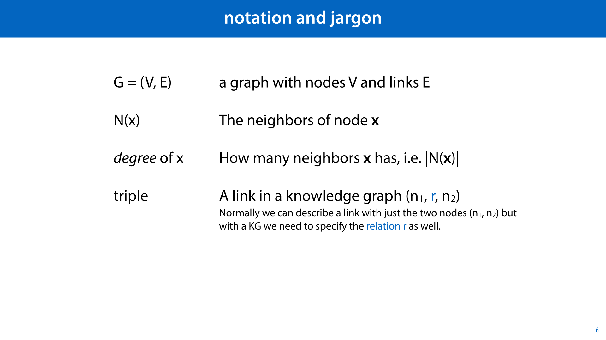

            <figcaption>
            

            </figcaption>
       </section>

       <section id="slide-007">
            <a class="slide-link" href="https://dlvu.github.io/graphs#slide-007" title="Link to this slide.">link here</a>
            

            <figcaption>
            
The adjacency matrix is a way to represent a graph as a matrix. Since matrices (and tensors more generally) are central to deep learning, the adjacency matrix comes up a lot.  

The idea is simple, we put all the nodes in the graph along the rows and columns of the matrix. The order is arbitrary, but we need to use a fixed order.  

Then, if node i is connected to node j, the element at (i, j) in the matrix has a 1, otherwise it has a zero. For an undirected graph, both (i, j) and (j, i) get a 1, so the matrix is symmetric. For a directed graph(i, j) only gets a 1 one if the connection is from i to j. 

            </figcaption>
       </section>

       <section id="slide-008">
            <a class="slide-link" href="https://dlvu.github.io/graphs#slide-008" title="Link to this slide.">link here</a>
            

            <figcaption>
            
We won’t discuss these in this lecture, but there exist graph neural network approaches for all of them.

            </figcaption>
       </section>

       <section id="slide-009">
            <a class="slide-link" href="https://dlvu.github.io/graphs#slide-009" title="Link to this slide.">link here</a>
            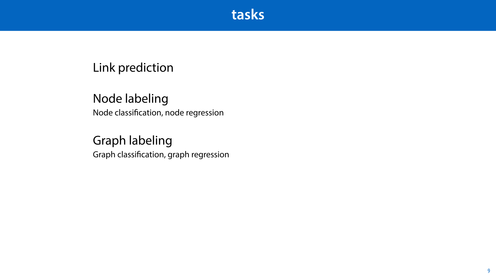

            <figcaption>
            
If you have a graph, these are the main abstract learning tasks you could want to perform on them. 

            </figcaption>
       </section>

       <section id="slide-010" class="anim">
            <a class="slide-link" href="https://dlvu.github.io/graphs#slide-010" title="Link to this slide.">link here</a>
            

            <figcaption>
            
The aim of <strong>link prediction</strong> is to predict links that are missing from the graph. This could be because the graph is genuinely incomplete, but it could also be a good way to predict links that <em>should</em> be in the graph for some reason.  

For example, if we train a model that thinks that Claire is likely to follow Don, then that would be a good recommendation for the social network to make to Claire.

            </figcaption>
            click image for animation
       </section>

       <section id="slide-011" class="anim">
            <a class="slide-link" href="https://dlvu.github.io/graphs#slide-011" title="Link to this slide.">link here</a>
            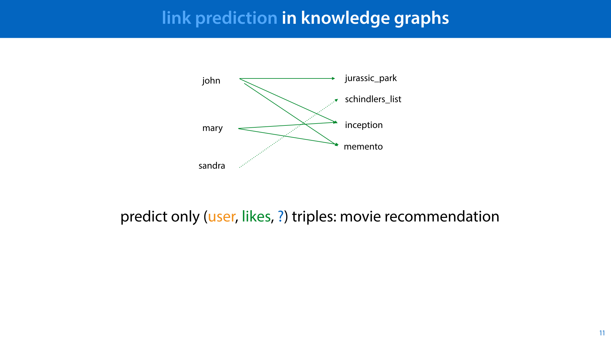

            <figcaption>
            
Link prediction <strong>in knowledge graphs</strong> is especially powerful. It’s like training a whole collection on classifiers and recommender systems in one go.  

If we have just two types of nodes (say users and movies) and one relation (indicating whether the user liked the movie) then link prediction becomes movie recommendation. By expanding the knowledge graph we can include information about the users and about the movies.  
<aside    >The connection between recommender systems and link prediction is a very fertile idea to keep in mind. For more on this, see the recommender systems lecture in our BSc course machine learning here: <a href="https://mlvu.github.io/embeddingmodels/"><strong>https://mlvu.github.io/embeddingmodels/</strong></a> (there’s also a connection to PCA there).</aside><aside    ></aside>
            </figcaption>
            click image for animation
       </section>

       <section id="slide-012">
            <a class="slide-link" href="https://dlvu.github.io/graphs#slide-012" title="Link to this slide.">link here</a>
            

            <figcaption>
            
<strong>Node classification</strong> is another task: for each node, we are given a label, which we should try to predict. 

If we have vector representations for our nodes, we can use those in a regular classifier, but the question is, how do we get those embeddings, and how do we ensure that they capture the required information? 

We can’t just assign node embeddings like before, and apply gradient descent on the classification loss. That would ignore the graph structure entirely and would train each embedding in isolation to produce a particular clasification. We wouldn’t generalize <em>between</em> nodes. 
<aside    > </aside><aside    ></aside>
            </figcaption>
       </section>

       <section id="slide-013">
            <a class="slide-link" href="https://dlvu.github.io/graphs#slide-013" title="Link to this slide.">link here</a>
            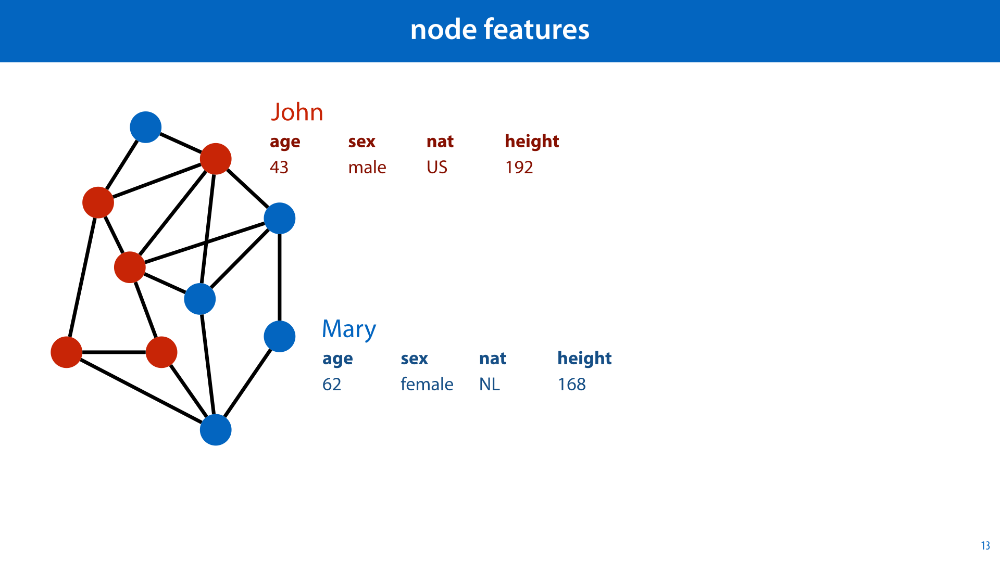

            <figcaption>
            
In many tasks (especially node classification) the nodes also come with feature vectors. These contain information about the nodes.  

You could see these kinds of tasks as a generalization of basic tabular classification, except there are relations drawn between the instances. If you remove all links, then you get a plain old classification task. 

            </figcaption>
       </section>

       <section id="slide-014">
            <a class="slide-link" href="https://dlvu.github.io/graphs#slide-014" title="Link to this slide.">link here</a>
            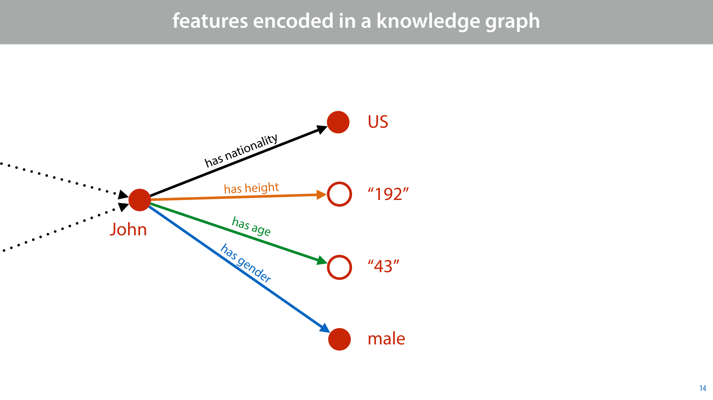

            <figcaption>
            
An alternative approach is to encode the information  you have about the instances as part of  the graph. This requires a knowledge graph. 

This approach has many benefits. It can deal very neatly with missing data (you just leave it out) and you can model things like units for attributes in well-designed ways. The downside is that this puts more weight on the modelling task. Building models that can use this kind of graph well is ongoing research.

            </figcaption>
       </section>

       <section id="slide-015">
            <a class="slide-link" href="https://dlvu.github.io/graphs#slide-015" title="Link to this slide.">link here</a>
            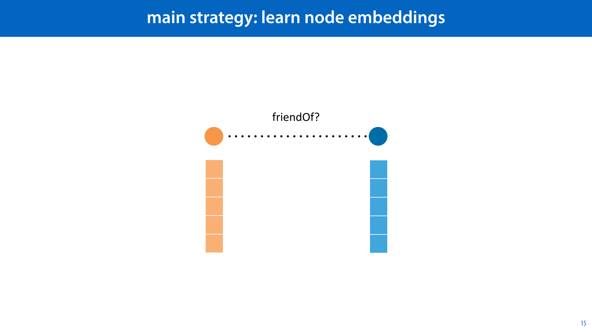

            <figcaption>
            
Finally, you may have a labeling task where the label applies not to one node but t<strong>o a whole graph</strong>. One example is the MUTAG dataset, where the task is to predict whether a particular molecule, represented as a graph, is mutagenic.  

You  can of course also do graph<em> regression</em>, where the task is to assign a <em>number </em>to each graph in the dataset.  
<aside    >The atoms in MUTAG have types. These aren’t drawn here, but they are usually included in the task as node features.  </aside><aside    >Note that in node classification your dataset is one (large) graph, whereas in graph classification it consists of many (small) graphs. There is a symmetry here with what we said for sequences: there are datasets that consist of a single sequence, or datasets that are a set of sequences, each with a label. </aside><aside    ></aside>
            </figcaption>
       </section>

       <section id="slide-016">
            <a class="slide-link" href="https://dlvu.github.io/graphs#slide-016" title="Link to this slide.">link here</a>
            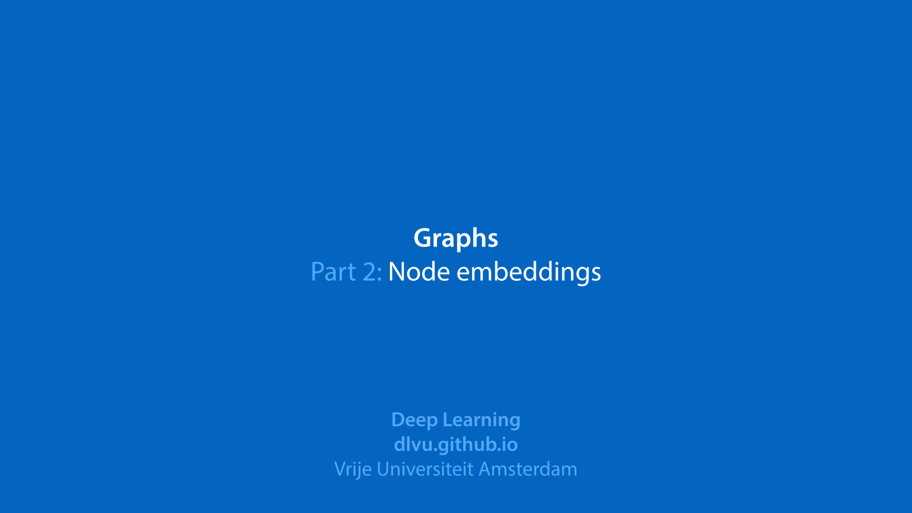

            <figcaption>
            
 

            </figcaption>
       </section>

       <section id="slide-017">
            <a class="slide-link" href="https://dlvu.github.io/graphs#slide-017" title="Link to this slide.">link here</a>
            

            <figcaption>
            
The key idea of link prediction is to come up with node representations that can predict, for two given nodes, whether there is or should be a link between them. For example, if your graph is a friendship  network, you could predict whether these two are or people should be friends. this prediction should be based on two vectors, representing the two people. These vectors are our <em>node representations</em>. 

We then train our node representations to make this prediction as accurate as possible.  

You can think of this as a <em>surrogate task</em>. Sometimes we are actually interested in predicting these links, but even if we aren’t, the resulting node representations can be used in other tasks, like node labelling. 

We’re focusing here on link prediction methods that work by building embedding vectors for the nodes in the graph. There may be other ways to solve the problem, but this is the most popular family of approaches. 

            </figcaption>
       </section>

       <section id="slide-018" class="anim">
            <a class="slide-link" href="https://dlvu.github.io/graphs#slide-018" title="Link to this slide.">link here</a>
            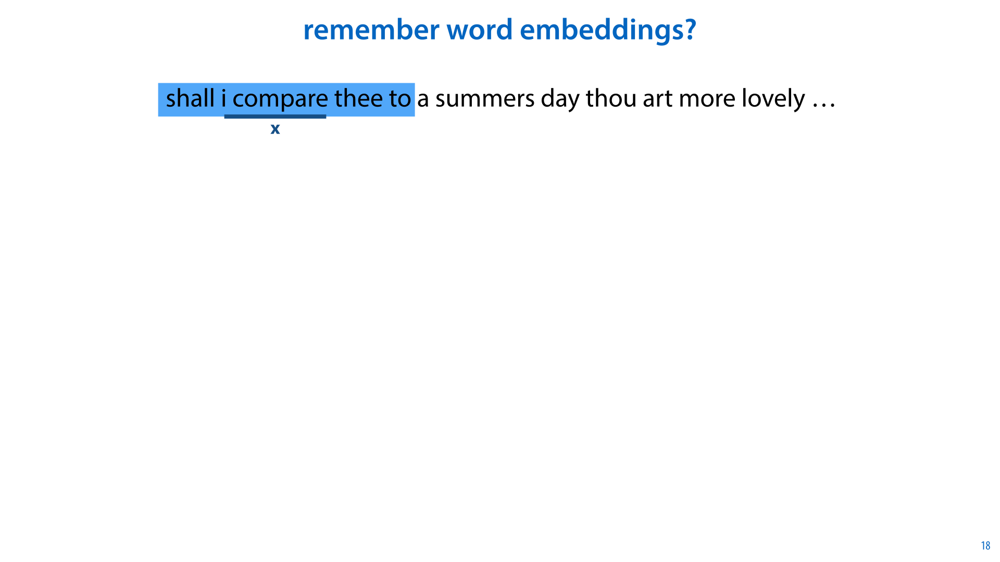

            <figcaption>
            
This is similar to what we did for <strong>word embeddings</strong>. Words for a set for which we have no features. All we know about a word is that it is different from other words, and the same as itself (across places where it occurs). We assign each word an embedding vector, and then use these vectors in a task, which leads to a loss. We train to minimize the loss, giving us optimized embedding vectors as a result.  

In the case of Word2Vec, the actual training task (predicting neighbouring words) was not something we were interested in: it was a proxy task to give us good embeddings.  

Link prediction can be both: a proxy task, or the actual task we’re interested in.  

            </figcaption>
            click image for animation
       </section>

       <section id="slide-019">
            <a class="slide-link" href="https://dlvu.github.io/graphs#slide-019" title="Link to this slide.">link here</a>
            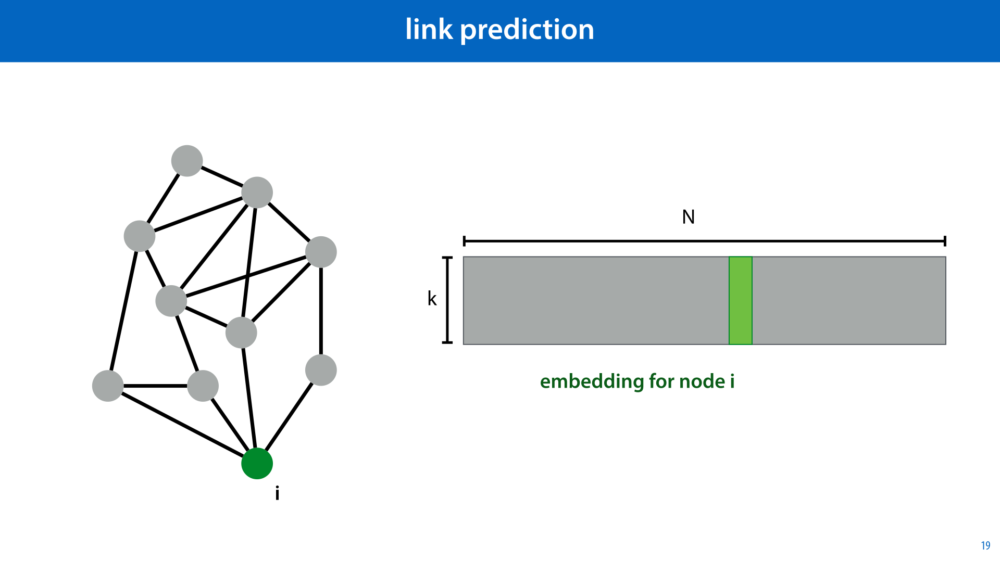

            <figcaption>
            
Assume we have a graph with N nodes. Our job is to generate N vectors representing these nodes. Or if we concatenate them, a matrix with N columns.  

The dimensionality of the embedding vectors, k, is a hyperparameter that we (usually) set ourselves.  
<aside    >Usually setting this too high leads to overfitting and setting it too low leads to underfitting, so it’s easy to tune if you have a validation set.</aside><aside    ></aside>
            </figcaption>
       </section>

       <section id="slide-020" class="anim">
            <a class="slide-link" href="https://dlvu.github.io/graphs#slide-020" title="Link to this slide.">link here</a>
            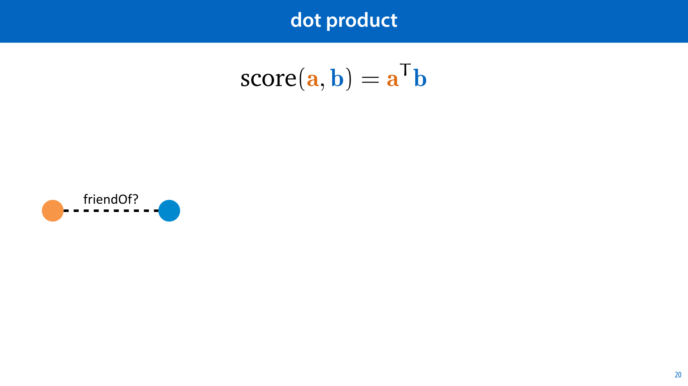

            <figcaption>
            
To figure out how we might train these embeddings, imagine first that we had the resources to manually set features for each node in our graph.  

We’ll stick with our example of a friendship graph. What features might tell us whether two people should be friends? Here we’ve gone with how physically active they are, how introverted they are, and politically conservative they are. We’ll assume (perhaps naively) that if these match between two people then they are more likely to make good friends. 

Each feature is a number between -∞ and +∞. The score is also in the range (-∞, ∞). 

What this shows, is that in this situation, where we have known features, the dot product is a good score to help us predict whether two people are, or should be, friends

            </figcaption>
            click image for animation
       </section>

       <section id="slide-021">
            <a class="slide-link" href="https://dlvu.github.io/graphs#slide-021" title="Link to this slide.">link here</a>
            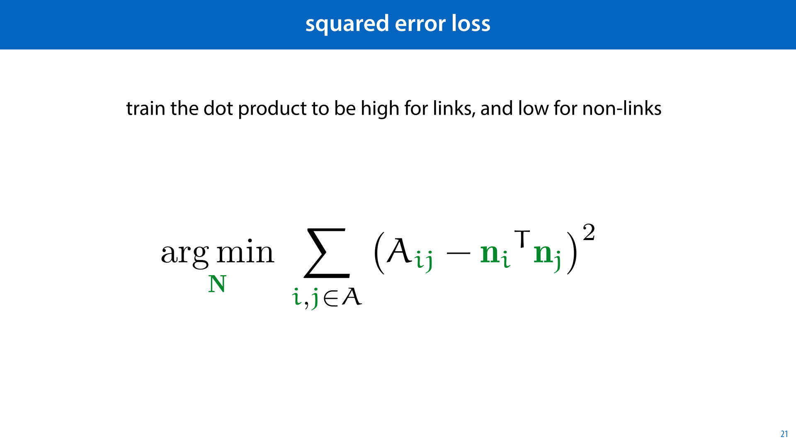

            <figcaption>
            
If we don’t have features, and instead want to learn the values of the embeddings, what we can do is take the dot product and train it to be high for pairs of connected people (friend) and low for pairs of unconnected people (non friends). If A is our adjacency matrix, we can use squared error for our loss and train the dot product to mimic the values in the adjacency matrix. 

This objective is something we can minimize by gradient descent.  

What’s wrong with this idea? 

The dot product needs to mimic value between 0 and 1 

assumes all values are known

            </figcaption>
       </section>

       <section id="slide-022" class="anim">
            <a class="slide-link" href="https://dlvu.github.io/graphs#slide-022" title="Link to this slide.">link here</a>
            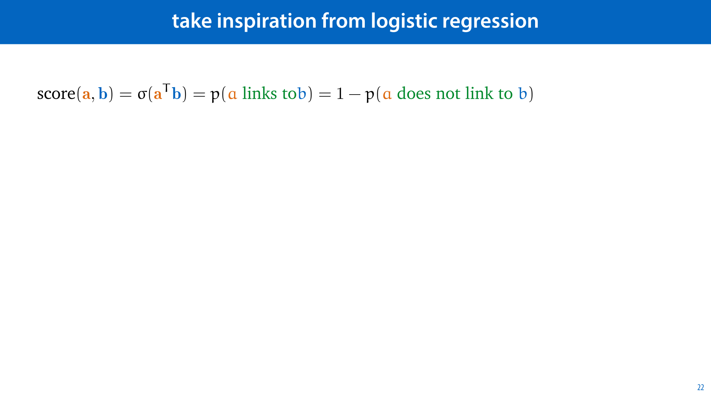

            <figcaption>
            
One common way to get scores that range from 0 to 1 is to model them as probabilities. We take the dot product of the two node embeddings and we pass it through a sigmoid function. We then interpret this as the probability that <strong>node a</strong> links to <strong>node b</strong>.  

Once we have that, we can compute the log-likelihood of the data under our model parameters (all the embedding vectors) and use that as our loss. 

            </figcaption>
            click image for animation
       </section>

       <section id="slide-023">
            <a class="slide-link" href="https://dlvu.github.io/graphs#slide-023" title="Link to this slide.">link here</a>
            

            <figcaption>
            
The next problem is that we often aren’t told which links are false. We will have lots of examples of people are friends, but we don’t have any examples of people who <em>shouldn’t</em> be friends. 

The solution is to assume that the complete graph (of all the people who could ever be friends) is sparse. That is, for a random pair of people the probability is much higher that they should be friends than that they shouldn’t. Moreover as the graph gets bigger, the probability that two random people should be friends goes to zero.  
<aside    >You can express this in big-O notation if you like. The total number of links in a graph grown in the order of the squares of the number of nodes, and the number of friends one person can have grows in the order of log n, so the total number of friendships grows as n log n. For example, if there are ten people, someone has 1 friend on average, if there are 100 people, someone has 2 friends on average, if there are 1000 people, someone has 3 friends on average and so on.  </aside>
If this is the case, then for a large graph, we can simply sample a random pair of nodes and t<em>reat it as a negative</em>. Occasionally we’ll be wrong, but in the vast majority of cases, we’ll be right. Gradient descent is very robust to the occasional bit of noise so we can expect a good model.  

            </figcaption>
       </section>

       <section id="slide-024">
            <a class="slide-link" href="https://dlvu.github.io/graphs#slide-024" title="Link to this slide.">link here</a>
            

            <figcaption>
            
With a bunch of negative samples, we have everything we need to implement this loss function. 

In the pseudocode, we sample one negative link for every positive link, but this proportion is a hyperparameter. Often, sampling many negative links is a strong strategy. 

            </figcaption>
       </section>

       <section id="slide-025">
            <a class="slide-link" href="https://dlvu.github.io/graphs#slide-025" title="Link to this slide.">link here</a>
            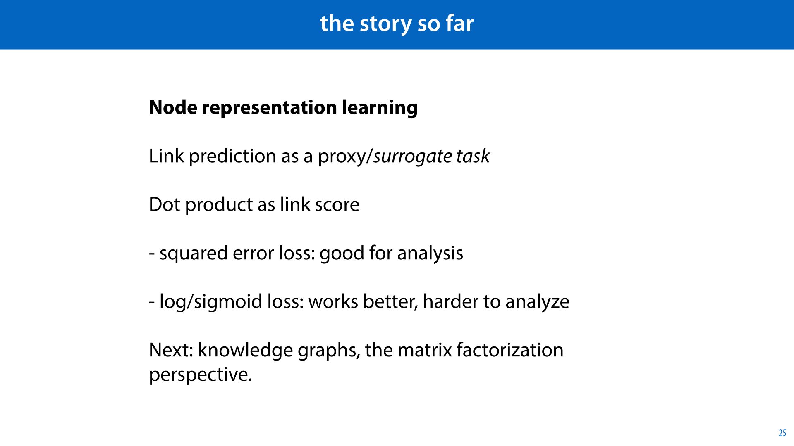

            <figcaption>
            

            </figcaption>
       </section>

       <section id="slide-026">
            <a class="slide-link" href="https://dlvu.github.io/graphs#slide-026" title="Link to this slide.">link here</a>
            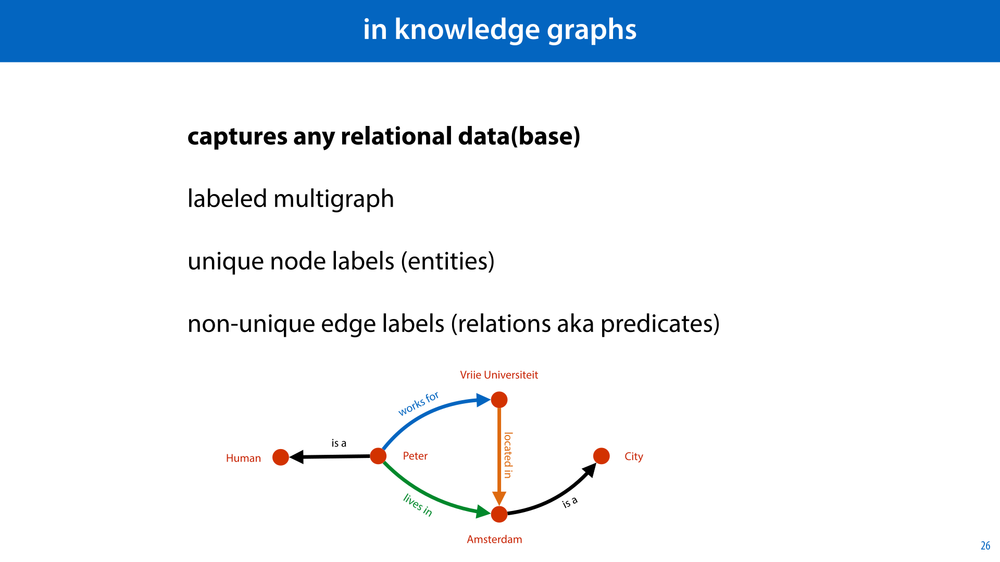

            <figcaption>
            
Link prediction is especially popular in knowledge graphs. This requires some extensions. 

            </figcaption>
       </section>

       <section id="slide-027">
            <a class="slide-link" href="https://dlvu.github.io/graphs#slide-027" title="Link to this slide.">link here</a>
            

            <figcaption>
            
Most centrally, link prediction now becomes triple prediction: we don’t need to predict just whether sandra and memento are connected, but we need to predict <em>which relation</em> connects them. In short we need a score function, as before, but now it has three arguments, the subject, predicate and object of the triple. It returns a score that indicates how likely the triple is.  

If we have a goodscore function, that is quick to compute, we can ask <em>queries</em>. For example, for an incomplete triple like (sandra, likes, ?), we can check what goes best at the place of the question mark. We simply try every single node in the graph, compute the score of the triple for each, and then rank the nodes by their score. The node <strong>x</strong> for which (sandra, likes, <strong>x</strong>) gives the highest score is our best predicted answer to the query.

            </figcaption>
       </section>

       <section id="slide-028" class="anim">
            <a class="slide-link" href="https://dlvu.github.io/graphs#slide-028" title="Link to this slide.">link here</a>
            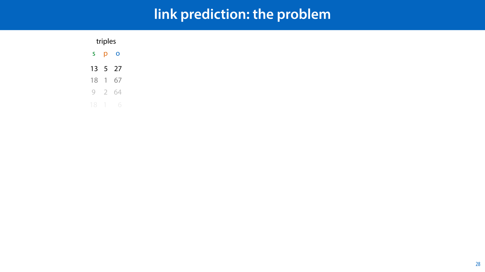

            <figcaption>
            
Link prediction models are evaluated on the task of answering triple queries. We set the data up as a long list of triples, and then withhold a test and validation slice.  

We build a score fuction s using the training data. Then on the withheld data, we pick a triple (s, p, o), withhold the tail (o) and use the score function to predict the what o was. We do the same for s, and see how well the model does.  
<aside    >We could also withhold p, but this is usually left out of the evaluation. Probably because there are fewer important use cases for predicting the relation betwen two given entities.  </aside>
More on the evaluation part later. 

            </figcaption>
            click image for animation
       </section>

       <section id="slide-029" class="anim">
            <a class="slide-link" href="https://dlvu.github.io/graphs#slide-029" title="Link to this slide.">link here</a>
            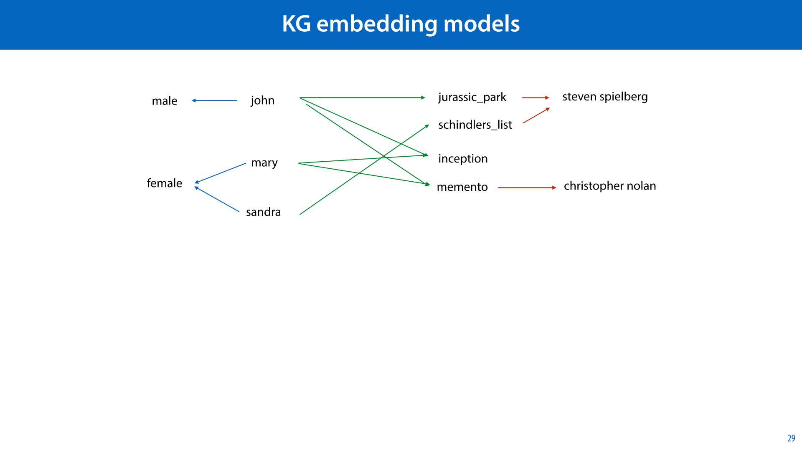

            <figcaption>
            
To build an embedding model, we proceed as before: we create embedding vectors for the nodes in the graph. We also create embedding vectors for the different relations (the predicate). 
<aside    >Not for each individual link, just for the each distinct way a link can be labeled. </aside><aside    >Sometimes the relation embeddings are matrices instead of vectors, but simple vectors are most common. </aside><aside    ></aside>
            </figcaption>
            click image for animation
       </section>

       <section id="slide-030">
            <a class="slide-link" href="https://dlvu.github.io/graphs#slide-030" title="Link to this slide.">link here</a>
            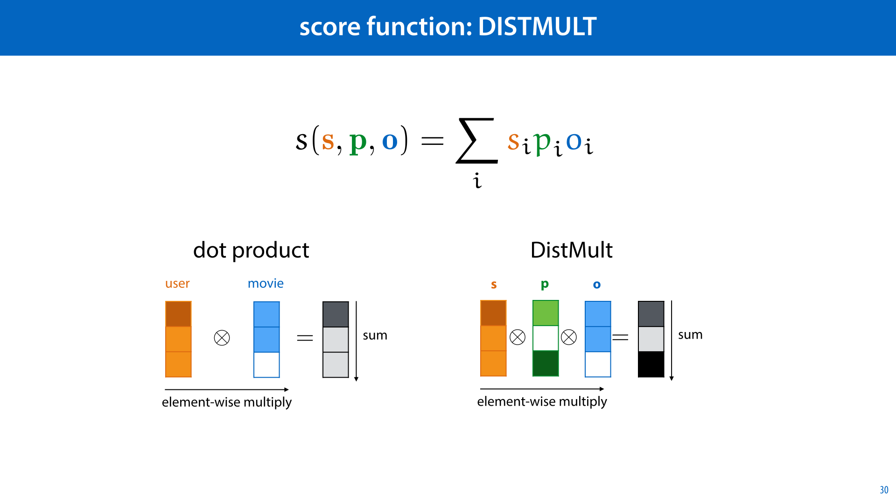

            <figcaption>
            

            </figcaption>
       </section>

       <section id="slide-031">
            <a class="slide-link" href="https://dlvu.github.io/graphs#slide-031" title="Link to this slide.">link here</a>
            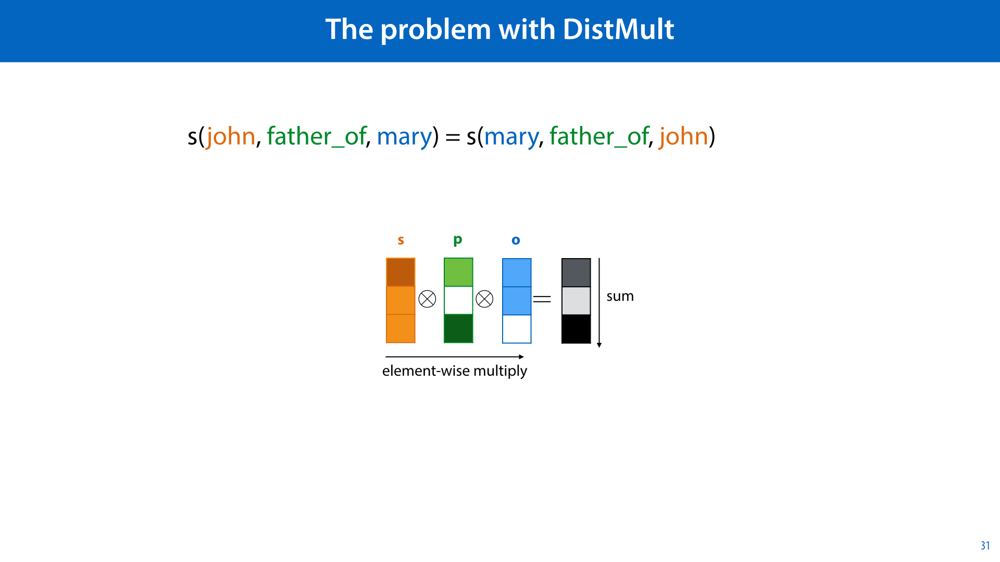

            <figcaption>
            

            </figcaption>
       </section>

       <section id="slide-032">
            <a class="slide-link" href="https://dlvu.github.io/graphs#slide-032" title="Link to this slide.">link here</a>
            

            <figcaption>
            

            </figcaption>
       </section>

       <section id="slide-033">
            <a class="slide-link" href="https://dlvu.github.io/graphs#slide-033" title="Link to this slide.">link here</a>
            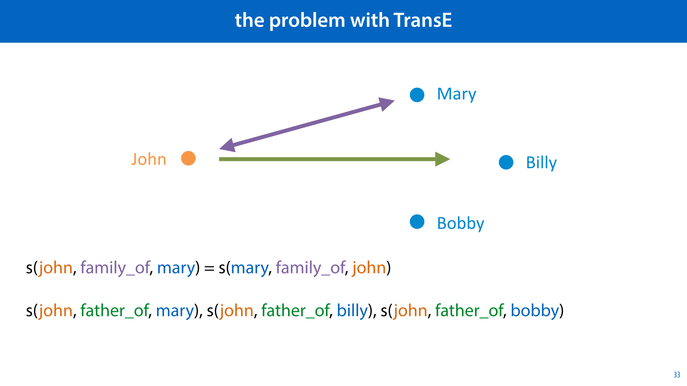

            <figcaption>
            

            </figcaption>
       </section>

       <section id="slide-034">
            <a class="slide-link" href="https://dlvu.github.io/graphs#slide-034" title="Link to this slide.">link here</a>
            

            <figcaption>
            

            </figcaption>
       </section>

       <section id="slide-035">
            <a class="slide-link" href="https://dlvu.github.io/graphs#slide-035" title="Link to this slide.">link here</a>
            

            <figcaption>
            

            </figcaption>
       </section>

       <section id="slide-036" class="anim">
            <a class="slide-link" href="https://dlvu.github.io/graphs#slide-036" title="Link to this slide.">link here</a>
            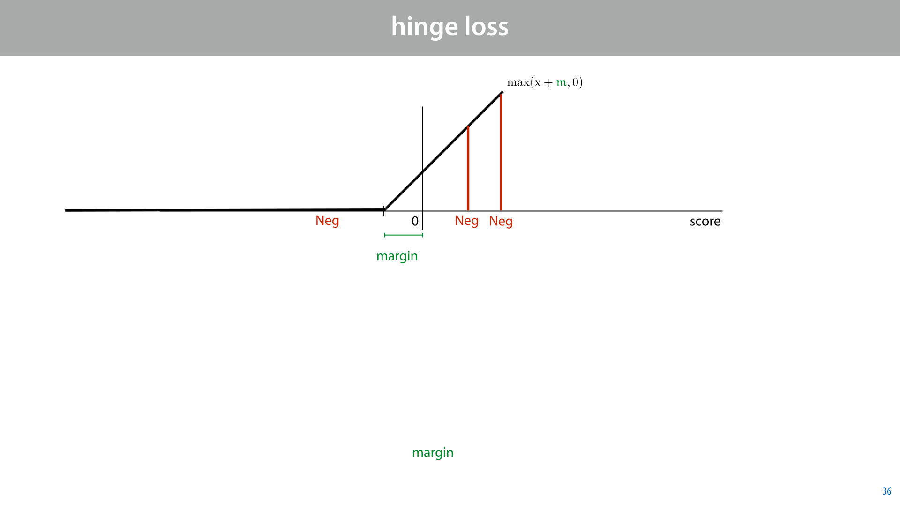

            <figcaption>
            
Where log loss takes inspiration from logistic regression, hinge loss takes inspiration from SVMs and the max-margin loss. In practice, it boils down to passing the raw score x through a hinge function max(x + m, 0) for negatives and - max(x +  m, 0) for positives. 

We then take the sign of the score as the prediction (a positive score is a positive triple). 

This means that positives that get a very high score don’t count in the loss function. Only the ones that the model gets wrong (true triples with a negative score) or just right (true triples with a low positive score) do anything to the loss function. The mechanism is similar to the SVM in that only a few key examples end up determining the parameters of the model.

            </figcaption>
            click image for animation
       </section>

       <section id="slide-037">
            <a class="slide-link" href="https://dlvu.github.io/graphs#slide-037" title="Link to this slide.">link here</a>
            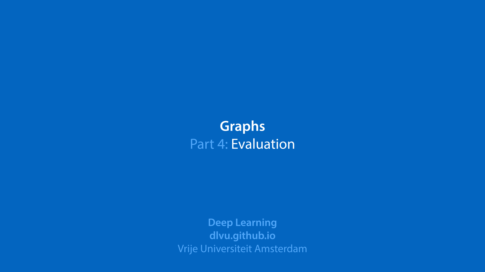

            <figcaption>
            

            </figcaption>
       </section>

       <section id="slide-038">
            <a class="slide-link" href="https://dlvu.github.io/graphs#slide-038" title="Link to this slide.">link here</a>
            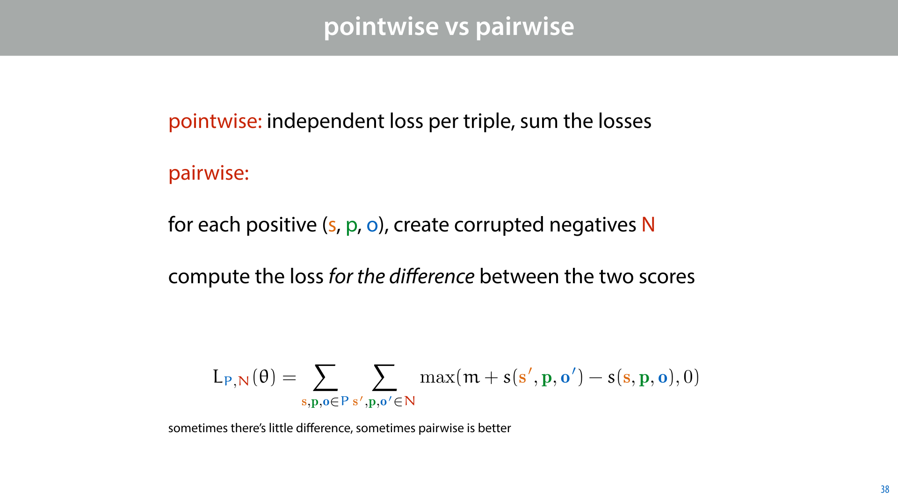

            <figcaption>
            
The pointwise hinge loss is shown, but you can do the same thing with a log loss.

            </figcaption>
       </section>

       <section id="slide-039">
            <a class="slide-link" href="https://dlvu.github.io/graphs#slide-039" title="Link to this slide.">link here</a>
            

            <figcaption>
            

            </figcaption>
       </section>

       <section id="slide-040">
            <a class="slide-link" href="https://dlvu.github.io/graphs#slide-040" title="Link to this slide.">link here</a>
            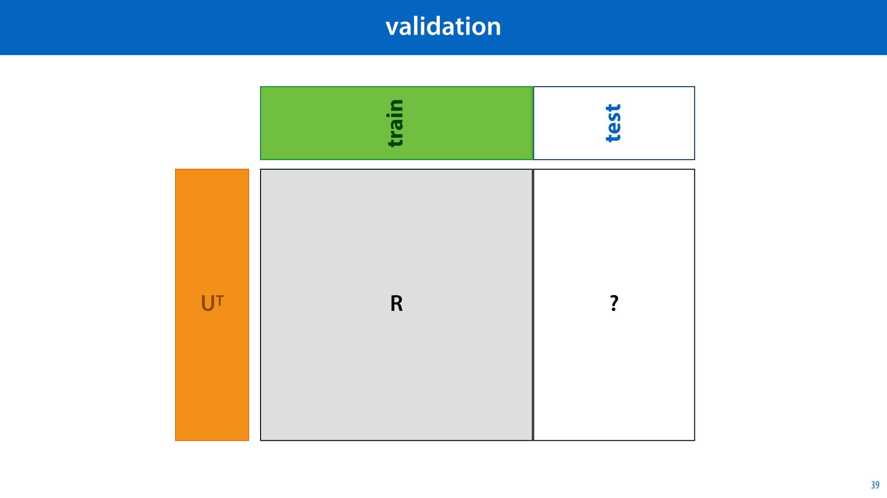

            <figcaption>
            

            </figcaption>
       </section>

       <section id="slide-041">
            <a class="slide-link" href="https://dlvu.github.io/graphs#slide-041" title="Link to this slide.">link here</a>
            

            <figcaption>
            
Think back to our movie recommendation example. Say we predict from user. movie embeddings by a simple dot product (the higher, the more likeley the user is to like the movie). 

In that case, all the predictions we can make (i.e. all the dot product) for a matrix that we can calculate by multiplying the matrix of user embeddings by the matrix of movie embeddings as shown.

            </figcaption>
       </section>

       <section id="slide-042">
            <a class="slide-link" href="https://dlvu.github.io/graphs#slide-042" title="Link to this slide.">link here</a>
            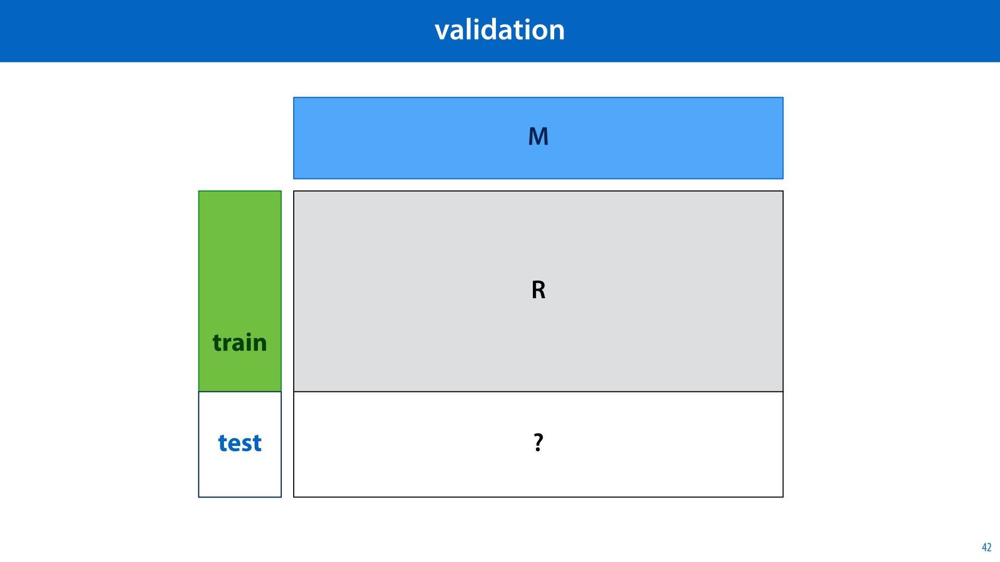

            <figcaption>
            
It is important to carefully consider our validation protocol. In other words: how do we withhold test data to train on. 

Let’s start with recommender systems. At first, you might think that it’s a good idea to just withhold some users. 

However, this doesn’t work: if we don’t see the users during training, we won’t learn embeddings for them, which means we can’t generate predictions.

            </figcaption>
       </section>

       <section id="slide-043">
            <a class="slide-link" href="https://dlvu.github.io/graphs#slide-043" title="Link to this slide.">link here</a>
            

            <figcaption>
            
How about if we withhold some movies? The same thing happens.

            </figcaption>
       </section>

       <section id="slide-044">
            <a class="slide-link" href="https://dlvu.github.io/graphs#slide-044" title="Link to this slide.">link here</a>
            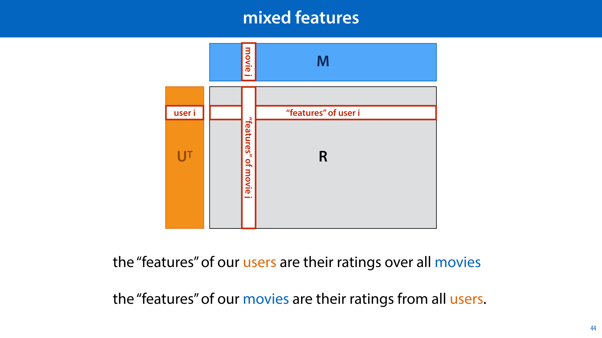

            <figcaption>
            

            </figcaption>
       </section>

       <section id="slide-045" class="anim">
            <a class="slide-link" href="https://dlvu.github.io/graphs#slide-045" title="Link to this slide.">link here</a>
            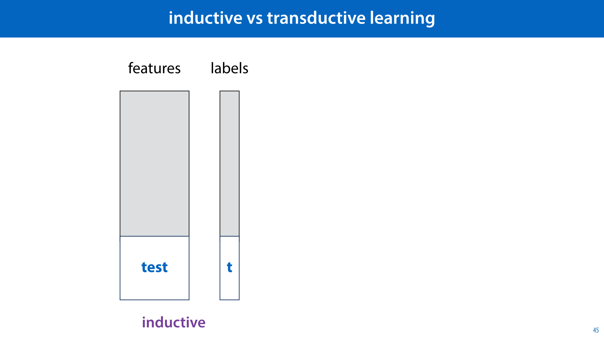

            <figcaption>
            
This is related to the difference between <strong>inductive</strong> and <strong>transductive </strong>learning. In the transductive setting, the learning is allowed to see the features of all data, but the labels of only the training data. 

In short, when you have embedding vectors for entities in your data, you can only do transductive learning. The reason is simple: you cannot learn what to do for entities you’ve never seen before, because you won’t have trained their embeddings yet. 

            </figcaption>
            click image for animation
       </section>

       <section id="slide-046">
            <a class="slide-link" href="https://dlvu.github.io/graphs#slide-046" title="Link to this slide.">link here</a>
            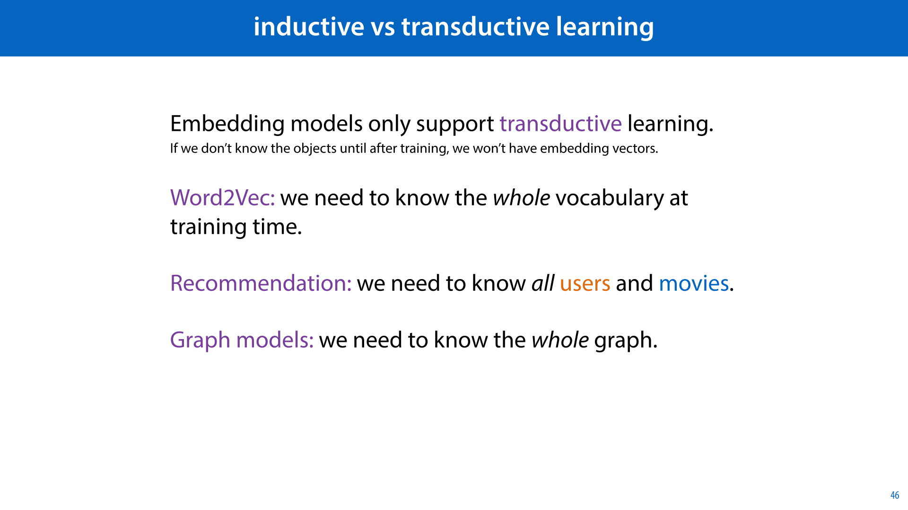

            <figcaption>
            

            </figcaption>
       </section>

       <section id="slide-047">
            <a class="slide-link" href="https://dlvu.github.io/graphs#slide-047" title="Link to this slide.">link here</a>
            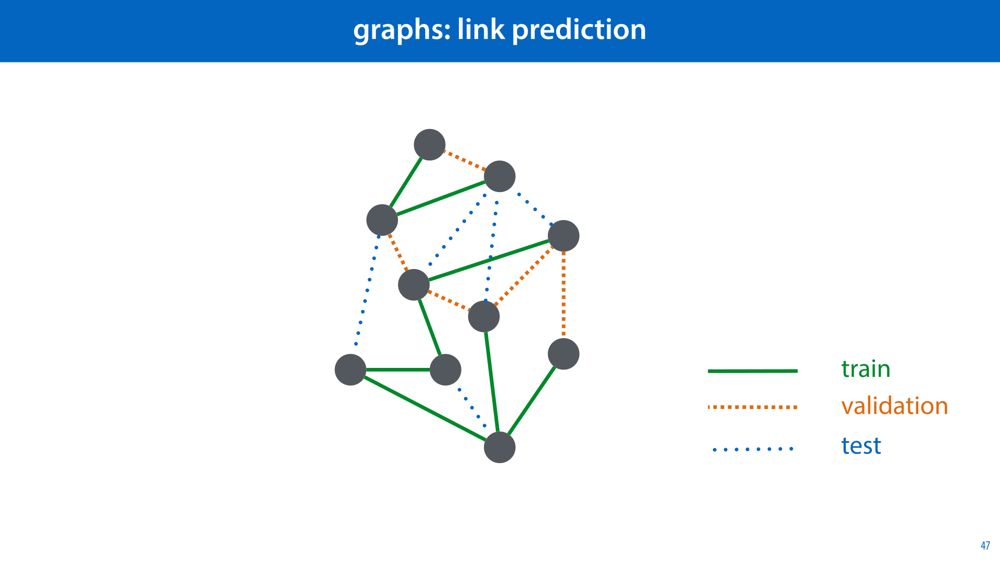

            <figcaption>
            

            </figcaption>
       </section>

       <section id="slide-048">
            <a class="slide-link" href="https://dlvu.github.io/graphs#slide-048" title="Link to this slide.">link here</a>
            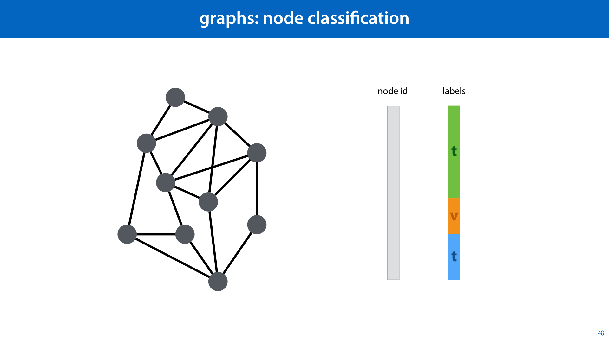

            <figcaption>
            
In the case of node classification, we provide the algorithm with the whole graph, and a table linking the node ids to the labels. In this table, we withhold some of the labels. The model is however, aware of the nodes for which we’ve withheld the labels.

            </figcaption>
       </section>

       <section id="slide-049">
            <a class="slide-link" href="https://dlvu.github.io/graphs#slide-049" title="Link to this slide.">link here</a>
            

            <figcaption>
            

            </figcaption>
       </section>

       <section id="slide-050" class="anim">
            <a class="slide-link" href="https://dlvu.github.io/graphs#slide-050" title="Link to this slide.">link here</a>
            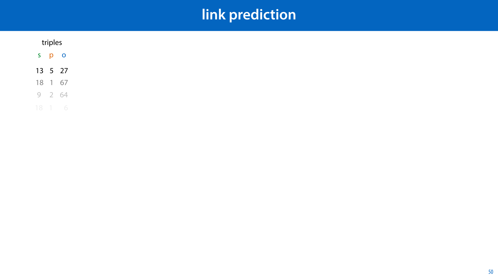

            <figcaption>
            

            </figcaption>
            click image for animation
       </section>

       <section id="slide-051">
            <a class="slide-link" href="https://dlvu.github.io/graphs#slide-051" title="Link to this slide.">link here</a>
            

            <figcaption>
            
Accuracy is rarely used, since most models get such low accuracy that we don’t get a very good signal of how well the models are doing relative to each other. However, it can help you understand what the other two metrics mean. 

The diagram illustrates each metric for an imagined test set of 6 triples (checking only the tail corruption). We test the model and for each triple, find what the rank of the true triple is. This is given on the horizontal axis. The metric is then computed by taking the average length of the bars (with the tallest ones having length 1). 

Note that this means that all metrics are values between 0 and 1. We can also conclude that the accuracy is always a lowerbound for the hits@k and for the mrr.

            </figcaption>
       </section>

       <section id="slide-052">
            <a class="slide-link" href="https://dlvu.github.io/graphs#slide-052" title="Link to this slide.">link here</a>
            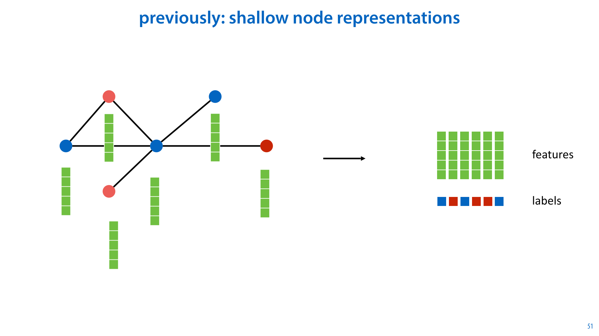

            <figcaption>
            

            </figcaption>
       </section>

       <section id="slide-053">
            <a class="slide-link" href="https://dlvu.github.io/graphs#slide-053" title="Link to this slide.">link here</a>
            

            <figcaption>
            
This paper is a good source for a detailed explanation of the knowledge graph link prediction protocol. 

            </figcaption>
       </section>

       <section id="slide-054">
            <a class="slide-link" href="https://dlvu.github.io/graphs#slide-054" title="Link to this slide.">link here</a>
            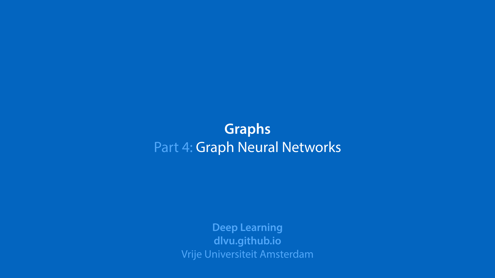

            <figcaption>
            

            </figcaption>
       </section>

       <section id="slide-055">
            <a class="slide-link" href="https://dlvu.github.io/graphs#slide-055" title="Link to this slide.">link here</a>
            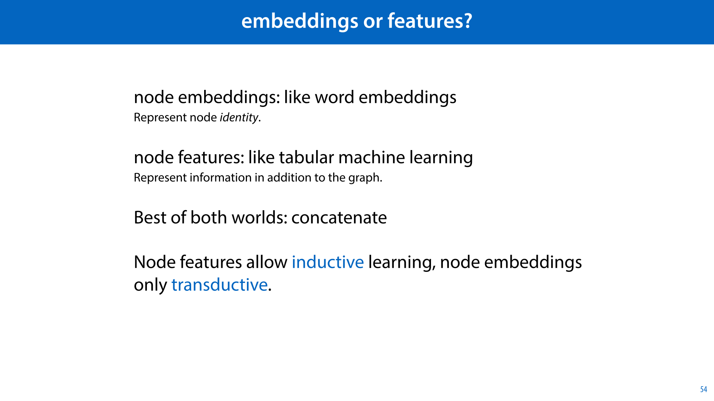

            <figcaption>
            
In the previous section we saw how to do link prediction with node embeddings. This is an interesting task in itself, but it can also be a good proxy task to train reasonable <em>node representations</em> that we can then use in a task like node classification.  

In this section we’ll go a bit further, and focus on node classification by deep neural network. 

            </figcaption>
       </section>

       <section id="slide-056">
            <a class="slide-link" href="https://dlvu.github.io/graphs#slide-056" title="Link to this slide.">link here</a>
            

            <figcaption>
            

            </figcaption>
       </section>

       <section id="slide-057">
            <a class="slide-link" href="https://dlvu.github.io/graphs#slide-057" title="Link to this slide.">link here</a>
            

            <figcaption>
            
By analogy with the sequence-to-sequence layer, we can design <strong>a graph-to-graph layer</strong>. We have a graph, with a certain number of nodes. Each node is represented by a vector. This could be an embedding vector, a feature vector, or the output of some process below this layer.  

The layer operates on the graph, and produces new vectors representing the nodes. Ideally, like the (non-trivial) sequence-to-sequence layers propagate information over the time dimension, the graph-to-graph layer propagates information over the graph structure. 

            </figcaption>
       </section>

       <section id="slide-058">
            <a class="slide-link" href="https://dlvu.github.io/graphs#slide-058" title="Link to this slide.">link here</a>
            

            <figcaption>
            

            </figcaption>
       </section>

       <section id="slide-059">
            <a class="slide-link" href="https://dlvu.github.io/graphs#slide-059" title="Link to this slide.">link here</a>
            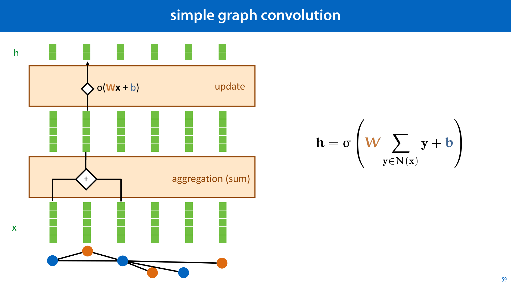

            <figcaption>
            
Here is the very simplest graph neural network we can build. The simple graph convolution. We start with node embeddings. Then the aggregation layer replaces each node embedding with the sum over the embeddings of all the neighbors of that node. Then we apply a simple linear layer, and a non-linearity.  

            </figcaption>
       </section>

       <section id="slide-060">
            <a class="slide-link" href="https://dlvu.github.io/graphs#slide-060" title="Link to this slide.">link here</a>
            

            <figcaption>
            

            </figcaption>
       </section>

       <section id="slide-061">
            <a class="slide-link" href="https://dlvu.github.io/graphs#slide-061" title="Link to this slide.">link here</a>
            

            <figcaption>
            

            </figcaption>
       </section>

       <section id="slide-062">
            <a class="slide-link" href="https://dlvu.github.io/graphs#slide-062" title="Link to this slide.">link here</a>
            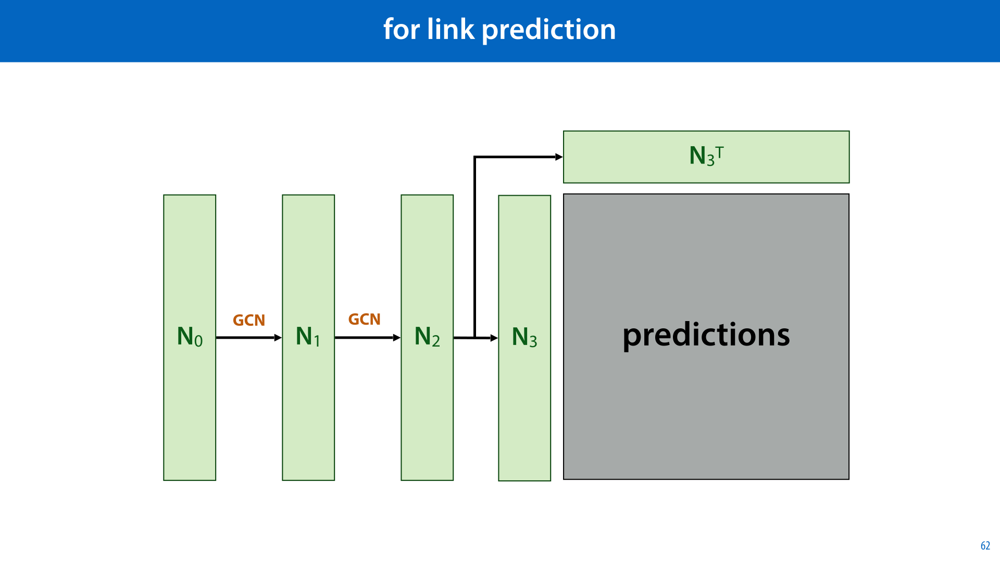

            <figcaption>
            

            </figcaption>
       </section>

       <section id="slide-063">
            <a class="slide-link" href="https://dlvu.github.io/graphs#slide-063" title="Link to this slide.">link here</a>
            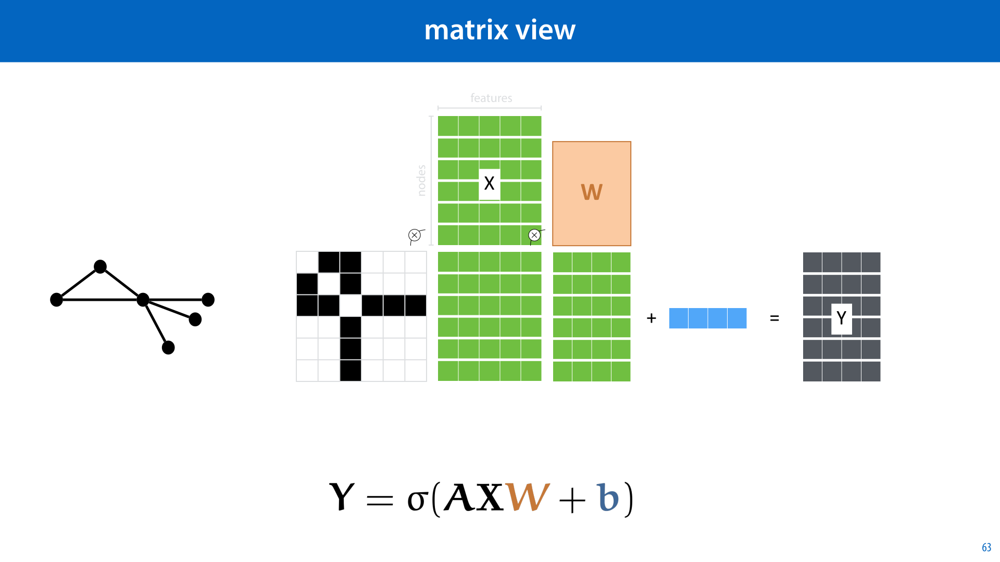

            <figcaption>
            

            </figcaption>
       </section>

       <section id="slide-064">
            <a class="slide-link" href="https://dlvu.github.io/graphs#slide-064" title="Link to this slide.">link here</a>
            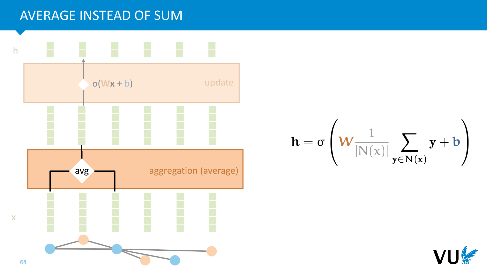

            <figcaption>
            
Remember that we should be on the lookout for activations blowing up. If we sum together the vectors for a node with five neighbors, then the output activations will be five times as big as the input activations.  

To fix this, we can simply replace our sum layer with an average.

            </figcaption>
       </section>

       <section id="slide-065" class="anim">
            <a class="slide-link" href="https://dlvu.github.io/graphs#slide-065" title="Link to this slide.">link here</a>
            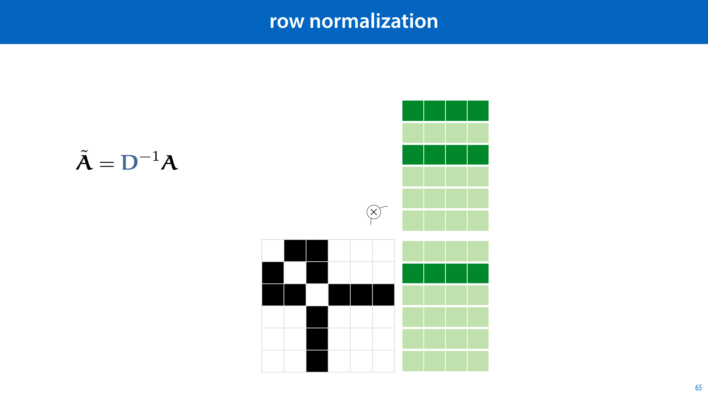

            <figcaption>
            
To write this in a matrix view, we create a degree matrix <strong>D</strong>. This is just a diagonal matrix with the degrees of the nodes along the diagonal. The inverse of a diagonal matrix just has 1/d where the original matrix has d, so <strong>D</strong>-1 gives us all the values we want to multiply by along the diagonal. 

If we multiply <strong>D</strong>-1 by <strong>A </strong>then we then we are row normalizing the adhjacency matrix. That is, all the values in one row sum to one. After row-normalizing, multiplying by the adjacency matrix computes precisely the average we are looking for. 

            </figcaption>
            click image for animation
       </section>

       <section id="slide-066" class="anim">
            <a class="slide-link" href="https://dlvu.github.io/graphs#slide-066" title="Link to this slide.">link here</a>
            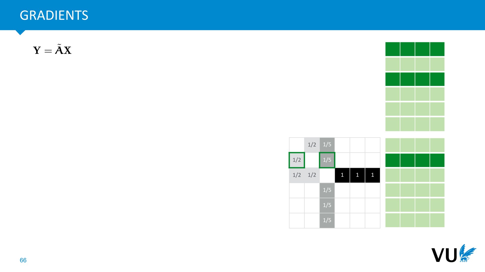

            <figcaption>
            
Of course, we don’t just care about keeping the activations in check.  

We know from previous derivations that if Y is computed by the matrix multiplication AX, then the gradients for X are computed by mutiplying the gradients  for Y by the transpose of A.  

This tells us that if we row-normalize, as we did in the last slide, we can end up shrinking and blowing up the gradients. In the example, we are multiplying the incoming gradient vectors for node 2 by 1/2 and 1/5, which sums to less than one. For node 3, the weights sum to 4! 

We can fix this by column-normalizing instead. 
<aside    >We give the gradient derivation here to make things self-contained, but it’s the same as we saw in the backpropagation lecture. </aside><aside    ></aside>
            </figcaption>
            click image for animation
       </section>

       <section id="slide-067" class="anim">
            <a class="slide-link" href="https://dlvu.github.io/graphs#slide-067" title="Link to this slide.">link here</a>
            

            <figcaption>
            
We achieve column normalization simply by right multiplying the inverse degree matrix.  

With column normalization, the gradients propagate perfectly, but of course now we have a problem with the activations: they can now shrink and blow up as before.  

For directed graphs, we often just row-normalize and call it a day. If the network isn’t too deep, the gradients should still propagate.  

For undirected graphs however, it’s more common to do a kind of mixture between row and column normalization.

            </figcaption>
            click image for animation
       </section>

       <section id="slide-068">
            <a class="slide-link" href="https://dlvu.github.io/graphs#slide-068" title="Link to this slide.">link here</a>
            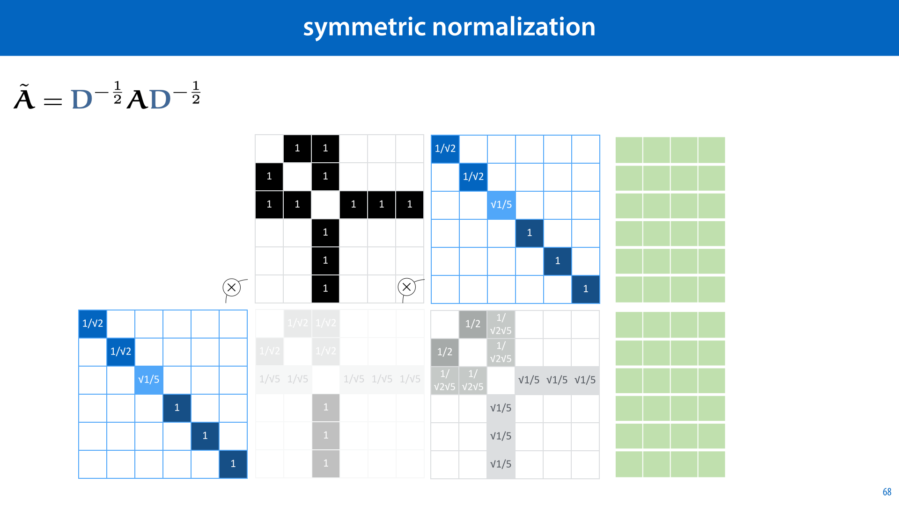

            <figcaption>
            
The trick is to break <strong>D</strong>-1 up into two matrices that give you if you multiply them together. This is easy to do with diagonal matrices, since multiply them is just element-wise multiplying the diagonal elements. That means that if we take the square roots of the diagonal elements (<strong>D</strong>-1/2), we get <strong>D</strong>-1 back. 

We can now row normalize “a bit” and column normalize “a bit” by premultlying by the square root degree matrix <em>and</em> post-multiplying by it. 

This gives us a bit of control over the activations blowing up and over the gradients blowing up. The weights are not fully normalized in the row or column direction (you can check that they never sum to one) but their sums should never sum a value that is too far below or above 1.

            </figcaption>
       </section>

       <section id="slide-069">
            <a class="slide-link" href="https://dlvu.github.io/graphs#slide-069" title="Link to this slide.">link here</a>
            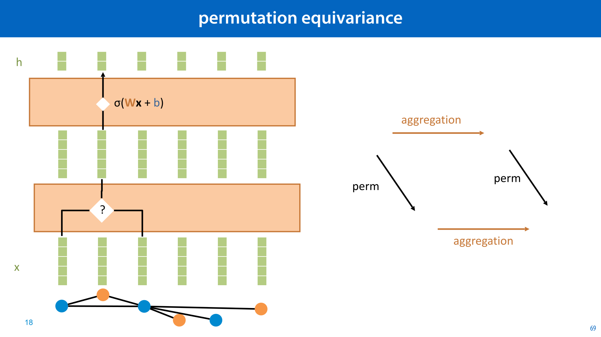

            <figcaption>
            
Which operations can we use for aggregation?

            </figcaption>
       </section>

       <section id="slide-070" class="anim">
            <a class="slide-link" href="https://dlvu.github.io/graphs#slide-070" title="Link to this slide.">link here</a>
            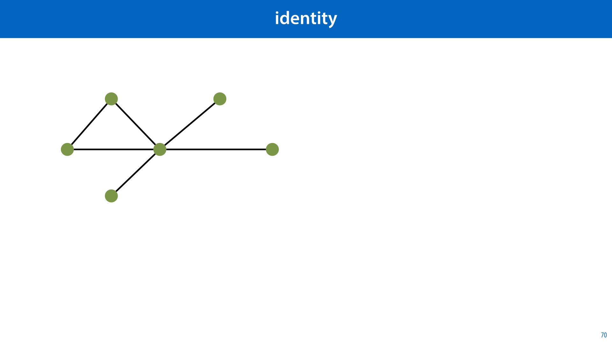

            <figcaption>
            
We can think of the aggregation step as taking the current node representation, and mixing in some of the representation of the neighbors. We usually don’t want to throw the current representation of the current node away, however, we just want to add to it.  

To achieve that, we should include the current node x among its own neighbors N(x). Or, equivalently, we should assume that each neighbor has a self-loop.  

Often, the self loops are given their own separate weight matrix <strong>V</strong>. This allows the network to treat the information propagating over the self loops differently from the information coming in from the neighbors. 

You can think of this as applying two GCNs: one for the regular graph, and one for the self loops.

            </figcaption>
            click image for animation
       </section>

       <section id="slide-071" class="anim">
            <a class="slide-link" href="https://dlvu.github.io/graphs#slide-071" title="Link to this slide.">link here</a>
            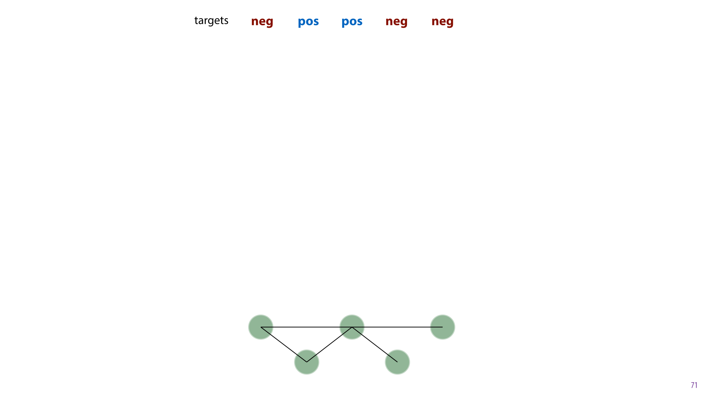

            <figcaption>
            
Here’s what a 2-layer node classification GCN looks like step by step, with the self loops in place.

            </figcaption>
            click image for animation
       </section>

       <section id="slide-072" class="anim">
            <a class="slide-link" href="https://dlvu.github.io/graphs#slide-072" title="Link to this slide.">link here</a>
            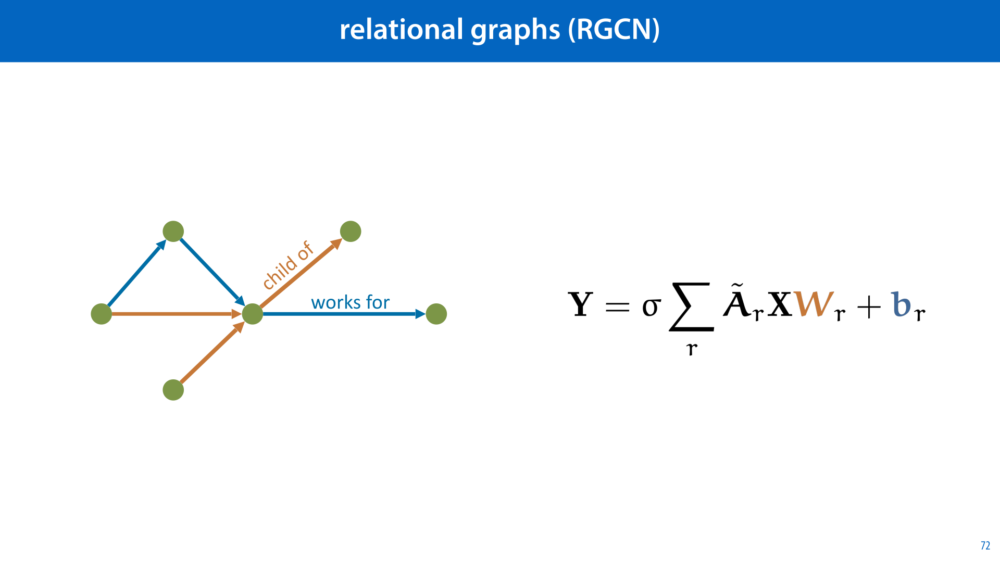

            <figcaption>
            
We can extend this idea to allow us to handle knowledge graphs. We simply apply a separate GCN for each relation, each with its own weight matrix. and then sum together their outputs. before applying the non-linearity. 
<aside    >We really should be averaging over the  relations rather than summing, to stop the gradientsd from blowing up, but for the shallow RGCNs we see in practice, it doesn’t seem to matter. The summed version is the canonical formula. </aside>
We can now treat the self loops as just another relation (the “identity” relation). 

We also normally include all inverse relations: if there is an arrow from a to b with relation r, we add an arrow from b to a with relation r-1.  
<aside    >In the image we’ve given these intuitive names, but for the model we don’t need to know what these are. We just add one inverse relation for every relation in the given graph.  </aside>
The reason for the inverse links is that in a directed GCN, the model passes information along the direction of the node. However this direction doesn’t usually mean that information only flows in one direction. It just indicates which node is the object and which node is the subject. We could let information flow in two directions, but that would be like making the graph undirected. Ie.e removing information. By creating inverse relations, information flows in two directions, but the information of the edge directions is retained.  

In short, if we are given a knowledge graph with R relations, our RGCN has 2R + 1 relations (we don’t add an inverse link for the identity).

            </figcaption>
            click image for animation
       </section>

       <section id="slide-073">
            <a class="slide-link" href="https://dlvu.github.io/graphs#slide-073" title="Link to this slide.">link here</a>
            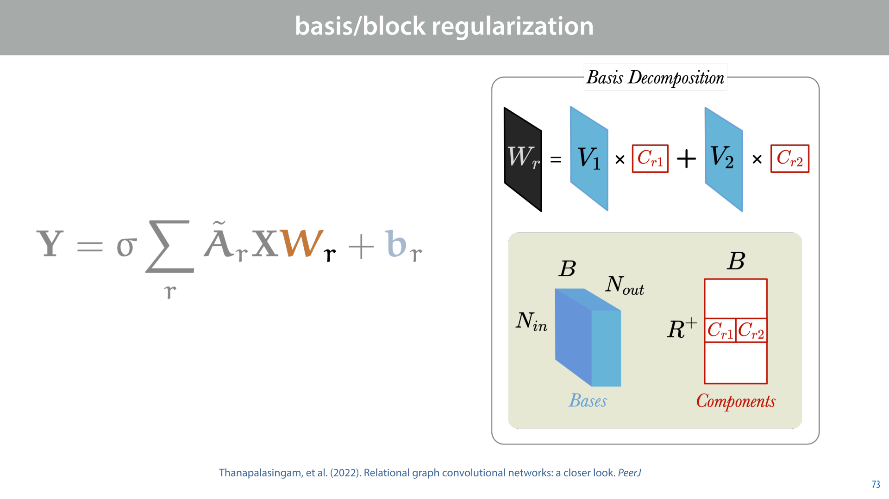

            <figcaption>
            
RGCNs with many relations are prone to overfitting, because they have a large number of weights (the double descent phenomenon has not been observed yet in GCNs).  

One way of regularizing them is to make the weigh matrices not free weights, but linear combinations of a small number of basis matrices. The picture shows the idea for two basis matrices V1 and V2. 

            </figcaption>
       </section>

       <section id="slide-074">
            <a class="slide-link" href="https://dlvu.github.io/graphs#slide-074" title="Link to this slide.">link here</a>
            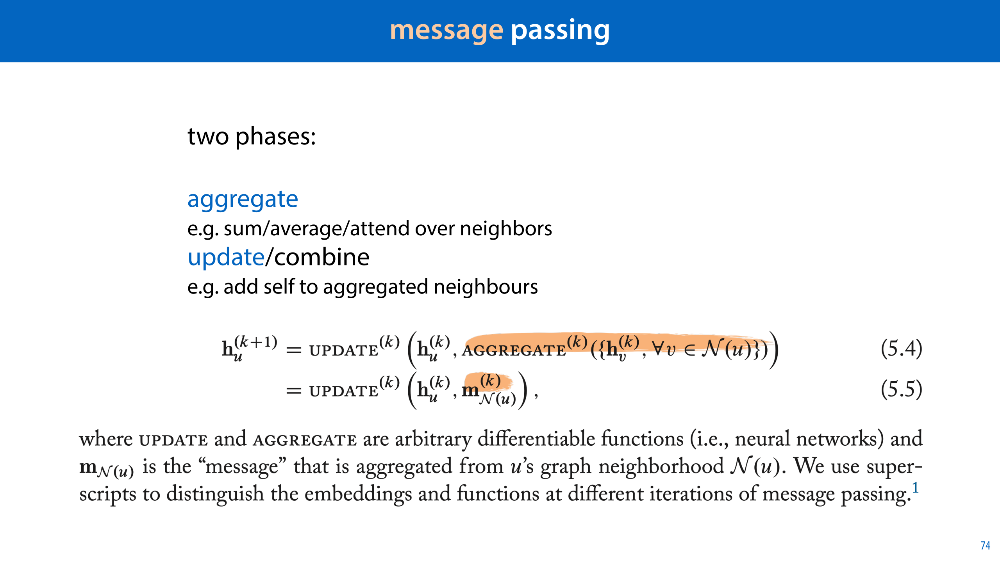

            <figcaption>
            
We can define a whole family of GNNs by alternating two types of layers. One that propagates information over the graph, and one that computes locally on the individual node embeddings. These are called <strong>aggregate</strong> and <strong>update</strong>. So long as we make sure that aggregate is permutation equivariant and update is local (i.e. pointwise), we can pick any function we like.  

This is called the <strong>message passing framework</strong>.  The idea is that the neural network computes its function by passing messages aling the links of the network.  
<aside    >The “update” is the FF layer in the earlier slide. In this case, the self-connection is included as an input there, but that might be different in other definitions of message passing.</aside><aside    ></aside>
            </figcaption>
       </section>

       <section id="slide-075">
            <a class="slide-link" href="https://dlvu.github.io/graphs#slide-075" title="Link to this slide.">link here</a>
            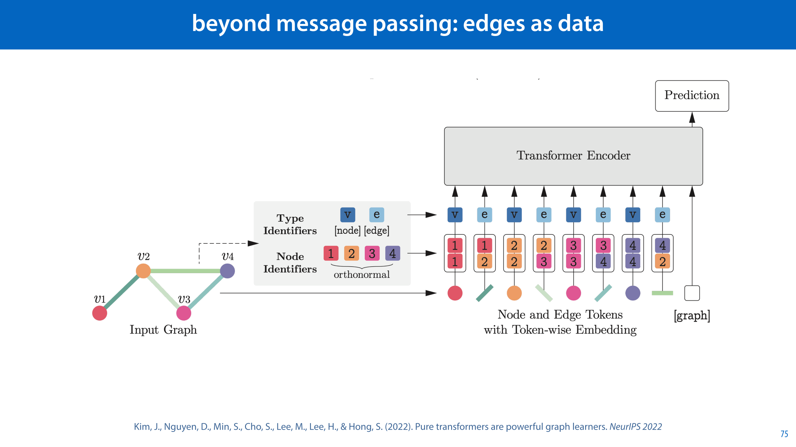

            <figcaption>
            

            </figcaption>
       </section>

       <section id="slide-076">
            <a class="slide-link" href="https://dlvu.github.io/graphs#slide-076" title="Link to this slide.">link here</a>
            

            <figcaption>
            

            </figcaption>
       </section>

</article>
